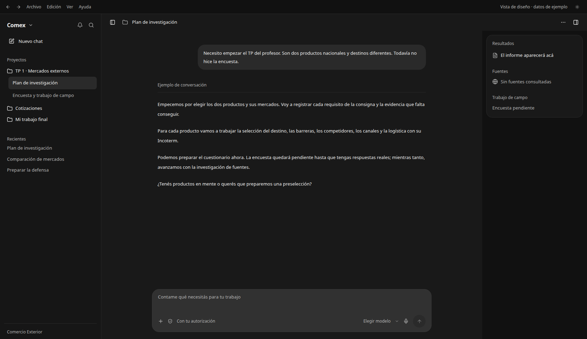

# Diseño de Comex

Referencia: captura aportada por el usuario el 05/11/2026. Chat central, proyectos a la izquierda, compositor inferior y panel de trabajo a la derecha; grises neutros y separadores discretos.

## Implementación

`apps/app/src/styles/comex-shell.css` se carga después de los estilos de OpenWork. Ajusta los tokens oscuros, las superficies del chat y la barra lateral, el compositor, las burbujas y el panel existente. Los atributos `data-comex-*` acotan los ajustes a esas superficies. El nombre visible por defecto es Comex.

Son cambios de presentación y marca: no cambian las acciones disponibles, los permisos, el modelo, el comportamiento del navegador ni las preferencias de tema guardadas. No se agrega una feature flag para este acabado visual, según la excepción de polish de `.opencode/skills/add-a-feature/SKILL.md`. Se respetan DESIGN.md P5, P7, S1, V1–V6 y T5.

## Vista de revisión

Con Vite activo en `apps/app`, abrir `/comex-design.html`. Es una **maqueta con datos de ejemplo**, fuera de la entrada de producción; no es un agente ejecutando el TP ni una prueba integral de la app. Usa el CSS compartido, el botón de envío real y el componente Button. Permite cambiar tema, ocultar proyectos/resultados y escribir un borrador; el envío está desactivado.

El panel de la maqueta muestra la disposición propuesta para resultados, fuentes y campo pendiente. Esas tres secciones todavía no están conectadas a los datos reales de la sesión; el panel de producción conserva sus destinos existentes.

[Claro](comex-claro.png) · [1366 × 768](comex-1366.png) · [390 × 844](comex-movil.png).

## Verificación

- Dependencias del frontend instaladas con Node 24.22.1 y pnpm 11.4.0, lockfile congelado.
- TypeScript de `apps/app` pasó sin errores.
- Build de producción de Vite pasó tras compilar `packages/types` con su configuración de tsup. No se construyó el instalador Electron.
- Maqueta renderizada con Chromium: sin errores JavaScript ni desbordamiento horizontal a 1680 × 972 y 390 × 844. Cambio de tema y ocultar panel comprobados.
- Las capturas son de la maqueta. Falta comprobar la aplicación completa con una sesión real, permisos, menús y navegador; no se afirma equivalencia visual de Word ni funcionamiento del TP completo.
