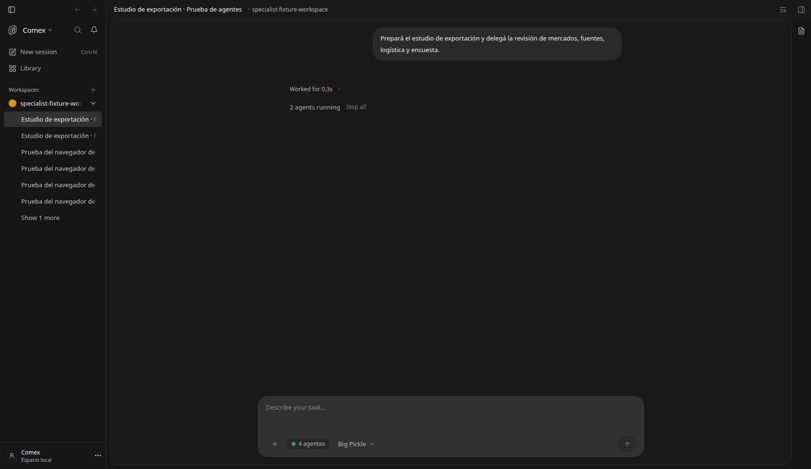
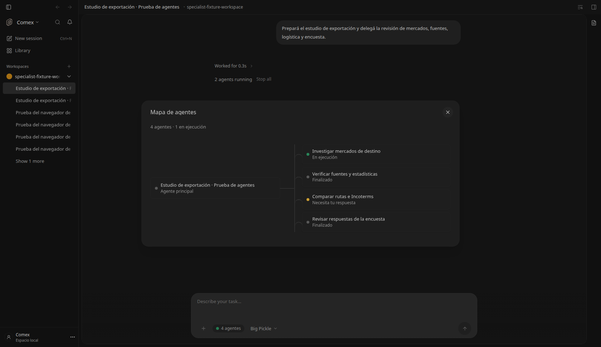
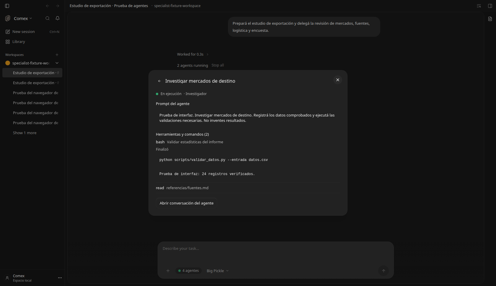

# Mapa de actividad de agentes

Feature `agentActivityMap`, self-hosted, autor `brianpadilla3072`.
Activada por defecto en esta distribución después de la verificación local.

El compositor muestra un botón con la cantidad de agentes delegados en esta
conversación. Abre un modal con el agente principal y sus tareas conectadas.
El punto verde indica ejecución confirmada; espera de una respuesta se marca
ámbar, fallos rojo y finalizados/detenidos/sin conexión gris, siempre con texto.
Las tareas finalizadas quedan disponibles para revisar su actividad.

Cada nodo abre el título, prompt y llamadas a herramientas del agente. Los
comandos y scripts aparecen en secciones desplegables con sus resultados o
errores, sin ejecutarlos desde la interfaz. La actividad se lee de la sesión
hija de OpenCode y se actualiza cada dos segundos mientras sigue activa; ante
un fallo se conserva lo leído y se ofrece reintentar. No se inventan comandos,
estados, tiempos ni cifras de tokens. El prompt es el de la tarea delegada,
no las instrucciones privadas del sistema.

Reutiliza `useSubagentRunState`, las llamadas `task`, el registro de actividad
y los estados nativos. Al activarlo, sustituye la lista local sobre el
compositor; las tareas remotas conservan su seguimiento existente. El mapa
representa las delegaciones directas de esta conversación. El botón para
abrir la conversación hija permite seguir su trabajo y sus propias delegaciones.

`DEN_FEATURE_AGENT_ACTIVITY_MAP=false` restaura la lista anterior, sin detener
agentes ni modificar conversaciones. Sin tareas delegadas no muestra el botón.

## Verificación

Dos pruebas React con el registro de actividad real verifican ejecución,
finalización, permisos pendientes, pérdida de conexión, apertura del prompt,
lectura de comandos solamente para el agente elegido, lectura final al terminar,
ausencia de botón sin tareas y conservación de tareas de turnos anteriores.

Chromium verifica el flujo completo con respuestas nativas de OpenCode de
prueba: botón de cuatro agentes, mapa con uno en ejecución y otro esperando,
prompt y comando desplegado con resultado, retorno al mapa, cambio a finalizado
y cierre con Escape. Sin errores de página. Los agentes y comandos de estas
capturas son fixtures de interfaz: no se ejecutaron esos scripts ni se inició
una investigación para producir las imágenes. La interfaz productiva lee las
sesiones y estados reales del motor.

La verificación integral académica y el instalador Windows siguen pendientes;
estas pruebas cubren el flujo de interfaz en Linux.
