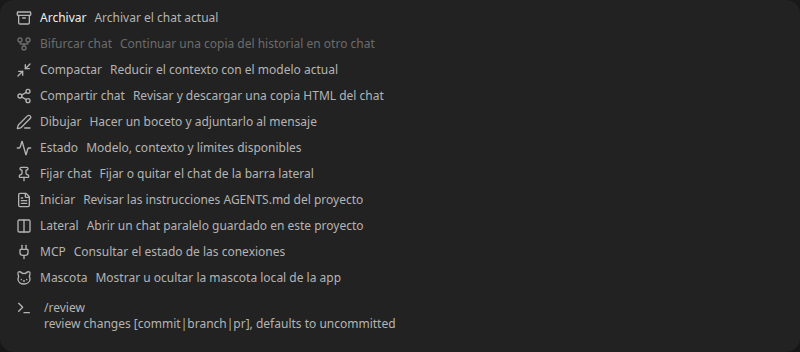

# Comandos del chat

Flag `comexChatCommands`, self-hosted, default false en el registro. Autor: brianpadilla3072. Habilitado en la distribución Comex salvo bloqueo explícito. Apagar restaura el catálogo anterior del motor; no modifica chats ni archivos.

## Funciones y propietario de cada operación

| Comando | Función | Ejecución |
| --- | --- | --- |
| `/archivar` | Archivar sin borrar | Servicio de archivado existente, motor OpenCode, verificación y deshacer existentes |
| `/bifurcar` | Copiar el historial a otro chat | Callback de bifurcación existente → OpenCode session.fork; vacío se bloquea, como exige el motor |
| `/compactar` | Reducir contexto | OpenCode v2 session.compact, con revisión del posible consumo de tokens; se informa admisión, no finalización |
| `/compartir` | Revisar y descargar una copia HTML | Herramienta local de la app; el motor actual no expone enlaces públicos |
| `/dibujar` | Adjuntar un boceto PNG | Lienzo local, después pipeline de adjuntos existente |
| `/estado` | Identificador, modelo, actividad, tokens y límites disponibles | Historial del motor y OpenCode usage.limits; no inventa contexto ocupado ni cuota |
| `/fijar` | Fijar/quitar el chat | Preferencia de barra lateral existente, sin otro almacén |
| `/iniciar` | Preparar instrucciones del proyecto | Inserta **`/init` nativo**; envío normal, modelo y permisos normales. No crea AGENTS.md por su cuenta |
| `/lateral` | Conversación paralela guardada | OpenCode session.create + disposición lateral existente; no motor ni historial alternativos |
| `/mcp` | Ver conexiones y su estado | Consulta del catálogo MCP existente, sin copiar configuración ni credenciales |
| `/mascota` | Mostrar/ocultar mascota local | Adorno de la app; sin agente ni actividad en segundo plano |

Los alias ingleses se resuelven en el compositor. Los nombres ya definidos por OpenCode conservan prioridad al escribirlos. Se conserva el catálogo de comandos y skills del motor, incluidos nombres de plugins con `:`. La fila Iniciar se bloquea si el motor no ofrece `/init`. No se agrega una política de ejecución sobre OpenCode: compactación admite la solicitud nativa incluso si hay una tarea en curso; archivado usa la revisión existente cuando hay actividad. No se crea una API paralela para ejecutar comandos, ni un registro de chats/historial/contexto alternativo. Las únicas herramientas nuevas son locales: lienzo, copia para compartir y mascota.

## Diseño y escala

Antes del cambio: compositor 1.719 líneas, superficie de conversación 4.235 (5.954 combinadas), menú limitado a ocho sugerencias y acciones de aplicación fuera del catálogo. Se agregan módulos separados para catálogo/validación, acciones, exportación, dibujo y mascota. El compositor solo mezcla opciones y deriva la selección; la superficie aporta sus referencias e historial completo. Archivar reutiliza el mismo servicio del lateral, incluidos conflictos, cancelación y verificación.

Resolución por mapa, sin consultar la red al escribir. El catálogo externo conserva su caché y cargas existentes. La lista dibuja hasta 40 filas al abrir y 24 resultados al buscar; no renderiza todo el catálogo. Exportar usa la lectura paginada completa existente bajo demanda y limita la copia a dos millones de caracteres. Un bloqueo de ejecución impide dobles pulsaciones y no hay reintentos automáticos de mutaciones. Estado y MCP se consultan al abrir sus vistas.

La copia compartida excluye herramientas, razonamiento, partes sintéticas y archivos adjuntos. Redacta algunos formatos conocidos de claves, exige revisar el texto y descarga un archivo local, sin subir ni publicar datos. El HTML escapa texto y aplica CSP sin scripts. La redacción no sustituye la revisión de datos privados.

Reutiliza Popover/Dialog/Button/Textarea. Las sugerencias permanecen ancladas al compositor, se filtran con teclado y cierran con Escape. Las capacidades bloqueadas permanecen visibles con el motivo. Reglas DESIGN.md P3/P4/P5/P8/P9/P10, S6/S7 y T5.

## Pruebas

Registro y alias, bloqueos por estado/capacidad, compatibilidad de nombres nativos, exportación segura y coste de búsqueda. Las comprobaciones de navegador no envían inferencias: las operaciones que podrían consumir tokens se revisan y cancelan o se interceptan en una prueba aislada.

## Evidencia y mediciones



[Vista de escritorio completa](commands-desktop.png).

[Móvil](commands-mobile.png) · [Estado](commands-status.png) · [Revisión de compactación](commands-compact-review.png) · [Dibujar](commands-sketch.png) · [Copia local](commands-share.png) · [Chat lateral](commands-side.png) · [Archivado](commands-archived.png) · [Sin conversación](commands-empty.png) · [Bandera apagada](commands-feature-off.png).

La vista apagada usa una respuesta interceptada de prueba; conserva el catálogo real del motor. El texto de la copia para compartir es un ejemplo editado en la revisión. La validación de admisión de compactación intercepta solo ese POST con el formato del contrato nativo; no ejecuta un modelo. Sí se comprobó creación lateral y archivado contra OpenCode real. Se confirmó que OpenCode rechaza bifurcar conversaciones vacías (`empty_session`); la opción refleja esa restricción. No se enviaron prompts ni se ejecutó `/init` durante las pruebas.

El compositor pasó de 1.719 a 1.763 líneas; la superficie de 4.235 a 4.246. Las funciones nuevas están en módulos separados. Se evita rehacer el catálogo por cada token transmitido y se prepara el índice al cambiar el catálogo. Medición local: 100.000 resoluciones de comando en aproximadamente 18–40 ms; búsqueda sobre 10.000 comandos nativos en aproximadamente 110–175 ms, excluyendo la preparación única del índice y dibujando solo 24 resultados. Son mediciones de este equipo, no garantías para otros dispositivos; un catálogo de ese tamaño justifica evaluar un worker si se necesita mayor fluidez.

Pasaron 26 pruebas de comandos, memoria, continuidad y permisos, typechecks de aplicación/servidor, comprobación del registro y `git diff --check`. Helm no está instalado; se omitió el render del chart. Las pruebas de navegador cubren selección, teclado, capacidades, `/init` nativo preparado, estado/MCP, revisión de compactación, fijar/quitar, mascota, PNG adjunto, HTML descargado, chat lateral, archivado y diseño de 390 px.

```sh
node --conditions=development --import ./apps/server/node_modules/tsx/dist/loader.mjs --test apps/app/tests/chat-commands.test.ts
```
