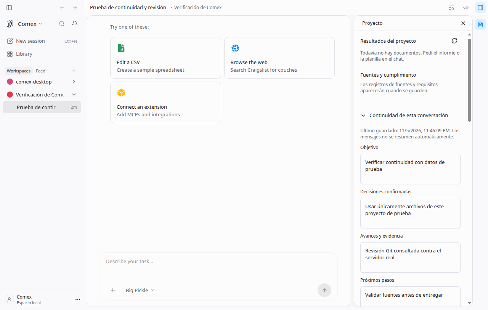

# Continuidad explícita por conversación

Feature: `comexContinuity`. Deployments: `self_hosted`. Author: `brian`.
Desactivada por defecto e independiente de `comexWorkspace`.

El panel del proyecto incluye una sección plegada «Continuidad de esta
conversación». Permite guardar objetivo, decisiones confirmadas, avances,
pendientes y archivos con evidencia sin editar JSON. El último resumen válido
se incorpora al contexto en el próximo mensaje de un proyecto Comex o
especialista. El resumen no demuestra que un entregable esté validado.

No se generan resúmenes automáticamente a partir del chat. La persona guarda
explícitamente los campos del panel. El asistente sigue pudiendo conservar sus
notas Markdown existentes. Un resumen guardado sobrevive al cierre de la app;
el borrador aún sin guardar se conserva durante errores y al plegar el panel.
También se guarda en el almacenamiento local del navegador por servidor,
proyecto y conversación, con la revisión original: al volver a abrir no puede
sobrescribir una revisión más reciente sin resolver el conflicto. Si el
almacenamiento local está bloqueado o lleno, se informa que hay que guardar
antes de cerrar. Borrar los datos del navegador elimina esos borradores, no
los checkpoints guardados en el proyecto. La acción para recuperar un borrador
anterior tras elegir la versión guardada dura mientras el panel está montado.
El navegador advierte antes de cerrar la página con cambios pendientes.

## Activación y comprobación

Usar el operador de features existente con
`DEN_FEATURE_COMEX_CONTINUITY=true` en la distribución local. Abrir un proyecto
Comex o especialista, abrir su panel de proyecto, desplegar Continuidad,
completar los campos y guardar. Cerrar y volver a abrir la conversación:
debería recuperar los valores. En el próximo mensaje, los pendientes guardados
se incluyen como datos del proyecto, sin cambiar instrucciones ni permisos.

Editar la misma conversación en dos ventanas permite comprobar conflictos:
guardar en una, luego guardar un borrador basado en la revisión anterior desde
la otra. La segunda muestra la versión actual y conserva el borrador. Elegir
«Conservar mi borrador» permite reconciliar las notas y requiere otro guardado
explícito. «Usar versión guardada» conserva una acción para recuperar el borrador
anterior. No hay sobrescritura incondicional.

Al desactivar la feature desaparece la sección, las rutas responden 404 y deja
de inyectarse el checkpoint. Los archivos existentes permanecen intactos.

## Persistencia y permisos

`GET /workspace/:id/continuity/:sessionId` requiere credencial de cliente.
`PUT` requiere credencial del host, modo escritura y la revisión esperada.
Ambas rutas verifican que la conversación pertenezca al proyecto antes de leer
sus archivos. La memoria se ancla al proyecto persistente; cambiar el directorio
de ejecución de la sesión a un worktree no cambia el archivo de continuidad.

Cada conversación usa `comex/sesiones/<id>.checkpoint.json`. Un esquema estricto
acepta hasta 16 decisiones, 16 avances, 16 pendientes y 16 archivos. Cada nota,
ruta y evidencia tiene hasta 800 caracteres; el objetivo tiene hasta 1600.
El archivo completo no puede superar 48 KiB. Los campos desconocidos y los
identificadores que permiten salir del proyecto se rechazan.

La escritura usa archivo temporal exclusivo, sincronización de contenido,
rename atómico, permisos 0600 donde el sistema los admite y un lock exclusivo
entre procesos. Una revisión anterior devuelve 409. Un archivo corrupto,
demasiado grande, de otra sesión o de una versión desconocida se excluye del
contexto y no se reemplaza silenciosamente. Los enlaces simbólicos se rechazan.

Las credenciales comunes (claves de proveedor, claves privadas PEM, Bearer,
Basic, asignaciones de password/token/api_key y credenciales URL) se redactan
antes de guardar y al leer. La redacción también se aplica a las notas Markdown
inyectadas cuando la feature está activa. Es una defensa adicional basada en
patrones, no una clasificación completa de secretos ni de datos personales.
El panel recuerda evitar claves y datos personales.
Los borradores aún sin guardar se conservan como texto local, igual que el
editor de memoria existente; la redacción del servidor ocurre al guardar el
checkpoint y no sanitiza retroactivamente el almacenamiento del navegador.

Si el proceso termina mientras posee el lock, se conserva el lock: no se roba
por antigüedad porque otro proceso lento podría seguir escribiendo. Quien
administra la instalación debe comprobar que no haya escritores activos,
respaldar el archivo y retirar el `.lock` si corresponde. Un checkpoint inválido
requiere inspección y recuperación manual. No se borra para fabricar una
revisión inicial nueva.

## Verificación

Con Node 24.22.1:

```sh
cd apps/server
node --conditions=development --import tsx --test test/comex-continuity.test.ts test/comex-continuity-routes.test.ts test/comex-workspace.test.ts
```

Con Bun 1.3.10:

```sh
cd apps/app
bun test tests/comex-continuity-panel.test.tsx
```

Las pruebas cubren límites, recuperación, aislamiento, credenciales comunes,
actualizaciones concurrentes, autorización del registro de rutas, rechazo de
proyectos ajenos, modo solo lectura, feature desactivada, guardado explícito,
fallo de red y resolución de conflictos sin perder el borrador. Las pruebas
de handlers no sustituyen una prueba HTTP del dispatcher completo.

El panel sigue DESIGN.md P3/P5/S1/S3 (disclosure y primitivas existentes),
C1/C3/C6 (acciones concretas, campos sin JSON y errores recuperables) y P8
(guardar sin confirmaciones innecesarias). La captura de la app integrada
debe acompañar la revisión según P10.

## Captura integrada



Se comprobó guardar desde el panel contra un servidor OpenCode v2 local. El navegador de prueba recibió autorización de host para las rutas del proyecto. Los datos son fixtures explícitos; no se ejecutó inferencia ni una investigación.
