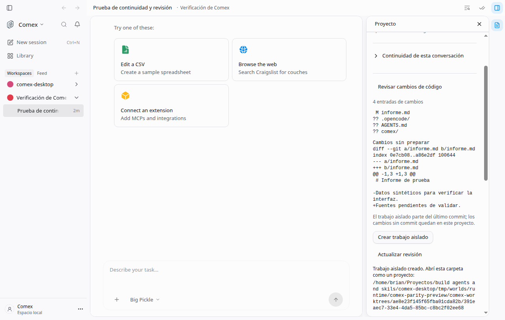

# Revisar cambios y aislar trabajo

`comexGitWorkspace` · self_hosted · brianpadilla3072 · desactivada por defecto.

Activar con `DEN_FEATURE_COMEX_GIT_WORKSPACE=true`. En Proyecto, abrir «Revisar cambios de código». El panel muestra estado y diferencias preparadas/sin preparar, sin ejecutar comparadores externos. Los archivos nuevos se enumeran; su contenido todavía no se compara. Las diferencias se limitan a 160.000 caracteres, con aviso de recorte; Git devuelve un error explícito si excede el límite de lectura.

«Crear trabajo aislado» crea un worktree con HEAD separado en el directorio privado del servidor y devuelve su carpeta para abrirla como otro proyecto. Exige el commit revisado y autorización de host; rechaza servidores de solo lectura y raíces anidadas. Los cambios sin commit permanecen en origen. No traslada automáticamente chats, no crea commits ni integra ramas. No hay borrado automático de worktrees.

Al desactivar, se oculta el panel y los endpoints devuelven 404. Los archivos y worktrees creados se conservan. Pruebas: `comex-git.test.ts`. Diseño: P5, P7, S5, C1; captura real adjunta de la interfaz integrada.

La prueba usa un repositorio fixture explícito, servidor real y autorización de host de prueba. Se comprobó revisión y creación desde el panel; no representa una revisión académica ni la integración de una rama.
