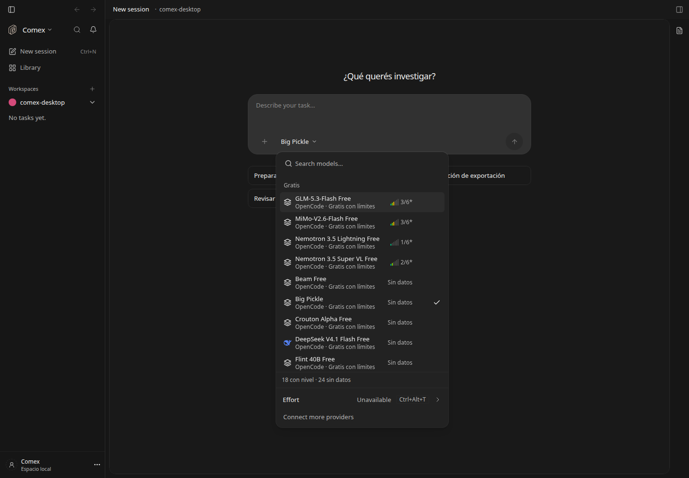
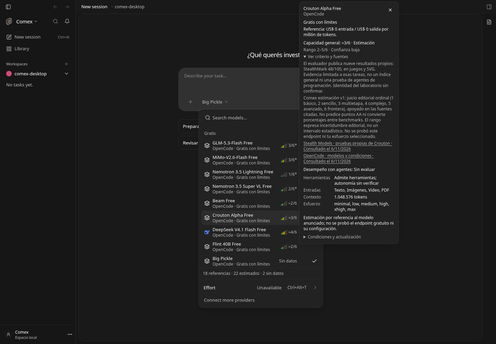
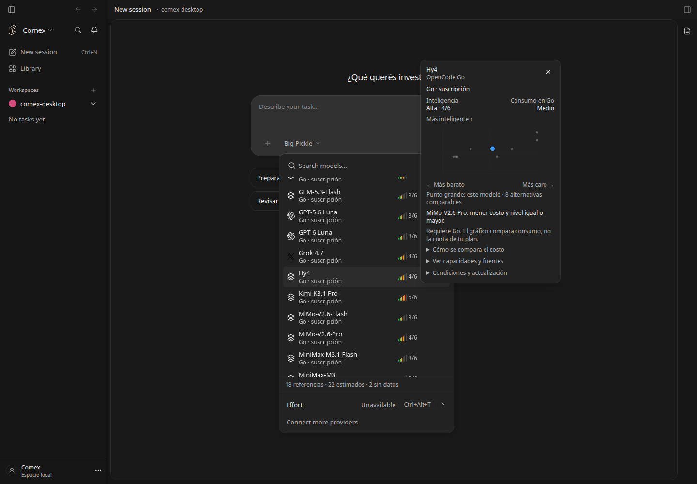
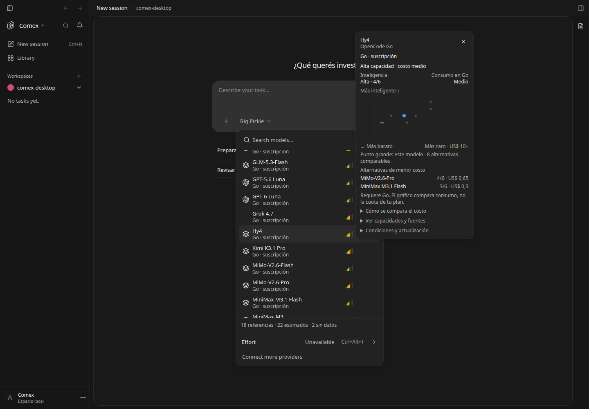
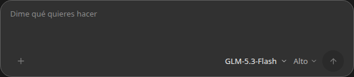

# Guía de modelos sin servicio central

Feature: `comexModelGuide`, self-hosted, autor `brianpadilla3072`. Registro apagado por defecto; la distribución Comex desktop lo habilita en el entorno del servidor, respetando `DEN_FEATURE_COMEX_MODEL_GUIDE=false`. Para servidor independiente: `DEN_FEATURE_COMEX_MODEL_GUIDE=true`. Apagarlo conserva SQLite y vuelve al selector anterior.

El release incluye `apps/server/src/model-guide/catalog.json`. Funciona sin conexión y sin URL remota. No requiere desplegar una API, ejecutar un agente ni programar una automatización externa. La aplicación mantiene una copia en `model-guide.sqlite`, junto a su configuración de runtime.



[Catálogo r2](model-guide-compact.png) · [Catálogo r3 a 390 px](model-guide-coverage-mobile.png)

[Vista a 390 px](model-guide-mobile.png) · [Función desactivada](model-guide-disabled.png)

## Actualizar mediante un release

1. Editar el JSON incluido. Incrementar `revision` (entero creciente) y actualizar `publishedAt` (UTC ISO 8601).
2. Validar con `pnpm models:catalog:check`.
3. Publicar el release habitual. El catálogo está importado por el código del servidor y entra en su build. Un release con revisión mayor reemplaza la copia anterior, sin borrar las observaciones locales.

Cada oferta usa la pareja exacta `providerID` + `modelID`. No se infiere que dos nombres comerciales correspondan al mismo modelo. `models` puede estar vacío: los modelos disponibles siguen apareciendo desde el motor con sus capacidades y precios informados, y se guardan localmente. El catálogo r2 incluye doce ofertas con referencias de Artificial Analysis Intelligence Index v5.0.1, consultadas el 6 de noviembre de 2026. No se asignan puntuaciones a identidades anónimas.

## Actualizar solo un JSON estático

```sh
pnpm models:catalog:export ./salida/model-catalog.json
pnpm models:catalog:schema ./salida/model-catalog.schema.json
```

Publicar `model-catalog.json` directamente en un hosting estático (por ejemplo Cloudflare Pages). La URL debe devolver el JSON, no una página HTML que lo contenga. No hace falta base de datos ni función de servidor en el hosting.

Configurar `updateUrl` en el JSON incluido **antes del release** para distribuir la URL a todos los usuarios. Alternativa por instalación: `OPENWORK_MODEL_CATALOG_URL=https://tu-dominio.example/model-catalog.json`. Un valor vacío desactiva las consultas remotas. Nunca se adopta una URL de actualización enviada por el archivo descargado.

Comex consulta al abrir el selector y luego mientras esté abierto; el servidor limita la descarga a una consulta por 24 horas, tanto en éxito como en error, incluso entre reinicios. No se despierta la computadora ni se hacen consultas con la aplicación cerrada. El botón **Actualizar catálogo** fuerza una consulta (cliente autenticado; no permite cambiar la URL). Las solicitudes simultáneas comparten una sola descarga. La copia consultada se muestra inmediatamente; una descarga automática aparece en la siguiente lectura del selector.

Las solicitudes externas son GET anónimos a la URL configurada, sin cuerpo, tokens, credenciales ni modelos privados. HTTPS obligatorio, sin redirecciones, 8 segundos de timeout y 2 MB máximos. JSON inválido, formato incompatible, duplicados, fecha futura, revisión anterior o cambios sin incrementar revisión conservan la última copia válida y muestran el estado pendiente. No se descarga ni ejecuta código. El operador controla la URL; sus datos se consideran contenido para mostrar, nunca instrucciones.

## Datos y evidencia

- Historial local: se conserva cada revisión aceptada del catálogo y cada cambio en los metadatos observados, incluyendo precios anteriores. Abrir el selector sin cambios no genera una nueva entrada de historial.
- Catálogo editorial: condiciones públicas por proveedor; ofertas con fuentes, fechas, precio USD por millón de tokens y evaluaciones opcionales.
- Observaciones: modelos encontrados por ámbito local, primera/última detección y disponibilidad en la última lista recibida. Se conservan los retirados. Solo se persisten campos permitidos; opciones del proveedor, claves, URLs de conexión y credenciales no entran en la tabla. Ámbitos se almacenan como hash.
- Desconocido es `null` o ausencia; nunca se convierte a precio cero, capacidad negativa ni puntuación cero. Precios con varios tramos no se aplanan: aparecen sin verificar.
- OpenCode Go se identifica como suscripción y se excluye del grupo Gratis. No se afirma que el plan del usuario esté activo ni que no haya consumo adicional. Los precios numéricos del motor se explican como tarifa de referencia, no como factura de Go.
- Cada evaluación exige nivel 1–6, benchmark, versión, puntuación original, unidad, esfuerzo, metodología, fecha de evaluación (o `null` si no está publicada) y fuente HTTPS con fecha de consulta. Usar umbrales fijos documentados en `methodology`; no mezclar versiones ni promediar pruebas incompatibles. El código valida la estructura, no la veracidad: la revisión editorial de fuentes sigue siendo necesaria.
- Sin evaluación: texto “Sin datos”, sin medidor vacío. Las barras grises solo representan la parte no alcanzada en modelos que sí tienen puntuación. Soportar herramientas no se interpreta como autonomía probada. Las variantes reales del motor se muestran aparte del nivel de capacidad general.

La ficha abre con hover sobre las barras, teclado (Enter/Espacio) o clic/toque. Consultarla no selecciona ni ejecuta el modelo. El posicionamiento usa Popover de Base UI y conserva el selector al cerrar la ficha. Reglas de diseño: P1, P3, P5, P10, S7 y V2; los colores de las barras responden al diseño solicitado y van acompañados por texto accesible.

## Verificación

```sh
node --conditions=development --import ./apps/server/node_modules/tsx/dist/loader.mjs --test apps/server/test/model-guide.test.ts apps/server/test/model-guide-routes.test.ts
TSX_TSCONFIG_PATH=apps/app/tsconfig.json node --conditions=development --import ./apps/server/node_modules/tsx/dist/loader.mjs --test apps/app/tests/model-guide.test.tsx
pnpm features:check
```

Node 24.22.1. Tests de persistencia, aislamiento, privacidad de descargas, actualización diaria, concurrencia, recuperación, validación y clasificación de suscripciones; pruebas de interfaz y screenshot contra el servidor/OpenCode reales. No se ejecutan inferencias de pago. Los benchmarks nuevos deben agregarse con evidencia; esta entrega no compra ni integra automáticamente bases con licencia o API privada.

## Niveles del catálogo r2 y vista compacta

Las filas del selector reducen su espaciado y usan títulos de 12 px. Las seis barras ahora miden hasta 14 px de alto (antes 20 px) y 2 px de ancho. La ficha tiene 288 px de ancho, menor espaciado y detalles de evaluación, condiciones y caché plegados. `s/d` significa sin datos, no puntuación cero. El pie indica cuántos modelos disponibles tienen nivel.

Escala editorial **Comex AA-6 v1**, sobre AA Intelligence Index **5.0.1**: <10 → 1; 10–<20 → 2; 20–<30 → 3; 30–<40 → 4; 40–<50 → 5; ≥50 → 6. Son umbrales fijos de presentación, no niveles oficiales de AA ni porcentajes. Se conserva el valor original y el enlace por modelo. Fuentes y valores en el JSON del catálogo; metodología externa: https://artificialanalysis.ai/methodology/intelligence-benchmarking.

Tres ofertas gratuitas llevan `assessmentScope: "base-reference"` y un asterisco junto al nivel: GLM-5.3-Flash Free, MiMo-V2.6-Flash Free y Nemotron 3.5 Lightning Free. Son referencias del modelo base anunciado por nombre, con correspondencia inferida; no prueban que el endpoint gratuito, su identidad exacta o su configuración tengan ese rendimiento. La ficha lo dice explícitamente. Las otras nueve ofertas identifican el modelo evaluado; tampoco son mediciones del servicio de Go. No se atribuye `max` a evaluaciones sin esfuerzo publicado. Gemini 4 Argon sí identifica `high` en la fuente.

La fuente no publica una fecha exacta de ejecución para estas fichas: se guarda `measuredAt: null` y se muestra la fecha de consulta, sin inventar una medición. Los modelos anónimos y las versiones sin correspondencia quedan sin datos; no se heredan puntuaciones entre versiones diferentes.

## Cobertura r3 y orden de la lista

El catálogo r3 agrega seis referencias: GPT-6 Luna (max), GPT-5.6 Luna (max), GLM-5.3 (max), Grok 4.7 (xhigh), Claude Haiku 5.5 (max) y el modelo base de Nemotron 3.5 Super VL Free. Total: **18 ofertas con nivel** y **5 fichas documentadas como N/A**, consultadas en sus páginas individuales de Artificial Analysis. Sigue usando exclusivamente el índice 5.0.1; no completa vacíos con números de otras versiones ni de modelos sucesores.

Se documenta explícitamente la falta de puntuación para Kimi K3, GLM-5.2, Qwen3.7 Plus, MiMo-V2.5-Pro y LongCat 2.0: las fichas consultadas muestran N/A para ese índice. El enlace y la fecha quedan en cada entrada. Otros identificadores, incluidos nombres promocionales sin coincidencia inequívoca, conservan Sin datos.

Al navegar, los modelos con nivel aparecen primero **dentro de cada grupo** de proveedor o facturación; entre ellos se conserva el orden original. No altera favoritos, recientes, grupos de la organización ni relevancia de búsquedas. Se mantienen visibles y seleccionables los modelos sin puntuación. Su ficha sigue mostrando las capacidades y precios que informa el motor; Sin datos se refiere a la evaluación, no a disponibilidad. El pie muestra ambas cantidades.

Verificación adicional: prueba de partición estable sin mutar entradas ni mezclar proveedores, prueba de estado desconocido sin medidor vacío, validación de las nuevas fuentes y prueba visual con el catálogo r3 en escritorio y 390 px.

## Investigación y estimaciones r4

A pedido del usuario se investigaron individualmente las **24 ofertas sin nivel** (22 nombres distintos). El catálogo r4 contiene las 42 ofertas detectadas: **18 referencias de evaluación, 22 estimaciones y 2 sin evidencia suficiente**. [Informe completo por oferta, fuentes y límites](investigacion-r4.md).

Las estimaciones tienen campos propios `reasoningEstimate` y `agenticEstimate`, separados de las evaluaciones `reasoning` y `agentic`. Se exige nivel, rango, confianza baja/media, explicación, metodología, fecha y al menos una fuente HTTPS. El nivel debe estar dentro del rango. No se genera una puntuación AA sintética ni se promedian benchmarks diferentes. Los rangos expresan incertidumbre editorial, no intervalos estadísticos. Ninguna estimación tiene confianza alta.

La fila muestra `≈3/6`; la ficha dice **Estimación**, rango y confianza. El criterio y los enlaces se despliegan en “Ver criterio y fuentes”. Las capacidades agenticas también pueden llevar una estimación propia; admitir herramientas por sí solo no asigna un nivel. Si una entrada tiene medición y estimación, la medición tiene prioridad. El orden dentro del proveedor es: referencias evaluadas, estimaciones, sin datos; favoritos y búsqueda conservan su orden.

Big Pickle y Pulse Alpha se investigaron y tienen ficha con el motivo de ausencia de nivel. Las pruebas limitadas de Crouton e Iceman no confirman su identidad ni una capacidad general: sus estimaciones tienen confianza baja y rango amplio. Las tarifas y límites de Go se siguen consultando en su fuente oficial; las tarifas variables no se convierten en un precio universal. Funciona con el mismo JSON incluido en el release, sin agregar servicios.



[Vista móvil de la ficha](model-guide-estimates-mobile.png). Verificado con 16 pruebas de catálogo, persistencia, rutas y presentación; validación de esquema y revisión en navegador.

## Comparar inteligencia y costo al pasar sobre una fila

La ficha abre al pasar por la fila completa, además del clic/toque/teclado de su botón. Su primera vista muestra inteligencia con nivel y costo bajo/medio/alto, más un gráfico: arriba aumenta la capacidad y hacia la izquierda disminuye el costo. El punto grande es la oferta consultada; los puntos pequeños son otras ofertas disponibles del mismo proveedor con precios comparables y el mismo método de evaluación. Las referencias de benchmark y estimaciones editoriales se comparan por separado. Las estimaciones muestran su rango como una línea punteada y mantienen rango/confianza visibles.

El costo compara un ejemplo fijo de 1 millón de tokens de entrada + 250.000 de salida, sin caché: `input + output / 4`. Bajo ≤ US$ 0,50; medio ≤ US$ 2; alto > US$ 2 para ese ejemplo. El eje horizontal es logarítmico. No representa el costo de resolver una tarea ni la factura del usuario. Go se rotula “Consumo en Go”, con su suscripción aclarada. Sin precio o sin capacidad no se dibuja una ubicación inventada.

Cuando hay una alternativa estrictamente más barata y de nivel igual o mayor se nombra en la ficha. Con estimaciones, el límite inferior de la alternativa debe alcanzar el límite superior de la consultada: los rangos superpuestos no permiten ese mensaje. No se divide una escala ordinal de inteligencia por un precio para fabricar un índice de rentabilidad. Las tarifas, fuentes y capacidades detalladas quedan plegadas para mantener la ficha compacta.



[Vista móvil](model-guide-value-mobile.png). Pruebas de cálculo, ausencia de datos, aislamiento entre proveedores y rangos superpuestos, más verificación real de hover, gráficos, cierre con Escape y límites de escritorio/390 px. Typecheck de la aplicación sin errores. Mantiene la bandera `comexModelGuide` (diseño P1, P3, P5, P10, S7).

## Barras sin números y ficha simplificada

A pedido del usuario se conservan colores, alturas y segmentos originales de las seis barras, eliminando el número, `/6` y los símbolos visibles de la fila. El nivel y su procedencia permanecen disponibles para lectores de pantalla y en la ficha. Los modelos sin evidencia mantienen “Sin datos”. Hover solo sobre las barras con 250 ms de demora; clic/toque y teclado siguen abriendo la ficha. Se cancela la apertura al abandonar el botón y al desmontarlo.

La ficha agrega una conclusión breve y hasta dos alternativas más baratas con nombre, nivel y costo del mismo ejemplo de tokens. Los resultados evaluados usan puntuaciones originales comparables para afirmar capacidad igual o mayor: compartir un tramo de seis barras no basta. Las estimaciones mantienen el criterio conservador de rangos. El eje de costos queda fijo entre US$ 0 y US$ 10, logarítmico y con importes mayores limitados al extremo señalado. El nivel superior se describe como “Muy alta”, sin afirmar inteligencia máxima.



[Vista móvil](model-guide-bars-only-mobile.png). Verificación: 10 pruebas de presentación y comparación, typecheck y navegador real en escritorio/390 px, incluyendo hover sobre barras y ausencia de apertura al pasar por el nombre. La bandera existente controla los cambios.

## Compositor inspirado en la referencia del usuario

Detrás de `comexWorkspace`, el cuadro usa esquinas más redondeadas, texto “Dime qué quieres hacer” y barra inferior con adjuntos a la izquierda, modelo/esfuerzo a la derecha y el envío circular existente. El esfuerzo tiene un menú directo con las variantes reales anunciadas por el modelo y conserva sus identificadores al enviar: por ejemplo GLM-5.3-Flash ofrece Bajo, Alto y Máximo, además del predeterminado. No se inventan modos de modelos sin variantes. Cambiar el modo cierra el menú y actualiza el control de comportamiento que ya usa el envío; no modifica las barras de inteligencia.

El control de permisos existente se muestra en Comex escritorio con texto del modo actual; conserva las restricciones administrativas, la consulta al servidor, el bloqueo por ejecución y la confirmación para habilitar permisos amplios. Exponer el control no cambia permisos ni activa aprobación automática. Sigue restringido al escritorio, por lo que no aparece en la captura del navegador. Dictado conserva su disponibilidad y conexión nativa existentes; no se agregan botones de voz sin función.



[Menú de modos](composer-modes.png) · [Escritorio](composer-reference.png) · [Móvil](composer-reference-mobile.png).

Validación en navegador real: selección de modelo y variante Alto, cierre del menú al elegir, tamaño de escritorio/390 px y ausencia de errores de JavaScript. No se enviaron prompts ni se cambiaron permisos. Typecheck de la aplicación sin errores. Reglas P3, P5, P10, S7 y T5 de `DESIGN.md`; al desactivar Comex se recupera el compositor anterior.

El control de permisos fue ampliado después de la revisión del compositor: ahora Comex tiene una implementación nativa v2 disponible también en la vista web local conectada, con los tres modos iniciales y creación de perfiles. Sustituye en Comex la limitación del control anterior descrita arriba. [Documentación actual de modos de permisos](../comex-permission-modes/README.md).
