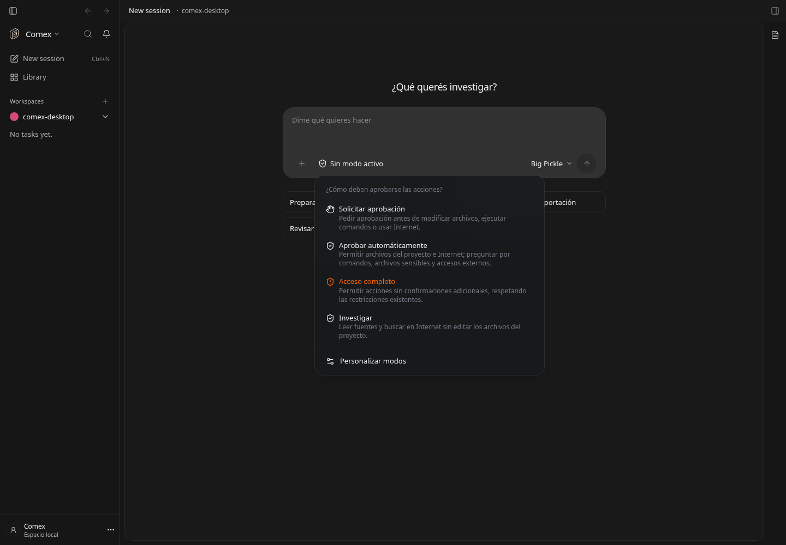
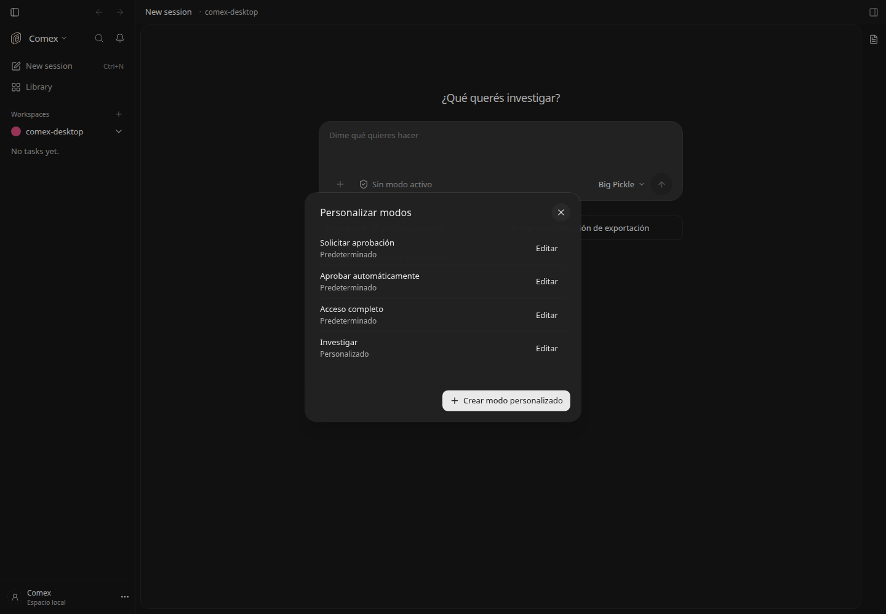
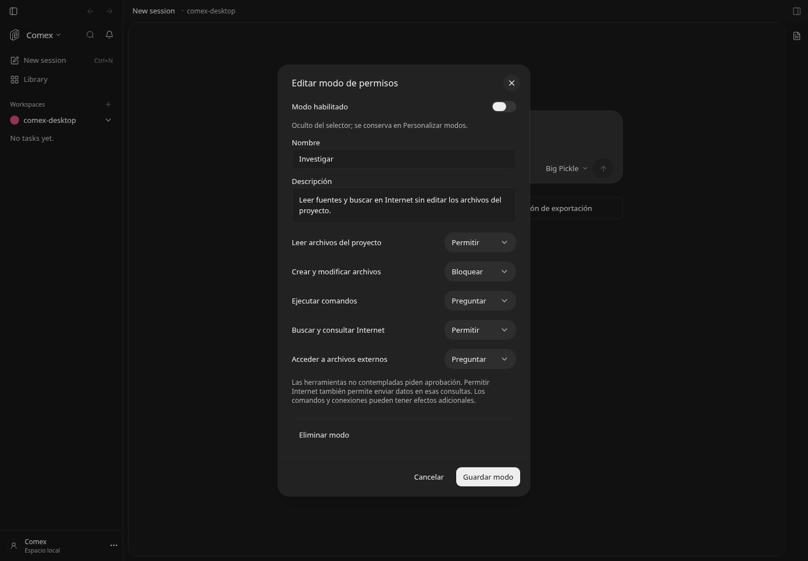

# Modos de permisos personalizables

Parte de la interfaz local `comexWorkspace` (self-hosted, apagada en el registro y activada por la distribución Comex). Se usa la misma bandera del compositor; no se cambia la modalidad de permisos al iniciar ni al abrir el menú. Desactivar la interfaz conserva los perfiles y los permisos que el usuario haya aplicado.



## Los tres modos iniciales

- **Solicitar aprobación**: lectura del proyecto permitida; preguntar antes de editar, ejecutar comandos, consultar Internet o acceder a archivos externos.
- **Aprobar automáticamente**: archivos del proyecto e Internet permitidos; preguntar por comandos, archivos sensibles, accesos externos y herramientas no contempladas. No afirma detectar automáticamente todos los riesgos.
- **Acceso completo**: permitir sin confirmaciones adicionales, conservando restricciones explícitas anteriores y las restricciones propias del motor y del administrador. No concede permisos del sistema operativo ni autorización a servicios externos.

Ninguno se activa al publicar esta función. Sin un modo aplicado y verificado, el control dice “Sin modo activo”. Se leen los permisos existentes sin asignarles automáticamente un perfil; no se infiere desde el nombre del modelo.

## Crear y personalizar

El selector incluye los modos habilitados y una única entrada de gestión: **Personalizar modos**. Allí, cada fila tiene una sola acción **Editar** y el pie contiene **Crear modo personalizado**. Se reutilizan los diálogos, botones y colores de la aplicación, filas compactas y separadores; crear y desactivar no aparecen como acciones en el selector.



“Crear modo personalizado” abre un formulario de nombre, descripción y cinco categorías: leer archivos, crear/modificar archivos, ejecutar comandos, Internet y archivos externos. Cada categoría admite Permitir, Preguntar o Bloquear. La plantilla inicial “Investigar” permite lectura y web, bloquea edición y pregunta por comandos y archivos externos. Aprobar un comando puede permitir sus efectos de escritura o red; no es un sandbox de solo lectura. Las herramientas no contempladas preguntan. Internet incluye enviar datos en consultas. Lecturas sensibles de `.env` y `.env.*` conservan aprobación o bloqueo.



Los perfiles se almacenan en SQLite por proyecto. Guardar no activa. En **Personalizar modos → Editar**, el interruptor **Modo habilitado** oculta o muestra el perfil sin borrarlo. Los ocultos permanecen identificados como Desactivado en la gestión y no pueden aplicarse desde la API. Ocultar el perfil en uso conserva sus permisos actuales. Los perfiles previos se migran como habilitados. Los iniciales permiten editar su visibilidad y duplicarlos para cambiar sus permisos. Los personalizados permiten editar permisos o eliminar con confirmación, excepto mientras están en uso; Duplicar y Eliminar están dentro del editor. Un máximo de 50 perfiles personalizados, nombres únicos y revisiones impiden pisar ediciones concurrentes.

## Aplicación y límites

Dentro del editor del modo en uso, **Desactivar modo activo** permite restaurar los permisos anteriores con una revisión separada. Esto modifica permisos; el interruptor de visibilidad solo oculta el perfil. La restauración exige proyecto inactivo, confirmación del motor y ausencia de cambios manuales concurrentes, y conserva todos los perfiles guardados.

Cada activación muestra un resumen y requiere “Aplicar al proyecto”. Afecta todas las conversaciones del proyecto, por lo que se exige que estén inactivas, sin preguntas ni solicitudes de permiso pendientes. Conserva aprobación del host, autenticación de cliente, ámbito colaborador y solo lectura. No se modifica el esfuerzo de razonamiento.

Se escriben reglas **nativas de OpenCode v2** en `permissions` del archivo local `.opencode/opencode.json` o JSONC existente, preservando otros campos y comentarios. No se reutiliza el formato v1 `permission`, ni su ruta deshabilitada con v2. Las reglas restrictivas originales se conservan en cada aplicación; las modificaciones manuales posteriores se detectan y no se reemplazan automáticamente. Se rechazan enlaces simbólicos, claves duplicadas, reglas inválidas y dos archivos locales ambiguos. La escritura usa archivo temporal y reemplazo, con comprobación de cambios concurrentes.

Antes de marcar un modo como aplicado se consulta la configuración y los permisos de los agentes que devuelve el motor. Un agente puede agregar excepciones propias: si no se puede verificar el modo o una excepción lo debilita, se restauran las reglas anteriores y se informa el impedimento. La comprobación de intersección de patrones es conservadora y puede rechazar una excepción que requiera revisión. Las políticas administrativas y los bloqueos propios del motor permanecen vigentes. Si el motor se desconecta tras aplicar un modo, se muestra pendiente de verificación.

La verificación usa metadatos; no compra inferencias ni ejecuta herramientas. En la revisión visual se guardó un perfil “Investigar” sin activarlo. No se cambiaron los permisos activos del proyecto del usuario.

## Verificación

Seis pruebas de reglas iniciales, preservación de restricciones, conflictos, escritura JSONC, rutas inseguras, autenticación/solo lectura, validación, revisión, confirmación, bloqueo por actividad, reversión ante falta de confirmación y excepciones de agentes. Prueba contra el motor v2 real en una carpeta temporal: refresco de reglas y rechazo de un agente con permisos más amplios, sin inferencia. Navegador real: tres opciones iniciales, creación/persistencia de Investigar, formulario, confirmación cancelada, creación dentro de Personalizar modos, ocultamiento persistente tras recargar, recuperación del perfil y diseño a 390 px. La revisión de restauración del modo activo se comprobó con una respuesta interceptada de prueba, sin cambiar permisos reales. Typechecks de aplicación y servidor.

```sh
node --conditions=development --import ./apps/server/node_modules/tsx/dist/loader.mjs --test apps/server/test/comex-permission-modes.test.ts
```

[Captura móvil](permission-modes-mobile.png). Diseño: P1, P3, P5, P8, P9, P10, S7 y T5 de `DESIGN.md`. Reutiliza DropdownMenu, Dialog, Select, Switch, Input y Button; no agrega listeners globales ni posicionamiento manual.

La prueba visual final también verificó editar la descripción del perfil guardado y cancelar su eliminación. Un agente local con excepciones incompatibles puede impedir aplicar Solicitar aprobación o un perfil restrictivo; en ese caso se informa y se revierten las reglas. La interfaz no modifica esos agentes por su cuenta ni presenta el cambio como exitoso.

La validación de rutas también cubre ocultar/recuperar modos iniciales y personalizados, rechazar la aplicación de un perfil oculto y ocultar el perfil activo sin modificar las reglas nativas. Typechecks de aplicación y servidor y las seis pruebas pasan. La comprobación global de banderas informa cambios ajenos pendientes en Helm y un documento ausente de `taskContinuity`; no se modifican en este ajuste.
