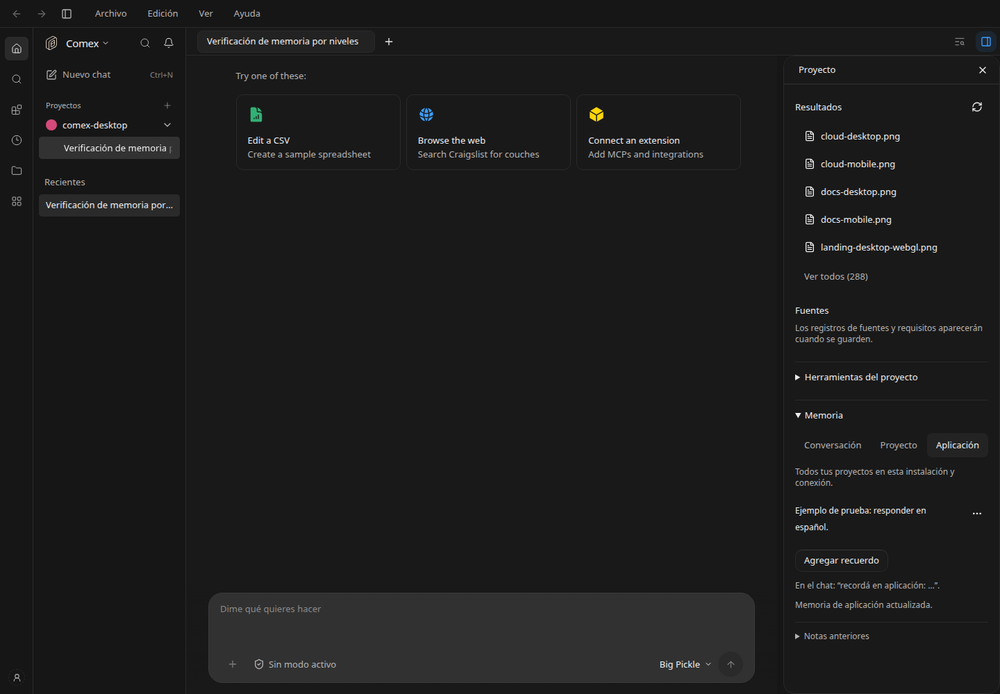

# Memoria por conversación, proyecto y aplicación

Feature `comexScopedMemory`, self-hosted, apagada por defecto en el registro. Autor: brianpadilla3072. La distribución Comex de escritorio la habilita salvo bloqueo explícito del operador. La instalación local de desarrollo usa el mismo flag del registro.

- **Conversación:** notas solo para ese chat dentro de su proyecto de origen.
- **Proyecto:** notas para todos los chats de la misma carpeta canónica, incluso si una conversación luego trabaja en un worktree.
- **Aplicación:** preferencias compartidas entre los proyectos de esta instalación y la misma identidad de conexión. No se comparten entre tokens de otros usuarios ni instalaciones; cambiar la identidad de conexión requiere recuperar/migrar las notas anteriores explícitamente.



El panel Memoria permite agregar, editar y eliminar notas en los tres niveles. Las notas anteriores en archivos siguen disponibles en un apartado separado y no se convierten automáticamente en preferencias globales. No se cambia el estado de las encuestas ni se interpretan notas como evidencia validada.

## Pedidos en el chat

Se reconocen órdenes directas, con contenido concreto, al admitir un prompt nativo v2:

```text
recordá: prefiero respuestas breves
recordá en conversación: estamos comparando dos alternativas
recordá en proyecto: expresar los costos en euros
recordá a nivel de aplicación que prefiero español
recordá esto para la aplicación: usar fechas día/mes/año
```

Sin nivel explícito se guarda en conversación. El servidor escribe el contenido literal antes de sincronizar las instrucciones del turno y agrega un recibo con el nivel y el texto realmente guardados. El agente recibe la instrucción de confirmar ese recibo, no simular una escritura. Pedidos ambiguos como «recordá esto», citas, texto pegado, adjuntos y contexto oculto no se extraen automáticamente: el agente pide el texto concreto o remite al panel. No se usa una inferencia auxiliar para decidir qué recordar. Un fallo de envío posterior no revierte una nota ya guardada; se puede verificar en el panel.

En cada turno v2 se cargan únicamente los niveles de esa conversación/proyecto/conexión. Si hay preferencias incompatibles se prioriza conversación, proyecto, aplicación, siempre por debajo del pedido actual y sin cambiar permisos. Las notas son datos no confiables, no instrucciones del sistema.

## Persistencia y protección de datos

SQLite local del runtime, tabla `comex_scoped_memory`. Claves hash derivadas del nivel, carpeta canónica y sesión o identidad de conexión; no se guardan tokens en las notas. Máximo 24 notas de 800 caracteres y 16 KB por nivel. Transacciones `BEGIN IMMEDIATE`, revisiones y validación impiden perder actualizaciones concurrentes. Los reintentos de una nota idéntica no crean duplicados. Los formatos habituales de claves se rechazan al guardar y se redactan al leer; esto no es un clasificador universal de datos personales. La corrupción se informa sin reemplazar registros.

Las rutas requieren cliente identificado y pertenencia nativa verificada de la conversación al proyecto. Escribir requiere colaborador/propietario y servidor habilitado para escritura. Un espectador no puede guardar mediante el panel ni mediante una orden de chat. La memoria de aplicación se aísla por la identidad autenticada, no por un identificador enviado por el cliente.

Desactivar la bandera conserva SQLite y los archivos anteriores, deja de admitir guardados por estas rutas y de inyectar los nuevos niveles. El editor anterior sigue disponible. No requiere servidor remoto, sincronización ni agente en segundo plano.

## Validación

Pruebas de gramática explícita, límites/secretos, separación entre conversaciones y proyectos, identidad de aplicación, revisiones, edición/eliminación, reintentos, permisos y bandera apagada. Una integración con motor HTTP de prueba recorre el proxy v2, verifica el recibo y las notas del siguiente turno, sin ejecutar inferencia.

```sh
node --conditions=development --import ./apps/server/node_modules/tsx/dist/loader.mjs --test apps/server/test/comex-scoped-memory.test.ts
```

La interfaz reutiliza Tabs, Dialog, DropdownMenu, Textarea y Button. Sigue DESIGN.md P3/P5/P8, S1/S2/S7 y V1/V2.

## Evidencia visual y resultado

[Editor](memory-editor.png) · [Móvil a 390 px](memory-mobile.png) · [Solo lectura](memory-readonly.png) · [Bandera apagada](memory-feature-off.png). Las dos últimas vistas usan respuestas interceptadas de prueba; no se alteran permisos reales ni la bandera de la instalación. Las capturas con notas muestran ejemplos de prueba, eliminados al terminar.

Navegador con API real: altas en los tres niveles, persistencia tras recargar, edición, eliminación y ancho móvil. Se creó y retiró una conversación vacía para esta verificación, sin enviar prompts a modelos. La integración del proxy usa un motor HTTP de prueba. Pasaron 21 pruebas de memoria, continuidad y modos, los typechecks de aplicación/servidor y la comprobación de banderas. Helm no está instalado, por lo que no se renderizó el chart. `git diff --check` sin errores.
