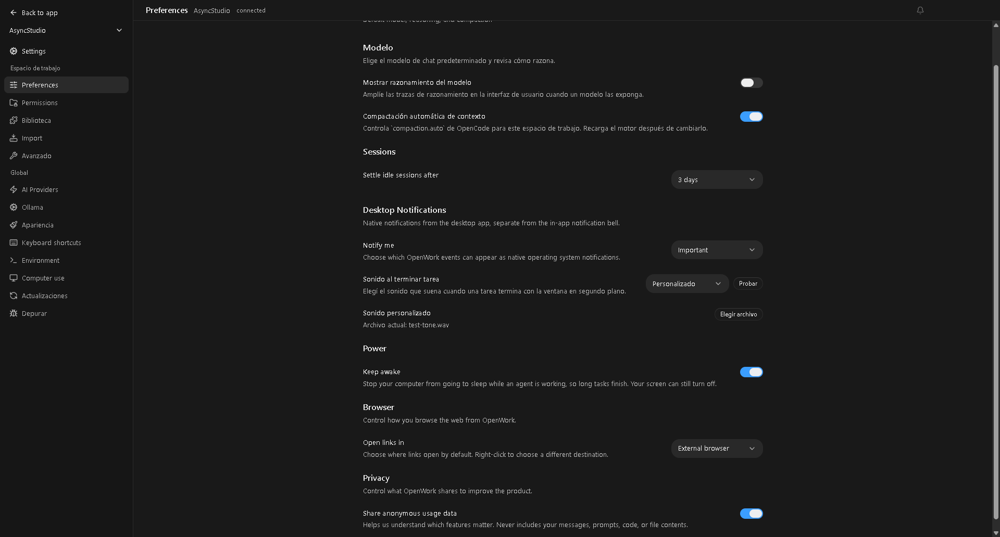

# Task completion sound

- **Feature key**: `comexTaskSound`
- **Deployments**: `self_hosted`
- **Author**: `brianpadilla3072`
- **Added**: 2026-11-16

## What it does

When an agent finishes a task, Comex can play a short sound. It only plays
while the OpenWork window is **not in view** (minimized, hidden behind another
window, or without focus) and only when the run ends **successfully**. Failures,
permission requests and questions keep their existing treatment.

The setting offers five built-in sounds (chime, bell, pop, marimba and soft),
all synthesized in the renderer with the Web Audio API, plus a **custom** sound
the person uploads (MP3, WAV or OGG, up to 2 MB). A **Preview** button plays the
selected sound before a run finishes. The build ships no audio asset and fetches
nothing.

The custom file is stored in IndexedDB (`openwork-media`), never on disk and
never in localStorage; the preference only records which sound is selected.

## How to try it

1. Start the desktop app with `DEN_FEATURE_COMEX_TASK_SOUND=true`.
2. Open **Settings → Preferences → Desktop Notifications**.
3. Pick a sound in **Task completion sound** (or **Custom** and upload a file).
   Use **Preview** to hear it.
4. Hide or minimize the window, send a prompt, and wait for the run to finish.

The preference lives in the app's local preferences (`taskSound`) and is off by
default. Desktop notifications are independent: the sound works with
notifications off. A preference saved by the first version (`"on"`) migrates to
`"chime"`.

## Turning it off

The kill switch removes the setting and silences completions within one feature
refresh (the desktop config provider polls every 15 seconds), even if a person
had already turned the preference on. Nothing about stored chats, runs or the
uploaded file changes.

## What to watch

- Audio is best-effort: a blocked audio device, a rejected `AudioContext` or a
  missing custom file never fails the run.
- The sound is throttled to one every 1.2 seconds, so several sessions
  finishing together do not stack.
- The uploaded file is capped at 2 MB and must have an `audio/*` MIME type.
