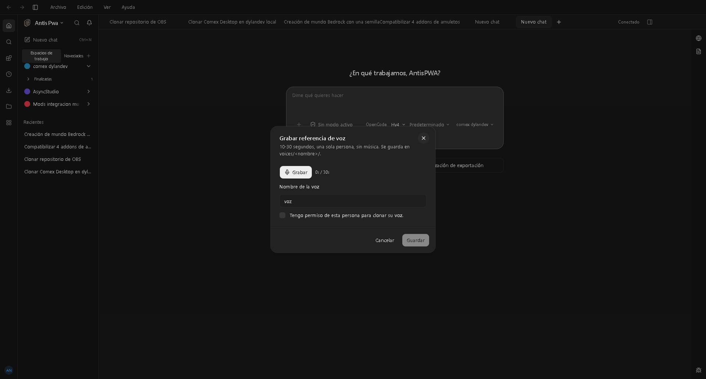

# Video studio

- **Feature key**: `comexVideoStudio`
- **Deployments**: `self_hosted`
- **Author**: `brianpadilla3072`
- **Added**: 2026-11-20

## What it does

Adds a **Video** group to the composer's “+” menu so a person can start the
video pipeline without typing the whole prompt:

- **New video** — asks `director-video` for the brief and creates the project.
- **Record voice reference** — records 10–30 s of the person's voice, asks for
  consent, and saves `voices/<name>/referencia.webm` + `consentimiento.md`.
- **Analyze references** — runs `video-inspiracion` on the reference videos.
- **Render video** — asks `video-studio` for the stills and the final render.

The buttons only prepare the prompt or the file; the agent and the skills
(`video-studio`, `video-inspiracion`, `voz-local`) still do the work. After a
recording, the composer is prefilled with the import instruction so the agent
converts it to WAV, normalizes it and creates the voice profile.

## How to try it

1. Start the desktop app with `DEN_FEATURE_COMEX_VIDEO_STUDIO=true`.
2. Open the composer's “+” menu and choose **Video**.
3. To test the recorder, allow the microphone when the app asks.
4. After saving, send the prefilled message and check
   `voices/<name>/referencia.wav` + `perfil.json`.

## Turning it off

The kill switch removes the Video group. Recordings and projects already saved
stay in the workspace; nothing is deleted. The microphone is only requested
while the recorder dialog is open.

## What to watch

- The recorder needs microphone permission (audio only; the app already allows
  it for the main window).
- Uploads go through the workspace inbox to the exact `voices/<name>/` path.
- No voice is imported without `consentimiento.md`; the skill refuses.
- The recorder caps at 30 s; shorter than 3 s cannot be saved.
