# Espacio Comex

`comexWorkspace` · `self_hosted` · autor: `brianpadilla3072`.

Esta distribución local de Comex activa la integración por defecto, sin exigir una cuenta de Den. El operador puede desactivarla con `DEN_FEATURE_COMEX_WORKSPACE=false`; la decisión pasa por el registro compartido de features. No está disponible en cloud.

La personalización por usuario y las aplicaciones especialistas se describen en [Perfiles locales con SQLite](../specialist-applications/README.md). El chat incluye [navegación lateral](../conversation-navigator/README.md) y [mapa de actividad de agentes](../agent-activity-map/README.md).

## Comportamiento

- Al abrir un proyecto, instala los 4 agentes y las 12 skills de `pack/` en `.opencode/`. Las actualizaciones reemplazan solamente archivos oficiales sin modificaciones. Si la estudiante personalizó un archivo, conserva su versión y deja la actualización en `.nuevo` (con sufijo de hash si ya había otra actualización).
- El panel Proyecto lista archivos reales del proyecto, fuentes y cumplimiento. Abre resultados solamente cuando la persona lo pide (DESIGN S5). Reutiliza los paneles de archivos, Excel y navegador existentes (P5).
- Los DOCX se muestran en un visor de lectura con ajuste de ancho. No edita Word; la paginación puede diferir de Microsoft Word. Utiliza [docx-preview](https://github.com/VolodymyrBaydalka/docxjs), cargado bajo demanda. Valida el ZIP y sus tamaños descomprimidos; desactiva fragmentos HTML, elimina vínculos activos y sanitiza el contenido. El iframe tiene sandbox sin permisos y CSP sin conexiones externas.
- La memoria del proyecto se guarda en `comex/estado.md`. Cada chat conserva notas propias en `comex/sesiones/<id>.md`. Se pueden revisar y guardar desde Proyecto. Los borradores sin guardar se conservan localmente y las escrituras verifican la versión del archivo. Si otra sesión cambió la memoria, muestra ambas versiones antes de permitir guardar; se pueden recuperar las notas descartadas durante esa comparación.
- En cada turno de OpenCode v2 se incorporan hasta 12.000 caracteres de memoria del proyecto y 6.000 de la sesión actual, como datos no confiables. Los archivos de más de 128 KiB se omiten del contexto automático. Se instruye al asistente principal a actualizar resúmenes trazables al cerrar un tramo significativo; esto depende del comportamiento del modelo. La memoria no equivale a todo el historial de otros chats. Los auditores mantienen sus permisos de solo lectura.
- El selector muestra primero el grupo Gratis, con etiquetas visibles, mientras `comexWorkspace` está activo. La clasificación v2 exige precios explícitos en cero en todos los tramos informados, incluidos cargos de caché; precios ausentes o desconocidos no se anuncian como gratuitos.
- El inicio ofrece tres pedidos en castellano: TP de investigación, cotización y revisión de informe/fuentes.
- La conexión de proveedores en OpenCode v2 usa `/api/integration` para descubrir métodos y los endpoints nativos `connect/key` y `connect/oauth`. OpenCode Console permite iniciar sesión con la cuenta; Go conserva su conexión por clave. Comex habilita Console al estar activa la feature y permitidos los proveedores propios; la restricción de modelos de la organización sigue prevaleciendo. La capa nunca consulta el listado de credenciales, que devolvería secretos. Referencia: [API oficial de OpenCode v2](https://dev.opencode.ai/v2/docs/api).
- En el motor administrado, el navegador nativo de Electron conserva sus controles y herramientas existentes. El botón Abrir navegador utiliza ese mismo panel. La versión web no ofrece el navegador nativo.
- El empaquetado incluye `pack/` como recurso externo y comunica su ubicación al servidor.

### Modelos gratuitos primero

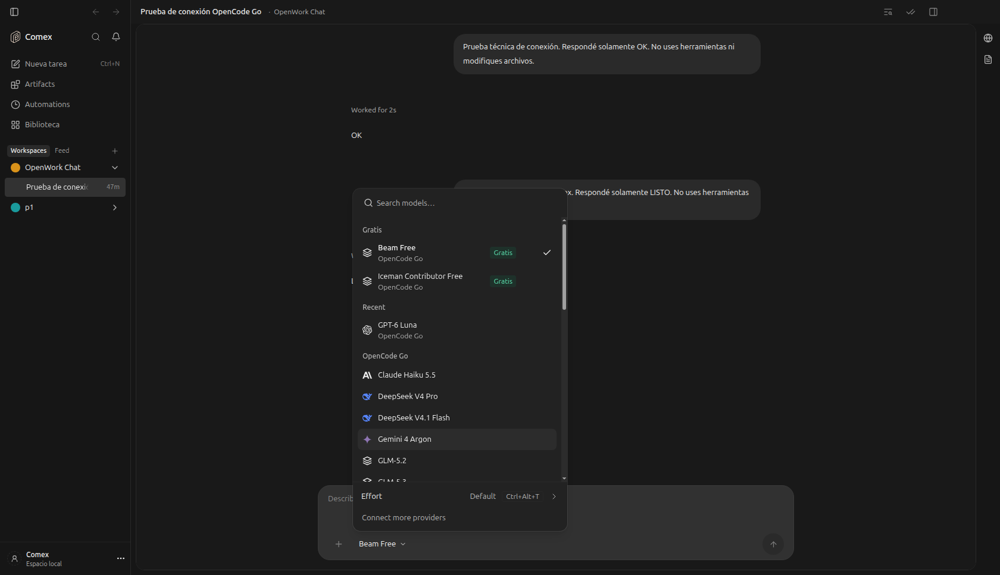

## OpenCode instalado

En escritorio, Comex detecta el recibo `opencode/service.json` del directorio
XDG de estado del usuario antes de aislar el perfil de desarrollo. Si existe,
se conecta directamente al servicio OpenCode v2; usa sus cuentas y modelos.
No copia claves de proveedores ni modifica su configuración global, migra su
historial o detiene su proceso al cerrar Comex. Los nuevos chats de este modo
pertenecen al historial del servicio instalado; los del motor administrado se
conservan en su propio perfil y no se trasladan automáticamente.

Solo acepta HTTP en `127.0.0.1` o `::1`, un recibo regular del usuario y una
respuesta de OpenCode v2 con el PID esperado. Relee el recibo y comprueba la
salud cada 15 segundos, para recuperar cambios de puerto/contraseña tras un
reinicio. Ante un fallo avisa y mantiene seleccionado ese servicio.
No cambia silenciosamente al motor administrado.

- Para iniciar el servicio: `opencode service start`.
- Ruta explícita del recibo: `OPENWORK_COMEX_OPENCODE_SERVICE_FILE`.
- Para usar el motor administrado: `OPENWORK_COMEX_OPENCODE_MODE=managed`.
- La detección se desactiva con `DEN_FEATURE_COMEX_WORKSPACE=false`.

El modo instalado mantiene las herramientas que ese OpenCode ya tiene y agrega
un complemento de navegador en `.opencode/plugins/comex-browser/server.js` de
cada proyecto registrado. No cambia la configuración global, las cuentas ni
las conexiones MCP de OpenCode. El complemento ofrece las herramientas
`browser_tabs/open/observe/act/extract/navigate/handoff` y WebMCP del navegador
integrado. El motor aporta el ID de la conversación; la política y las
aprobaciones siguen pasando por el host de Comex.

El token de transporte queda fuera del proyecto, en un archivo privado 0600 del
runtime, y se vuelve a leer en cada llamada para admitir reinicios. La copia
en el proyecto contiene solamente referencias a archivos locales. Se rechazan
carpetas enlazadas y no se sobrescriben copias modificadas o de otra instancia.
Al cerrar Comex se cierra solo el puente, sin detener el servicio instalado.
La carga por proyecto sigue el mecanismo nativo de
[plugins de OpenCode v2](https://dev.opencode.ai/v2/docs/plugins).
El panel Proyecto, Word, Excel y la inyección de memoria del servidor siguen
funcionando. La compatibilidad del servicio instalado se verificó en Linux.

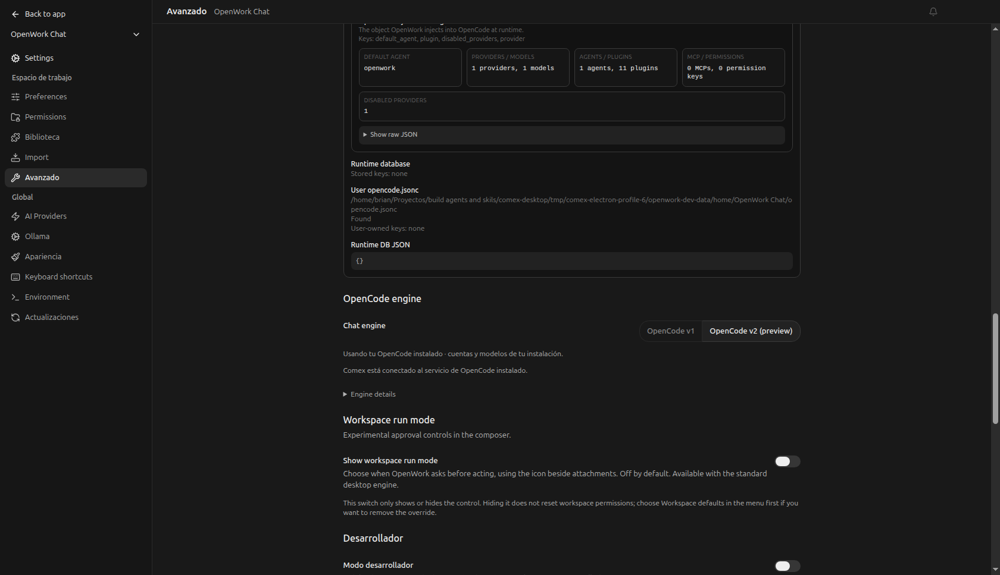

Las promociones tienen su propio [flag booleano, desactivado por defecto](../openwork-promotions/README.md).

## Desactivación

El interruptor oculta el panel Comex y el visor Word nuevo; deja de instalar/actualizar el pack y de incorporar memoria automática a los turnos v2. Conserva los documentos, notas y chats. Los agentes, skills e instrucciones AGENTS.md ya instalados siguen en la carpeta: desactivar no los desinstala ni borra personalizaciones. El navegador y Excel existentes siguen disponibles.

## Evidencia

Capturas de la aplicación real con documentos de ejemplo explícitos; no representan una investigación terminada. Se mantuvo el chat como superficie principal, controles compartidos y paneles por acción de la persona (DESIGN P5, P7, P10, S5).

### Word

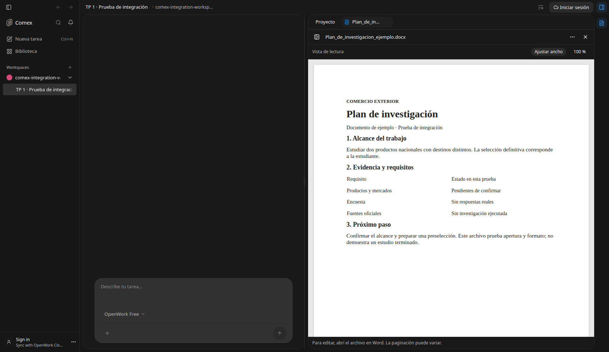

### Excel

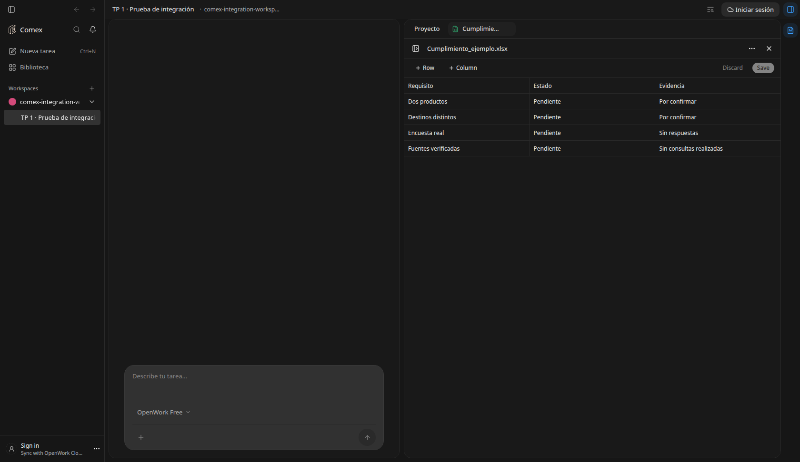

### Memoria del proyecto

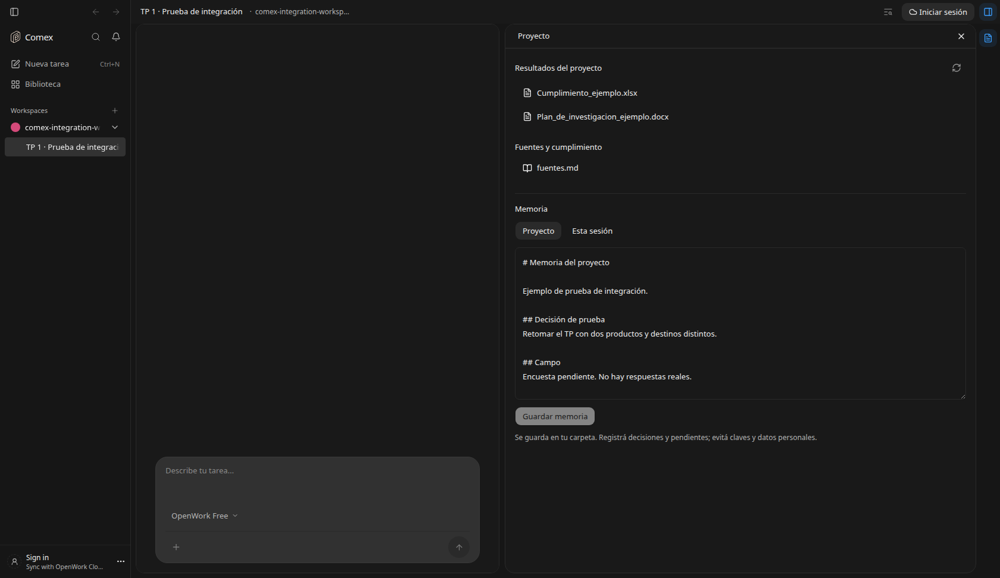

### Memoria de sesión

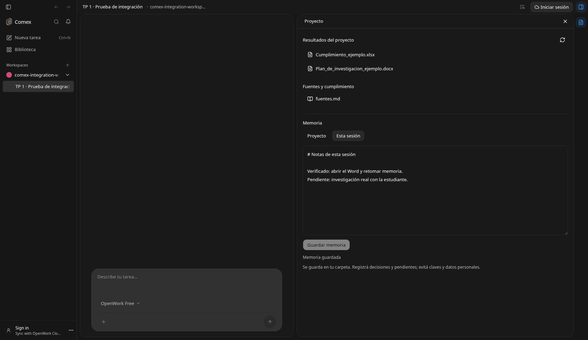

### Conflicto de memoria

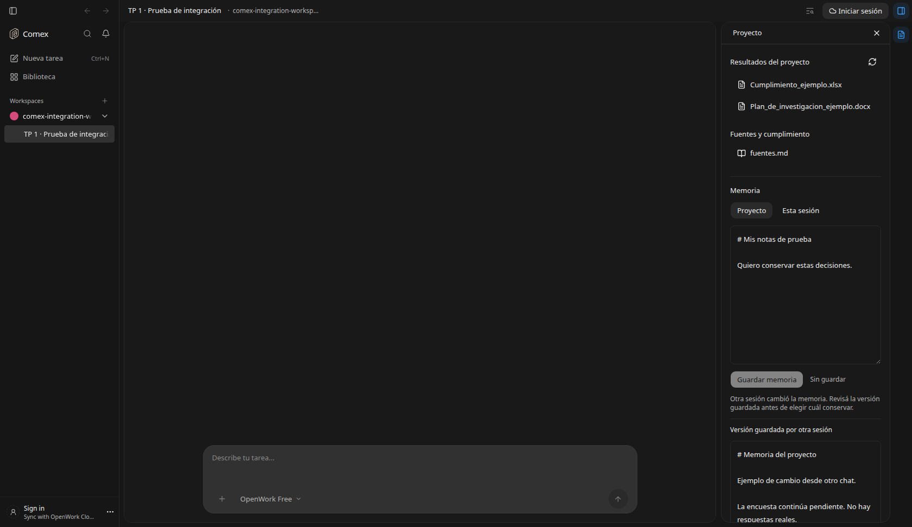

### Conexión de cuenta

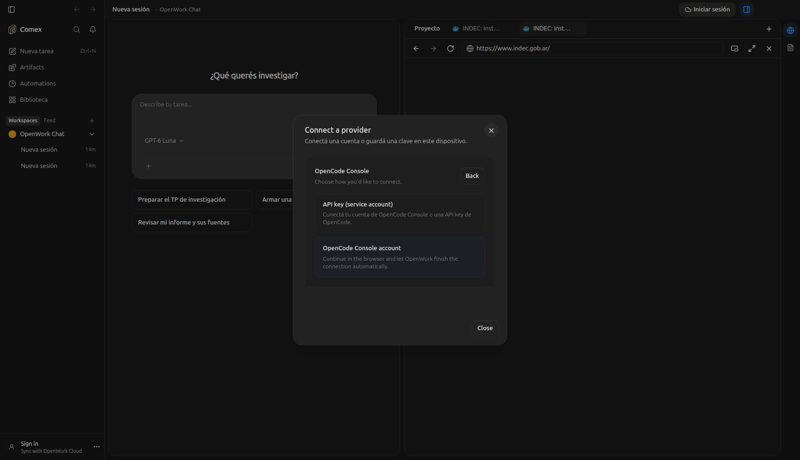

### Navegador nativo

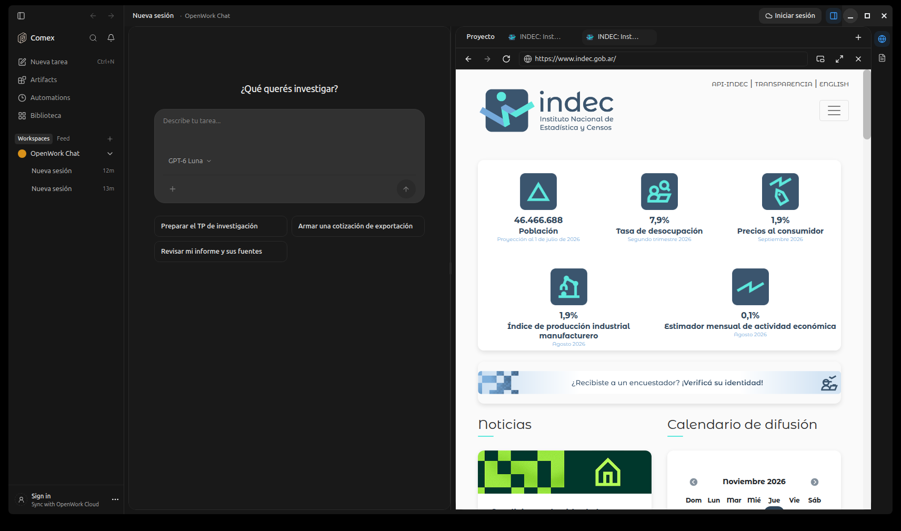

## Validación y límites

Resultado global: **Incomplete**. La integración local tiene pruebas verdes; falta la validación académica con modelo, campo real y una instalación Windows limpia.

Batería reproducible: `pnpm test:comex` (Node 24, pnpm fijado por el repositorio, Bun y Python con python-docx/openpyxl). Son 92 pruebas: registro de features (26), instalación/memoria (8), panel (5), visor Word (2), generadores (6), autenticación nativa (6), errores de conexión (4) y reglas de acceso a Console (6) y presentación de errores de credenciales (4), conexión al servicio/flag de publicidad (4) y reactividad de promociones (2) y prioridad/precios de modelos gratuitos (3), perfiles SQLite/packs (5) y alta de aplicaciones (2), navegación lateral (3), mapa de agentes (2) e interruptores de ambas funciones (1) y puente del navegador instalado (3). Ninguna omitida.

Mejoras verificadas en los generadores: códigos HS/país como texto, decimales en ambos formatos, rechazo de valores no finitos, respuestas multilínea intactas y fórmulas importadas tratadas como datos literales. La cotización rechaza costos negativos o no finitos.

Verificado en Linux:

- `python3 pack/scripts/validar.py`: 12 skills y 4 agentes válidos.
- `node --import ./apps/server/node_modules/tsx/dist/loader.mjs --test apps/server/test/comex-workspace.test.ts`: actualizaciones y conflictos del pack, symlinks rechazados, memoria persistente separada por sesión e interruptor del operador.
- Typecheck de app y servidor; compilaciones del servidor y frontend. El control de features no pudo renderizar Helm porque Helm no está instalado.
- Integración de UI con servidor y motor reales: abrir DOCX y XLSX, guardar memoria, recargar y volver a leer, guardar notas de otro alcance. Sin errores de página.
- Validación en Chromium del visor DOCX: rechazo de ZIP excesivo y DTD; exclusión de altChunk y CSP presente.
- Regresiones adicionales: 3 pruebas de inicio de workspace, 5 de instrucciones v2 y 12 del navegador nativo (incluido Chromium real) pasan.
- El motor enumera los 4 agentes y las 12 skills instalados (además de las skills globales existentes).
- Navegación nativa de Electron a INDEC con título y URL reales.

La prueba de UI adicional confirmó comparación/resolución de conflictos con archivos reales; la desactivación en UI se comprobó simulando la respuesta del endpoint de feature, además de las pruebas del resolvedor del servidor. El catálogo de autenticación se consultó en Chromium contra el motor real: Console devuelve clave y cuenta OAuth, Go devuelve clave. La conexión inicial del perfil administrado falló con una clave vencida. Se incorporó el modo de servicio instalado y se verificó una respuesta real `OK` desde Comex con `opencode-go/gpt-6-luna`, usando la cuenta que el servicio local ya tenía. No se registraron claves en el repositorio ni en capturas. Se envió además un mensaje desde el compositor de la aplicación y recibió `LISTO`, con un modelo disponible y sin invitaciones publicitarias. Esto verifica conexión e inferencia, no el trabajo académico completo.

La presentación v2 ahora conserva `response.body`, identifica `api_key_expired` y explica la renovación en castellano. Una conexión que el motor ya marca `needs_auth` no se anuncia como conectada después de guardar. Go aparece junto a Console en la lista de proveedores y tiene el enlace Obtener una clave nueva.

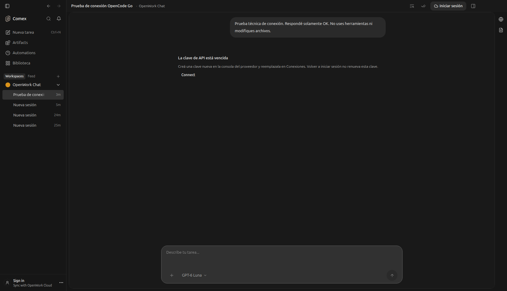

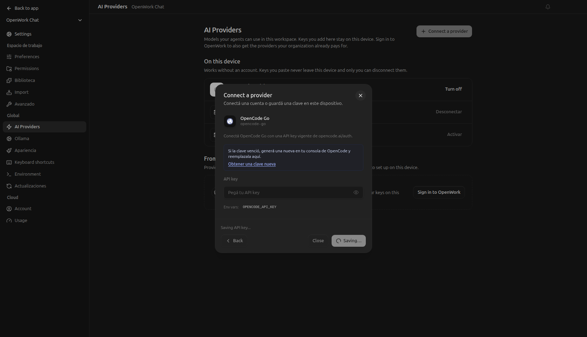

No se ejecutó una investigación completa mediante un modelo, ni se verificó la generación autónoma del informe académico. Los generadores del pack requieren sus dependencias Python. Las encuestas necesitan respuestas reales. No se generó ni validó un instalador Windows/macOS ni una presentación PowerPoint. El siguiente hito es ejecutar el caso TP1 con proveedor configurado, contrastar sus fuentes y evaluar los entregables con `pruebas/casos/tp1-2026/criterios.md` en el proyecto padre.

Prueba real adicional del navegador instalado: `opencode-go/beam-free` ejecutó
`browser_tabs`, `browser_open` y `browser_observe` sobre example.org, y luego
`browser_act` para seguir «Learn more». El recibo confirmó un clic, cero fallos
y navegación a `https://www.iana.org/help/example-domains`, título «Example
Domains». No se usaron búsquedas ni shell para esa comprobación. La captura
con imagen en una pestaña oculta no quedó verificada; la prueba confirma
navegación, lectura textual y clic.

## Modos de permisos del compositor

La interfaz Comex ofrece los tres modos iniciales y perfiles personalizables por proyecto. [Funcionamiento, límites, pruebas y capturas](../comex-permission-modes/README.md). El menú requiere conexión v2 para aplicar; no activa permisos ni elimina restricciones por abrirlo.
