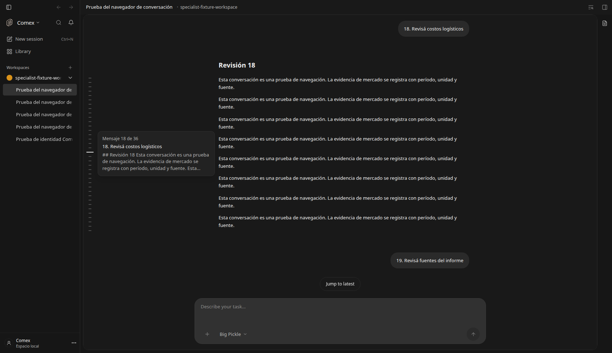
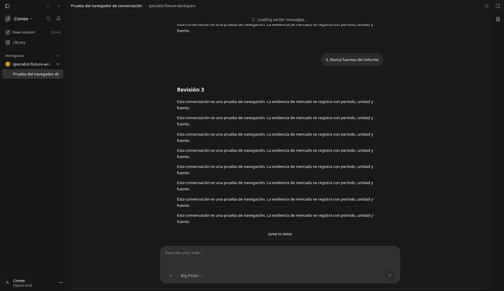

# Navegador de conversación

Feature `conversationNavigator`, self-hosted, autor `brianpadilla3072`.
Activada por defecto en esta distribución después de la verificación local.

Una columna discreta a la izquierda del chat muestra una marca por mensaje de
la persona. Al pasar el cursor muestra una vista previa del pedido y de la
respuesta. El clic salta al mensaje; la marca activa sigue la lectura.

El teclado permite recorrer las marcas con arriba/abajo e Inicio/Fin, y saltar
con Enter o Espacio. La vista previa usa el HoverCard compartido con portal,
límites de ventana y cierre con Escape. Se muestra en pantallas de escritorio
(desde 1024 px); las pantallas pequeñas conservan el scroll habitual.

No modifica chats ni la memoria. Las vistas previas incluyen texto visible y
nombres de adjuntos; no muestran razonamiento, argumentos de herramientas ni
contenido de archivos. Los mensajes revertidos no forman parte del navegador.

Si el historial está cargado por páginas, el botón superior permite cargar toda
la conversación. Ante un fallo conserva las marcas disponibles y permite
reintentar. El salto monta solamente el grupo necesario en el transcript
virtualizado, sin renderizar todo el historial.

El flag se resuelve en el servidor local y se actualiza en el cliente con el
resto de funciones locales. `DEN_FEATURE_CONVERSATION_NAVIGATOR=false` vuelve
al scroll habitual; los mensajes y la posición guardada se conservan.

## Verificación

Tres pruebas React verifican asociación de respuestas, omisión de razonamiento
y contenido de adjuntos, teclado, ausencia en un chat vacío y recuperación de
errores al cargar el historial. Pasan además las 64 pruebas existentes de scroll.

Se verificó en Chromium con el chat real y un fixture explícito de 36 turnos
servido con el formato nativo de OpenCode: salto al primer mensaje inicialmente
virtualizado, clic a un punto intermedio, vista previa, salto con Fin/Enter al
último, marca activa, pantalla angosta y flag desactivado. Sin errores de página.
El fixture no representa una investigación realizada por un modelo.

