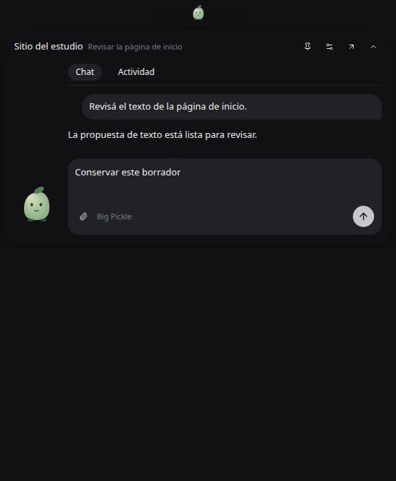
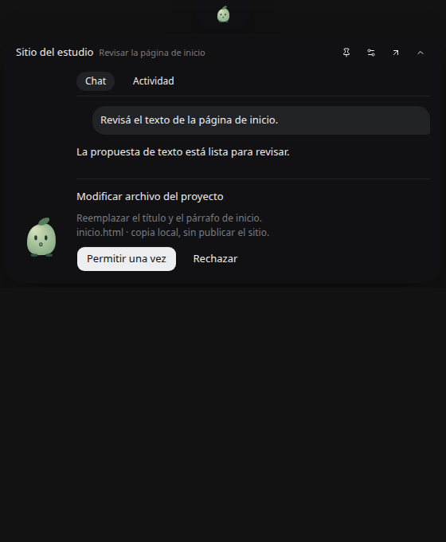
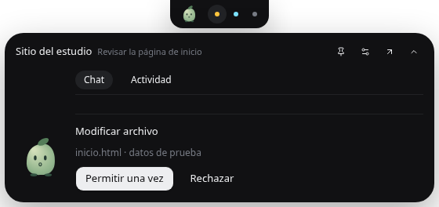

# Cápsula de escritorio

Feature `desktopCompanion`, self-hosted, autor `brianpadilla3072`, apagada por
defecto. Activar con el control de operador existente
`DEN_FEATURE_DESKTOP_COMPANION=true` al lanzar el escritorio. No se activa en
las distribuciones cloud/enterprise. Un `false` conserva el cierre habitual.

La mascota queda arriba al centro, sin texto propio. Al abrirla comparte fila
con el chat. Usa una ventana React pequeña, componentes Button/Textarea del
producto y un personaje original en Canvas 2D; no incluye arte, nombre ni
sonidos de Coucou. Referencia de interacción: Louis-CFM/coucou,
commit `b1bc09de7f7c24a80bd8eca5729b8bee60f66402` (MIT para el código).

## Funciones

- Cerrar la ventana principal la oculta conservando su renderer y el servidor.
  Con el modo compañero activo, solo se muestra una interfaz: la principal al
  estar visible, o la cápsula al cerrarla, ocultarla o minimizarla. Volver a abrir
  la principal oculta y pliega la cápsula sin perder sus borradores.
  El cierre durante la carga inicial también conserva el proceso. Si el arranque
  de la cápsula falla, se vuelve a mostrar la principal y se permite cerrar normalmente.
  Bandeja → Salir conserva el cierre ordenado. Si falla el arranque de la
  cápsula, el cierre normal sigue funcionando.
- Clic o `Ctrl+Alt+Espacio` (`Cmd+Alt+Espacio` en macOS) abre el chat de la cápsula
  cuando la principal está oculta; si está visible, enfoca esa ventana. La bandeja
  permite abrir la app, abrir el chat, ocultar la cápsula y salir.
- Hasta seis indicadores de conversaciones recientes: gris leída/sin novedades,
  amarillo pregunta o permiso pendiente, celeste respuesta sin leer. Se usa la
  última respuesta completada por la IA de la última hora; un mensaje del
  usuario, renombrar o abrir historial no reinicia esa ventana. Leer una
  respuesta reciente la deja gris una hora desde el primer visto. Otra respuesta
  vuelve a celeste. Las solicitudes pendientes tienen prioridad y no caducan
  por tiempo. Hover muestra el título; clic cambia de conversación.
- Mantener abierto, plegado con Escape, cierre a los 5/15/30 segundos al salir,
  apertura opcional tras 500 ms de hover. Un borrador, adjuntos, una operación
  o una pregunta pendiente impiden el plegado automático.
- Texto y adjuntos hacia la conversación enfocada, actividad reciente, detener,
  permisos una vez/rechazar y preguntas. Se reutiliza la admisión nativa, el
  proveedor/modelo y los permisos de esa conversación. No hay otro motor.
  Mientras haya un permiso pendiente, la solicitud reemplaza el campo de
  mensaje para reducir la altura; el borrador y sus adjuntos se conservan.
- Hasta ocho adjuntos y 8 MB en total desde la cápsula. Archivos más grandes se
  adjuntan desde el chat completo. Soltar un archivo lo agrega al borrador;
  enviarlo requiere una acción aparte.
- Mascotas Brote/Brasa y carga de PNG/WebP/JPG propios. La imagen se normaliza
  hasta 256 px y se guarda con las preferencias locales. La animación se limita
  a 12 fps en la mascota grande durante trabajo, respeta movimiento reducido
  y se pausa fuera de vista. La mascota pequeña no anima continuamente al
  trabajar. En reposo solo hay parpadeos espaciados.

## Identidad, permisos y fallos

Solo el frame principal publica estado y recibe comandos. La cápsula tiene un
preload separado sin tokens, acceso a shell, fetch nativo ni lectura del disco.
Cada superficie enfocada tiene un destino efímero: cambiar de conversación o
desmontarla invalida los comandos anteriores. Las respuestas de permisos se
comprueban de nuevo contra la solicitud vigente.

Los comandos se deduplican y los permisos no se responden dos veces con ids de
comando distintos. Un envío incierto se conserva, bloquea el reenvío desde esa
cápsula y requiere revisar el chat completo. No hay reintentos automáticos.
La conexión se comprueba aparte del contenido: después de 30 segundos sin
actividad se envía un ping con nonce; si no vuelve una respuesta del frame
principal en diez segundos, se conservan los datos y se desactivan acciones.
Una caída del renderer invalida el estado inmediatamente. Reanudar/desbloquear
la máquina vuelve a comprobar conexión, vencimientos y posición. Estar en
reposo no implica desconexión.

La primera versión conserva el renderer principal porque actualmente participa
en dispatch y sincronización. No afirma una reducción de RAM por ocultarlo.
Los indicadores usan el inventario cargado y las respuestas observadas por el
stream existente o el historial ya cargado. No inventan fechas a partir de
`session.time.updated` ni recuperan todos los historiales al arrancar. Los vistos
se guardan localmente por identidad/workspace/conversación, hasta 2.000 entradas
de fechas, sin texto ni credenciales. Abrir la cápsula plegada o ver una
respuesta anterior no marca como leída una respuesta más nueva. La selección
reutiliza la navegación existente; no registra agentes de otras herramientas.

## Apagar y limitaciones

Desmarcar «Cápsula visible» en la bandeja restaura la ventana principal y deja
de interceptar su cierre. Apagar la feature al reiniciar conserva preferencias,
historial, archivos y tareas. La salida real detiene los servicios existentes;
cerrar la ventana no equivale a salir.

La geometría se recalcula al cambiar pantallas y se ancla al borde superior y
centro horizontal de la pantalla completa, incluso con paneles laterales.
El borde superior respeta el panel reservado por el sistema (en GNOME, debajo
de la barra superior) para que la mascota no quede oculta detrás del reloj.
En Linux, con la cápsula habilitada y DISPLAY disponible, se usa XWayland para
permitir posicionamiento; una selección explícita de ozone-platform prevalece.
Wayland nativo restringe el posicionamiento; no se promete paridad con el
layer-shell GTK de Coucou.
No incluye dictado universal, grabación de reuniones, cliente móvil, vestuario
ni mascota libre por el escritorio.

## Evidencia

Las capturas usan el componente real y un puente controlado con datos de
prueba; no son inferencias ni acciones sobre archivos del usuario.





Verificado el 11 de noviembre de 2026:

- 18 pruebas de ciclo de vida/IPC y 15 del host y recientes aprobadas.
  Las regresiones anteriores de Stop y tiempos de ejecución también pasaron.
- Typecheck de app y Electron, comprobación del puente y `features:check`
  aprobados. Helm no está instalado: su render no se ejecutó.
- Build de la entrada real y prueba de interfaz en Chromium: envío único,
  borrador rechazado conservado, separación entre conversaciones, permisos al
  plegar, bloqueo offline, carga de mascota y geometría a 320 px. Sin errores
  JavaScript. Los comandos de esta prueba tienen respuestas controladas.
- Prueba reproducible `apps/app/tests/desktop-companion-ui.mjs`: catorce recorridos
  con build real y un puente aislado, sin inferencias. Borrador y adjuntos sobreviven
  al desmontar y recrear el chat; las cuentas quedan separadas. Preguntas y permisos
  reemplazan al input. Un envío incierto sigue bloqueado al volver al chat; un fallo
  confirmado conserva el borrador. Enter rápido envía una sola vez, Stop se enruta
  al host y desconectar deshabilita el envío. Sin desborde a 320/560 px.
  Se conservan opciones múltiples y texto libre al plegar una pregunta, se bloquean
  sus campos al responder y una respuesta inicial atrasada no borra permisos nuevos.
  Apagar la cápsula desmonta el Canvas para detener la animación.
- Electron real bajo Xvfb/X11: preload sandboxed, cierre que oculta la ventana
  principal, centrado superior, IPC sin duplicados, permiso conservado al
  plegar y destrucción de ventanas al salir. Se corrigió una carrera entre
  ResizeObserver y el plegado: actualizar altura ya no abre la ventana.
  Se probaron entrada de teclado y envío en la ventana dock y cinco ciclos de
  plegado/apertura. Una solicitud rechazada antes de enviarse permite reintentar;
  una respuesta incierta conserva la protección contra duplicados.
- Indicadores en Chromium: tres colores, selección, celeste a gris al leer,
  plegado sin visto, rechazo del visto con historial anterior, solicitud que
  reemplaza al campo de mensaje y geometría a 320 px. En Electron se comprobó
  la lista permitida de destinos y que el visto pertenece a la respuesta actual.




La prueba nativa es reproducible con `apps/desktop/test/desktop-companion-native.mjs`.
Requiere una build de app con `OPENWORK_ELECTRON_BUILD=1` para URLs relativas;
`OPENWORK_COMPANION_BUILD` apunta al directorio que contiene `companion.html`.
En Linux se ejecuta Electron con `xvfb-run -a` y `--ozone-platform=x11`.
El script crea su propio perfil temporal y usa un host de prueba sin motor,
credenciales ni acciones sobre proyectos del usuario.

Apagar desde la bandeja notifica a los puentes React para retirar sus suscripciones,
cancelar las tandas y el vencimiento de recientes; el proceso nativo rechaza las
actualizaciones tardías y libera el atajo que registró. La marca de la bandeja refleja
el estado real. Reactivar explícitamente reconstruye el estado actual. Las ventanas
se conservan: esto reduce trabajo en segundo plano, no libera toda su memoria.
Una respuesta nueva reinicia el visto aunque llegue con una fecha de finalización
anterior al último visto de otra respuesta; leer la misma no renueva la hora.

Para la prueba Chromium, construir con `pnpm --dir apps/app exec node
scripts/build-companion-performance.mjs` y usar la ruta emitida como
`COMPANION_UI_BUILD`. Ejecutar `node apps/app/tests/desktop-companion-ui.mjs`
con Playwright disponible; `PLAYWRIGHT_MODULE` permite indicar su ruta local sin
agregar dependencias al producto. El script sirve la build en un puerto libre
y cierra servidor y navegador al terminar.

Esta evidencia no certifica una inferencia real, el instalador ni Windows,
macOS o Wayland. La app instalada no se actualizó ni se reinició. La feature
sigue apagada por defecto.

## Optimización y medición

No hay polling de un segundo en la cápsula ni en sus dos puentes React. Los
estados iguales no se vuelven a enviar. El texto visible se agrupa en ventanas
de 250 ms; permisos, preguntas, disponibilidad y cambio de destino se publican
sin esperar esa tanda. Plegada se omiten mensajes y actividad, y el host no
construye esa proyección durante cada token. El historial se recorre desde el
final, deteniéndose en ocho mensajes/6.000 caracteres por mensaje.

Los recientes se invalidan por cambios de estado, solicitudes y respuestas
completadas; los deltas de texto no invalidan ese índice. Un único timeout
sigue el próximo vencimiento de todos los candidatos, incluidos los que están
fuera de los seis puestos visibles. Los vistos se escriben solo al cambiar.
Electron envía parches de estado: las preferencias y la imagen no acompañan
cada fragmento de respuesta. Tampoco se vuelve a cambiar el tamaño nativo si
la geometría es igual.

Medición controlada del 11 de noviembre, Linux/Xvfb, Pentium Gold G5420, cuatro
CPU lógicas, Electron 43.8.1. Una ejecución de 15 segundos por fase y caso,
animación apagada, texto simulado a 20 cambios/s, hooks y componente reales.
No hay servidor OpenCode, inferencia ni perfil del usuario. La memoria es la
suma de PSS de los procesos Electron; CPU es la suma informada por
`app.getAppMetrics()`. Son muestras breves, no un benchmark estadístico ni
mediciones de la app instalada.

| Caso | Fase | Estados enviados a la cápsula | Proyecciones de mensajes | CPU Electron (%) | PSS (MiB) |
| --- | --- | ---: | ---: | ---: | ---: |
| Antes | Reposo, plegada | 30 | 0 | 0,183 | 195,43 |
| Optimizada | Reposo, plegada | 0 | 0 | 0,033 | 194,17 |
| Apagada | Reposo | 0 | 0 | 0,017 | 166,56 |
| Antes | Recibiendo texto, plegada | 30 | 300 | 0,666 | 196,63 |
| Optimizada | Recibiendo texto, plegada | 0 | 0 | 0,350 | 195,13 |
| Antes | Recibiendo texto, abierta | 31 | 301 | 0,766 | 210,83 |
| Optimizada | Recibiendo texto, abierta | 53 | 53 | 1,333 | 215,82 |

La mejora comprobada es eliminar trabajo repetido en segundo plano. Abierta
actualiza el texto más seguido que la versión anterior, por lo que el CPU de
esa fase sube; se limita a cuatro tandas/s. No se afirma ahorro sustancial de
RAM: la cápsula plegada añadió aproximadamente 28 MiB al host de prueba
apagado. La ventana principal real sigue conservándose porque dispatch y
sincronización dependen de ella. Liberarla requiere extraer primero ese
controlador; no se destruye para aparentar ahorro ni se interrumpen tareas.

Una prueba separada del canvas registró, en muestras de un segundo: cero
dibujos trabajando plegada, doce dibujos de la mascota grande abierta, cero
de la pequeña, cero de la grande fuera de vista y cero con movimiento reducido.
Chromium también verificó selección, vistos, permisos y el diseño a 320 px.

Datos: [performance.json](performance.json). Reproducción desde la raíz del
repositorio, con Node 24 y pnpm:

```sh
pnpm --dir apps/app exec node scripts/build-companion-performance.mjs
```

El último renglón informa una carpeta temporal nueva. Usarla como
`COMPANION_PERFORMANCE_BUILD`:

```sh
COMPANION_PERFORMANCE_BUILD=/tmp/carpeta-informada \
COMPANION_PERFORMANCE_RESULT=/tmp/companion-performance.json \
xvfb-run -a pnpm --dir apps/desktop exec electron --no-sandbox \
  --ozone-platform=x11 test/desktop-companion-performance.mjs
```

`COMPANION_PERFORMANCE_ENABLED=false` mide el host sin cápsula.
`COMPANION_PERFORMANCE_CONTROLLER` permite comparar una copia previa del
controlador con su build correspondiente. El «antes» registrado se capturó
del árbol de trabajo previo a esta optimización. Las pruebas nativas usan un
perfil temporal y `--no-sandbox`; no certifican el aislamiento del instalador.
