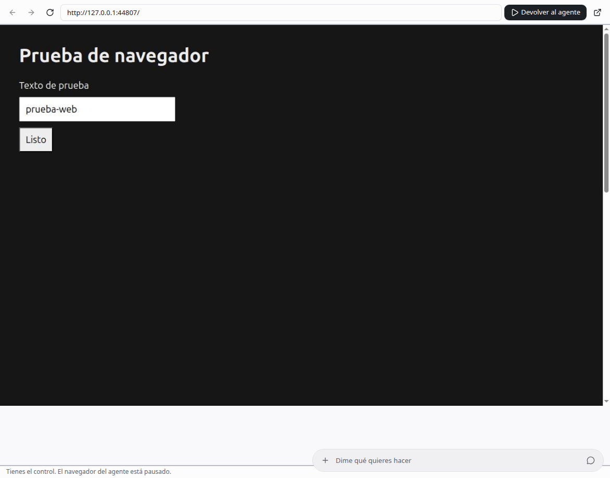
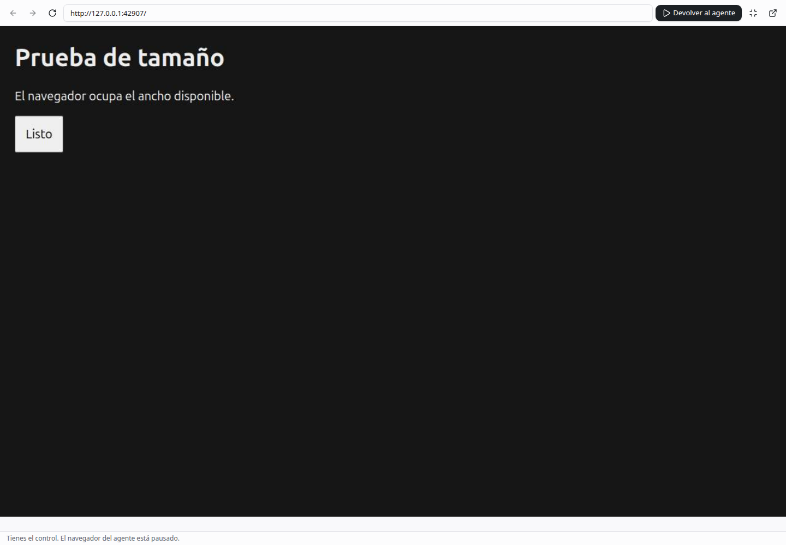

# Connected local web access

Feature: `desktopLocalWeb`, self-hosted only, default off. Owner: brianpadilla3072.

The desktop's **View → Ir a web** command previously opened its Electron/Vite renderer URL when no web server was available. A browser has neither the Electron bridge nor that renderer's connection state, so the page redirected to welcome. A renderer hash link is not a standalone authenticated web link.

With `DEN_FEATURE_DESKTOP_LOCAL_WEB=true` at desktop launch, each embedded server generation enables its static UI surface using the packaged app bundle. The command opens that server's URL and the current conversation using web path routing. There is no second engine, HTTP listener, history store or copied credential file. The page receives the existing client bootstrap through the existing static UI policy; it does not receive the host or owner token. Features requiring owner access keep their existing pairing/authorization checks.

The development launcher (`pnpm dev`, `pnpm dev:electron`, `pnpm dev:worktree`) supplies this flag as `true` when unset, so subsequent dev restarts retain browser access. Set `DEN_FEATURE_DESKTOP_LOCAL_WEB=false` to disable it explicitly. This default belongs only to `apps/desktop/scripts/dev-features.mjs`; packaged desktop and the feature registry remain opt-in. No host-specific port or profile is part of that default. Always use **View → Ir a web**, which discovers the live embedded server; a Vite URL is only the renderer. Changes to the web frontend require rebuilding `apps/app/dist`, since the connected web surface serves that bundle rather than Vite HMR.

The embedded server must bind to loopback. Wildcard/LAN binds are rejected. The packaged bundle receives an origin base for its relative assets and a versioned desktop-web bootstrap marker. The frontend uses web deployment behavior and connects to the page's own origin. Both the custom View menu, the native menu and the shell's getWebUrl use the same resolver. Without a ready connected web surface the command reports failure instead of opening a desktop renderer or an API JSON response.

To try it, build the app and server, launch Electron with the feature enabled, open a conversation and select **Ir a web**. Use the URL returned by that command rather than a development renderer URL. No machine-specific port, profile or workspace ID is embedded in this code. The flag must be explicitly enabled in the installation's launcher/operator configuration; the registry default remains off.

Turning the flag off removes this instance's desktop static web surface on subsequent requests without deleting histories or stopping the engine. It does not revoke the server's existing client credential or other independently configured self-host web surfaces. The desktop keeps working. No renderer connection credentials are added to URLs, logs or repository files.

Rust readiness: the root request, ready receipt and desktop bootstrap have Zod schemas in `apps/server/src/desktop-local-web.ts`; host/flag policy vectors live in `contracts/desktop-local-web/v1/policy.json`. Filesystem validation stays at the edge; host policy is pure. The chosen web root belongs to one embedded server's lifetime, not process-global state. The HTTP/bootstrap contract uses ordinary JSON. No new runtime dependencies were introduced; Rust equivalents are serde, url and filesystem access.

Validation: seven unit/integration server tests cover feature off/on, immediate disable, loopback-only policy, invalid/missing roots, relative assets, cross-site token suppression and enabling the existing embedded listener without starting an engine. Existing web origin tests pass. After restarting the real desktop with the feature enabled, its shell web URL resolver returned the current server's conversation URL. Chrome loaded that URL and its messages for 12 seconds, reloaded, and retained the conversation for another 12 seconds without welcome. The real openWebInBrowser action also returned success with the connected URL. Browser test profiles were closed and removed; the user's requested app/web window was retained. Linux was exercised; Windows/macOS execution remains unverified.

Design rules: P1 (report readiness accurately), P11 (retain the existing conversation). No new screen or visual component is introduced. Live conversation contents were not saved as public screenshots.

## Mobile PWA and tailnet access (operator configuration)

The existing manifest/standalone experience now includes a stable root identity/scope and real 192/512 PNG icons rendered from the existing brand vector. This restores installability; no new app screen, install prompt or offline cache is introduced (DESIGN P5, P11). The phone still needs the running desktop and Tailscale. A service worker is not required for installation in supported browsers; see [MDN's installability requirements](https://developer.mozilla.org/en-US/docs/Web/Progressive_web_apps/Guides/Making_PWAs_installable).

With `desktopLocalWeb` enabled, the embedded port defaults to **44129**. An operator may override it with `OPENWORK_DESKTOP_WEB_PORT` (integer 1–65535). Invalid values are rejected. An occupied required port reports `desktop_web_port_unavailable` instead of silently switching to a random origin. This also rejects the embedded adapter's bind-race fallback. With the feature off, the existing remembered/dynamic port selection remains unchanged. Port vectors under `contracts/desktop-local-web/v1/ports.json` are portable to Rust (serde integer validation); the only added runtime dependency is already-used Zod.

Every server generation activates the web root automatically, including renderer-triggered startup when initial bootstrap has no local workspace. This matters for phones: enabling it only in the boot-workspace path left a real restart returning 404. Verification after the fix returned 200 **before** any call to getWebUrl or Ir a web.

Keep the embedded listener on loopback. Use [Tailscale Serve HTTPS](https://tailscale.com/docs/features/tailscale-serve) so the phone's browser sees a trusted secure context:

```sh
# Installation default; if overriding the backend, update the target accordingly.
tailscale serve --bg --https=44129 http://127.0.0.1:44129
tailscale serve status
# Remove only this service; never reset other applications' Serve configuration.
tailscale serve --https=44129 off
```

Open **`https://DEVICE.TAILNET.ts.net:44129/`**, using the certificate name reported by Serve. No workspace or session ID is required: the root opens `/session`, then existing routing selects an available workspace. The root does not promise to mirror the currently selected desktop chat. Install from Chrome's install menu on Android, or Safari's Share → Add to Home Screen on iPhone. Installation itself is a phone-side user action.

The previous HTTP/IP TCP forwarder on this port was replaced by HTTPS for installation. Plain HTTP on a tailnet IP is not a secure context. Keep other Serve listeners unchanged; this is tailnet-only Serve, not public Funnel. `--bg` persists the proxy, and the desktop now retains the fixed endpoint across restarts. No tokens belong in the URL or proxy configuration.

Live Linux verification: trusted TLS, HTTP 200 after actual relaunch, Chrome mobile emulation at 390×844 with no horizontal overflow, bootstrap present after wait/reload, and zero errors from `Page.getAppManifest` and `Page.getInstallabilityErrors`. Desktop layout also inspected at 1280×800. Chrome/profile/screenshots were temporary and removed; screenshots of real project names were not published. The phone's native installation UI, remote-device ACLs and Windows/macOS execution were not exercised. A stable URL alone can be a blank 404; check manifest/icon responses, secure context and bootstrap as well.

## Browser pane in connected web

The same `desktopLocalWeb` flag also enables the conversation's browser resource pane in connected local web. Its authenticated `/workspace/:id/browser/view` route validates workspace/session ownership before forwarding to the live desktop bridge. Frames come from the existing Electron tab; there is no iframe and no second browser login. An exact owned URL reuses its existing tab. Desktop must remain running. This does not import extensions or sessions from the user's external Chrome profile.

**Tomar control** pauses the agent's tab before accepting pointer, keyboard, paste, scrolling and navigation input. **Devolver al agente** revokes web input. Merely viewing frames never calls agent `observe` or replaces its element refs. Commands are serialized per session, bounded, and canceled before dispatch when the viewer disconnects. Hidden/inactive panes stop polling. Captures are JPEG, bounded to 1600×1000, and requested approximately every 1.2 seconds after the preceding response; this is a periodically refreshed view, not video or a complete remote desktop. Mobile currently uses the existing conversation layout without the resource pane.

Shared request/receipt schemas live in `packages/types/src/browser-web-view.ts`, with synthetic JSON vectors in `contracts/browser-web-view/v1/`. The controller has injected I/O and per-instance queues; Rust can implement the same JSON protocol with serde, a session queue and a native webview capture/input adapter. Relaunch path restoration has separate vectors under `contracts/desktop-relaunch/v1/`; it pins the original profile before restarting so the embedded server's child environment cannot select a nested desktop profile. No history is copied or migrated.

Live validation on Linux used the actual desktop tab plus a separate headless web viewer and a synthetic local site. Real CDP pointer/keyboard input opened the web resource, took control, entered `prueba-web`, pressed the fixture button, verified the native DOM, and returned control. All temporary sessions, native tabs, viewer processes and fixture listeners were removed afterward. Windows/macOS execution and mobile pane support are not claimed.

The browser pane reuses the current resource view and toolbar components (DESIGN P1, P11). The screenshot below contains only the synthetic fixture pane, with no conversation or account content.



The web frame now fills the pane width even when Electron returns a smaller capture, retaining its aspect ratio. **Ampliar navegador** uses the browser's native fullscreen surface; its exit button returns to the conversation. Normalized input coordinates remain relative to the rendered image. DESIGN P5/P11: existing toolbar Button/icons and browser fullscreen behavior are reused. Live split-pane validation measured 586 px of frame in 586 px of available width, then 1440 px in fullscreen, and verified a click in the native fixture after resizing. App typecheck and production build passed.


