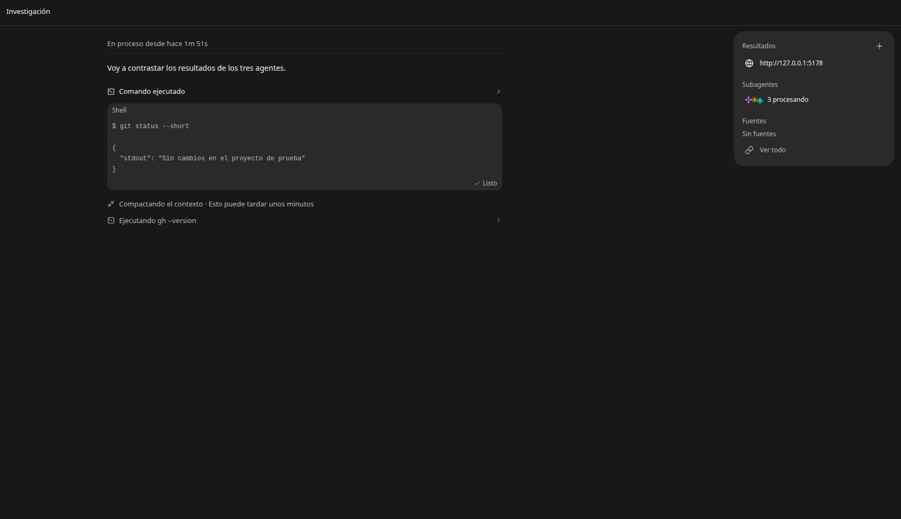
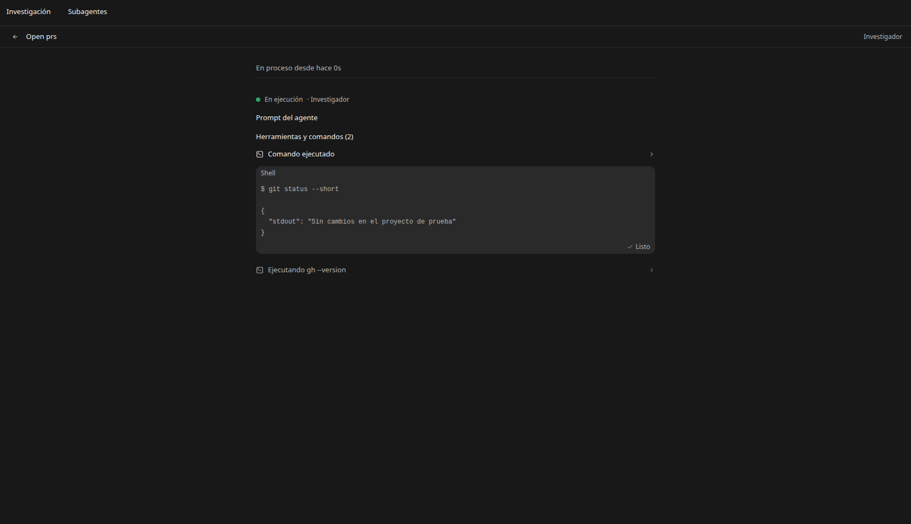
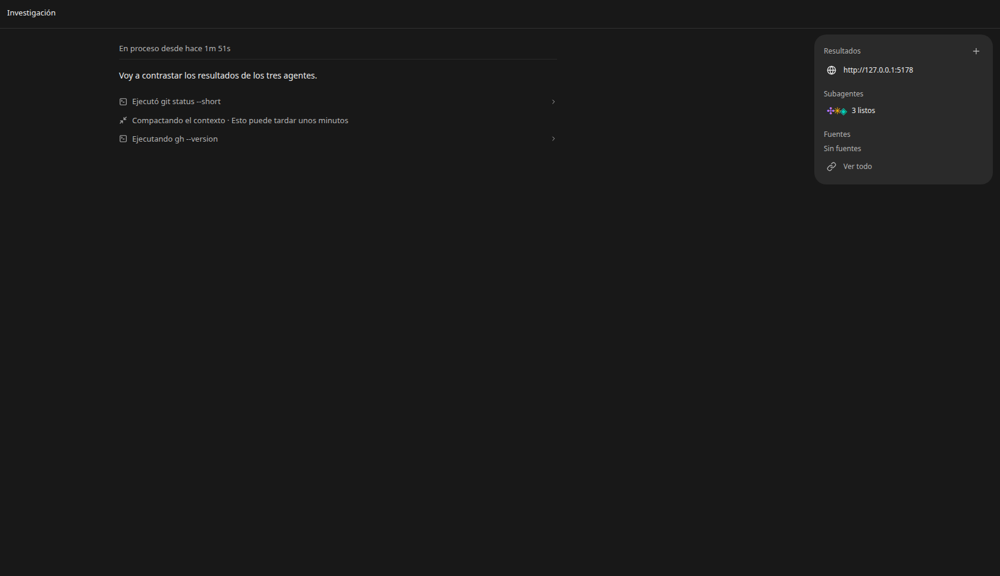

# Actividad de agentes en el chat

Implementación de la referencia visual del usuario: actividad en líneas compactas, detalles de comandos y subagentes en la tarjeta derecha. Se conserva OpenCode como dueño de la ejecución y se reutilizan los registros, estados y herramientas existentes. No se añade otro orquestador.

## Comportamiento

- El turno activo muestra «En proceso desde hace…» encima de su respuesta. El tiempo usa el inicio y las esperas que ya conoce el chat; una conexión sin confirmar muestra reconexión.
- Las herramientas locales muestran icono, verbo y comando/archivo/búsqueda. Abrir una fila muestra el comando, su salida y el estado. Los resultados extensos se formatean al abrir, con desplazamiento dentro del detalle.
- Los subagentes conservan sus filas y acciones del historial, con texto compacto de inicio/finalización, espera o fallo.
- La tarjeta derecha incorpora **Subagentes** entre Resultados y Fuentes: marcas de identidad estables dentro de la lista y recuentos como «3 procesando», «3 listos», «1 con errores» o «sin confirmar».
- Su resumen abre la pestaña **Subagentes** del chat propietario. Abrir un agente consulta únicamente su historial; muestra estado, tiempo, modelo si el motor lo informó y comandos desplegables. El prompt queda cerrado inicialmente. Volver conserva la lista; también se conserva el acceso existente a la conversación completa.
- La pestaña se reutiliza por conversación. El historial no se guarda en el almacenamiento de pestañas; las consultas se separan por endpoint, identidad y conversación. El seguimiento se detiene al ocultar la pestaña y al finalizar el trabajo conocido.
- «Compactando el contexto» usa el estado nativo. El recibo «Contexto compactado» se registra con `session.compacted`; terminar un indicador no acredita éxito por sí solo. Una respuesta nativa marcada como resumen y completada permite reconocer la compactación desde el historial cuando ese motor la conserva. No se atribuye automáticamente un origen manual o automático que el motor no informó.

La disposición y las filas nuevas usan `comexWorkspace`. El mapa previo mantiene su control `agentActivityMap`. Se reutilizan Button, Collapsible, Dialog y el seguimiento nativo (DESIGN P5, S3, P6, P11); los datos y estados no se simulan en la aplicación (P1), y las vistas se abren por una acción de la persona (S5).

## Verificación y límites

- TypeScript de la aplicación sin errores.
- Ocho pruebas de estado: final de compactación confirmado, aislamiento y reutilización de pestañas de agentes, además de las pruebas de recursos existentes.
- Navegador headless con componentes reales y estados de prueba: tres trabajando → tres listos → estado sin confirmar; apertura de pestaña; consulta solo del agente elegido; vuelta a la lista; tiempo y compactación; comando/salida desplegables y serialización diferida del resultado.
- Las capturas son montajes de componentes con fixtures y encabezado de prueba. No acreditan una ejecución real de investigación. No se enviaron mensajes, comandos de investigación ni agentes, ni se generó un instalador.
- El ejecutor Bun de las pruebas antiguas no está disponible en este entorno. Se usaron las pruebas de estado con el cargador TypeScript existente y la verificación de navegador indicada.

