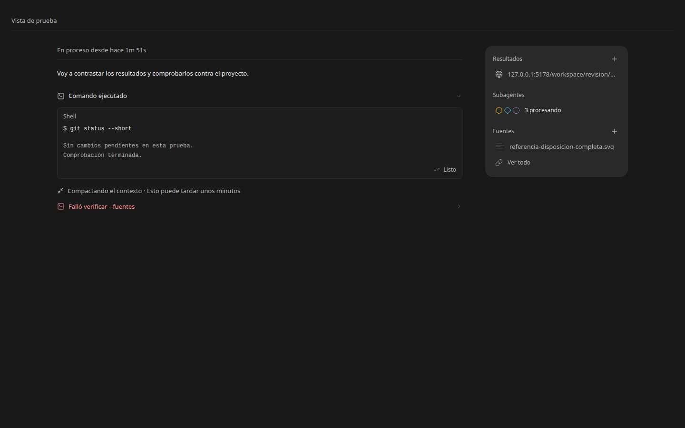
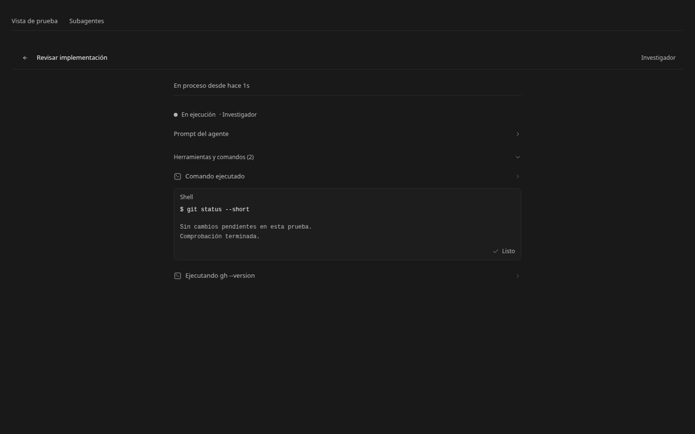
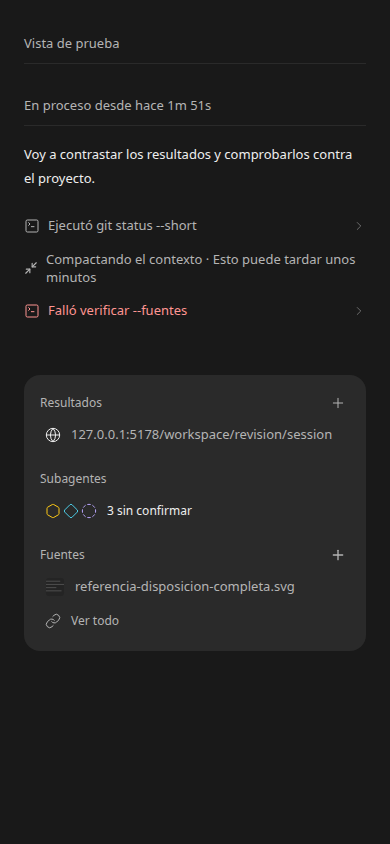

# Pulido visual — 11 de noviembre de 2026

La tarjeta Resultados/Subagentes/Fuentes usa una jerarquía, alturas de fila y separación uniformes. Miniaturas y destinos largos conservan su espacio sin ampliar la tarjeta. Las marcas vectoriales de los agentes se mantienen por identidad entre la tarjeta, la lista y el historial. Los estados extensos pueden ocupar varias líneas.

Los detalles de comandos separan entrada y salida, mantienen el resultado plegado hasta abrirlo y muestran el estado al pie. Los errores tienen un tono propio y los controles desplegables tienen foco visible. La cabecera de agentes permanece visible al recorrer su actividad; la carga ocupa la geometría de la lista y respeta movimiento reducido.

Se conserva el funcionamiento y los controles de las funciones existentes. Se aplicaron DESIGN P5/P6, S3, V1/V2/V4/V5/V6. No se cambiaron ejecución, permisos ni herramientas.

Verificación: TypeScript y revisión en navegador headless de los componentes reales con fixtures. Se comprobaron vista de escritorio, ancho de 390 px sin desbordamiento horizontal, separación de comando/salida, menú anidado, vista previa de imagen, detalle y vuelta a la lista de agentes, y estado sin confirmar. Las capturas son muestras aisladas, no conversaciones ni investigaciones reales; no se enviaron mensajes ni se ejecutaron herramientas.

