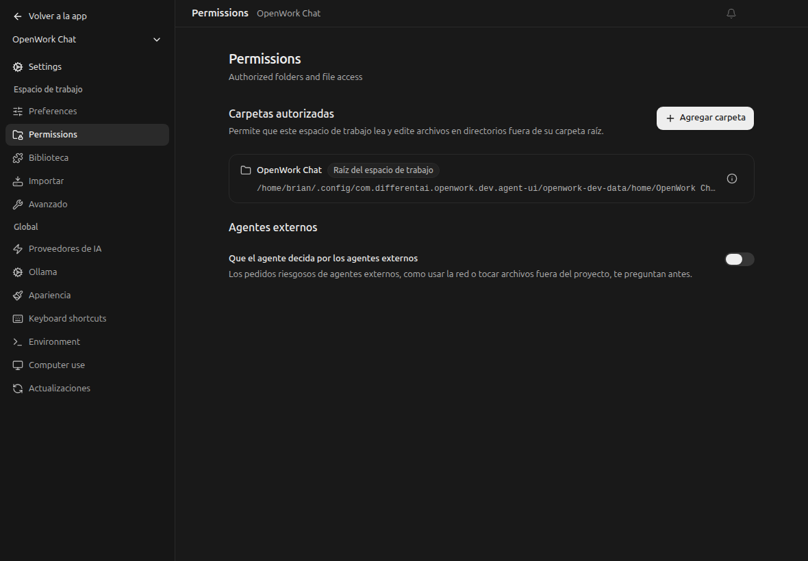
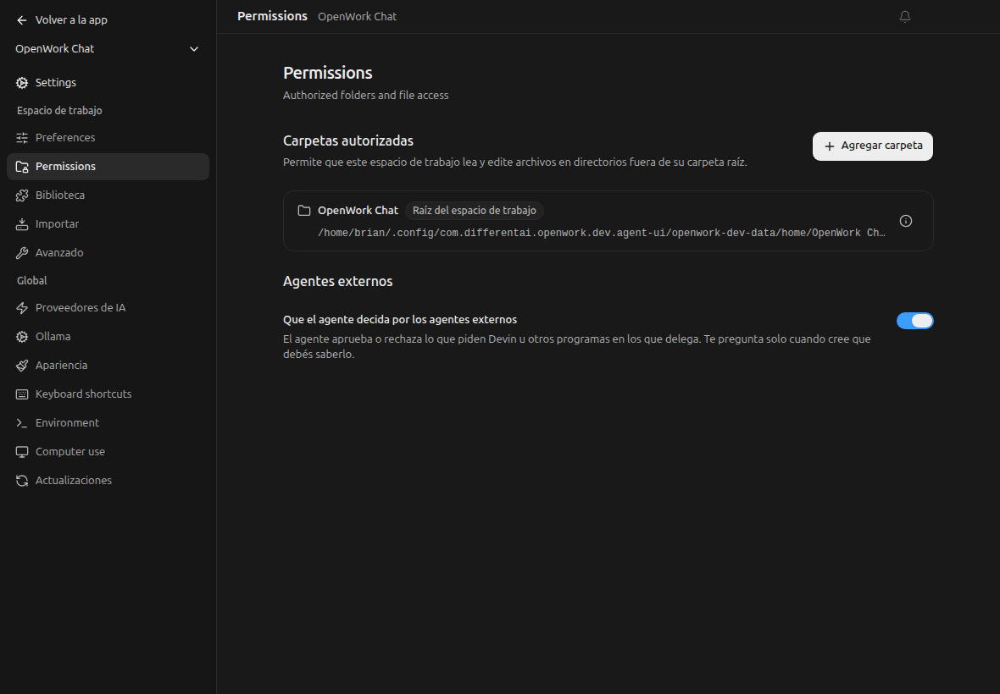

# Delegar tareas a agentes CLI externos (`externalDelegates`)

- **Flag:** `externalDelegates` · **Deployments:** `self_hosted` · **Default:** apagado · **Autor:** brianpadilla3072
- **Encender localmente:** `DEN_FEATURE_EXTERNAL_DELEGATES=true`

## Qué cambia

OpenCode puede **aprender a usar otro agente de línea de comandos** (Devin CLI, Codex,
Aider, Gemini CLI o cualquier CLI), probarlo, guardar una *receta* y después **delegarle
tareas**. No hay un motor nuevo: OpenCode sigue siendo el único que razona, y el otro agente
es una herramienta más. Todo corre en la computadora, sin servicios externos de OpenWork.

Si se le pide "descubrí cómo usar devin cli", el agente:

1. Lee la guía (`delegate_guide`), busca el programa y su versión (`delegate_probe`).
2. Lee `--help` y la ayuda de los subcomandos (y la documentación web si hace falta).
3. Si hace falta un login o un asistente de primer uso, lo maneja en una terminal real
   (`term_open` / `term_read` / `term_send` / `term_wait`). Las claves y los códigos los pide
   a la persona.
4. Prueba un comando no interactivo con una tarea trivial, corrige los flags y repite.
5. Registra la receta (`delegate_register`). **La persona lo aprueba.**
6. Delega con `delegate_start` y sigue la tarea con `delegate_status` / `delegate_result`.
   Por defecto el agente externo trabaja en un **git worktree aislado**. El resultado trae la
   respuesta, los archivos cambiados, un diff resumido, la ruta del worktree y el id de
   sesión (para continuar con `sessionId`).

## Permisos, preguntas y seguimientos

El agente externo puede pedir permisos o hacer preguntas a mitad de la tarea. Esos pedidos los
maneja el agente que delegó (OpenCode), y lo riesgoso te llega a vos.

- **Estado `needs_input`:** `delegate_status`/`delegate_result` devuelven `pendingInput`:
  - `permission`: qué herramienta, qué comando, qué archivos y las opciones que ofrece el agente.
  - `question`: el texto de la pantalla o de la salida.
- **`delegate_reply`** responde de una de estas formas:
  - `decision: allow | allow_always | reject` decide un permiso.
  - `ask_person` deriva la decisión a la persona.
  - `text` responde una pregunta o manda un seguimiento.
  - `done` da por terminado un programa que quedó esperando.
- **ACP (`kind: "acp"`, recomendado):** usa el Agent Client Protocol por stdio.
  - Los permisos llegan como `session/request_permission`.
  - La sesión queda abierta 30 minutos para seguimientos, que van con `delegate_reply` `text`.
  - Se retoma con `sessionId` (`session/load`) cuando el agente lo soporta.
  - `acpMode` elige el modo de sesión.
- **Pedidos en paralelo:** si el agente pide varios permisos a la vez (herramientas en paralelo),
  quedan en cola. `pendingInput` muestra el primero y `queuedPermissions` cuántos esperan detrás.
  Ninguno se pierde.
- **Retomar con `sessionId`:** sigue trabajando en el mismo worktree, con los cambios que ya hizo.
- **Política (`permissions`), por tipo de herramienta ACP:**
  - `allow` responde que sí sin preguntar. Por defecto: read, search, think, edit, move.
  - `agent` lo decide el agente que delegó. Por defecto: execute, delete, switch_mode, other.
  - `person` lo decide la persona. Por defecto: fetch.
  - `deny` responde que no.
- **Siempre van a la persona,** diga lo que diga la política:
  - las rutas fuera de la carpeta de la tarea;
  - los comandos con red, privilegios o publicación (`curl`, `ssh`, `sudo`, `git push`, `npm publish`, `docker`, `rm -rf /` …).
- **Hosts sin diálogo nativo:** con aprobaciones automáticas (`auto`) nadie ve el pedido, así que
  lo que va a la persona se **rechaza**. Con `manual` va a la cola de aprobaciones.
- **Terminal (`pty`):** si la pantalla queda quieta `idleSeconds` sin `doneText`, la tarea pasa a
  `needs_input` con la pantalla, en lugar de darse por terminada.
- **`cli` con `keepStdinOpen`:** si no hay salida durante `idleSeconds`, pasa a `needs_input` y la
  respuesta se escribe en stdin.
- **Comandos como texto:** `delegate_probe` y `term_open` aceptan `"devin --help"` además del
  array. Si el texto tiene comillas o símbolos de shell, se rechaza y se pide el array.

## Quién decide (menos preguntas)

El modo se guarda en el archivo de recetas (`settings.decider`). Las herramientas del agente no
pueden cambiarlo.

| Modo | Qué te pregunta |
| --- | --- |
| `person` (por defecto) | Una sola vez por programa: "¿dejar que el agente aprenda a usar y use X?". Queda recordado entre reinicios (`approvedPrograms`) y cubre también el registro. Además, cada permiso riesgoso. |
| `orchestrator` | Nada. El agente que delega decide todo, incluidos los permisos riesgosos: le llegan como `needs_input` con `reason` `risky_command` u `outside_folder` y puede usar `ask_person` si cree que debés saberlo. |

Para cambiarlo:
- En la app: **Ajustes › Permisos › Agentes externos › "Que el agente decida por los agentes
  externos"**. Solo lo puede cambiar el dueño (token del host); en la web sin acceso de dueño, o
  con el bloqueo del operador, se ve bloqueado con el motivo.

  | Apagado (por defecto) | Encendido |
  | --- | --- |
  |  |  |
- `PUT /delegates/settings` `{ "decider": "orchestrator" }`, con el token del host (dueño).
- Como bloqueo del operador: `OPENWORK_DELEGATES_DECIDER=orchestrator|person`, que tiene prioridad
  sobre lo guardado.

## Cómo está hecho

| Pieza | Dónde |
| --- | --- |
| Esquemas versionados y códigos de error | `apps/server/src/delegation/schema.ts` |
| Lógica pura: argv sin shell, escape para `cmd.exe`, búsqueda en PATH/PATHEXT, lectura de JSONL, pantalla VT100 | `apps/server/src/delegation/core.ts` |
| Procesos (pipes, PTY, kill del árbol de procesos) | `apps/server/src/delegation/process.ts` |
| Tareas, terminales, worktrees, aprobaciones y respuestas | `apps/server/src/delegation/service.ts` |
| Cliente ACP (JSON-RPC por stdio) | `apps/server/src/delegation/acp.ts` |
| Recetas guardadas | `<runtime>/delegates/recipes.json` (`delegateStore`, `version: 1`) |
| MCP local `openwork-delegates` | `apps/server/src/delegation/mcp.ts`, ruta `/mcp/delegates/:workspaceId` |
| Alta y baja de la entrada MCP en cada workspace | `apps/server/src/delegation/runtime.ts` |
| Contrato para otra implementación | `contracts/delegation/v1/vectors.json` |

- **Integración con OpenCode:** el server publica un MCP HTTP en loopback, con un token HMAC
  por workspace (el mismo patrón que los MCP administrados locales), y lo escribe en la
  configuración de MCP de cada workspace. Así sirve igual en el motor v1 y en el v2.
- **Recetas:** son globales a la instalación (describen programas de esta computadora). Tipos:
  `acp` (protocolo ACP, el preferido), `cli` (una ejecución no interactiva; salida `text` o
  `jsonl` con `resultField` / `sessionIdField`) y `pty` (se maneja en una terminal;
  `readyText`, `doneText`, `idleSeconds`). El prompt va como argumento (`{prompt}`) o por stdin. `resume` usa
  `{sessionId}`. `versionCommand` detecta actualizaciones: `delegate_list` marca `changed`.
- **Mac, Windows y Linux:**
  - Nunca se arma una cadena de shell: el argv se pasa tal cual.
  - En Windows se resuelven `PATHEXT` y los *shims* `.cmd`/`.bat` (como los de npm) se
    ejecutan con `cmd.exe /d /s /c` y el escape de `cross-spawn`. Un salto de línea en un
    argumento de un `.cmd` se rechaza (`delegate_argument_unsafe`); para esos programas el
    prompt va por stdin.
  - Terminal: en la app de escritorio, `node-pty` (ya incluido; ConPTY en Windows). En el
    server suelto, `script` en macOS y Linux. En Windows sin la app de escritorio no hay
    terminal (`delegate_pty_unavailable`); las recetas `cli` sí funcionan.
- **Seguridad:**
  - El agente externo no hereda las credenciales de OpenWork (`OPENWORK_*`,
    `OPENCODE_SERVER_*`, `DEN_*`).
  - Ejecutar un programa nuevo para descubrirlo y registrar una receta piden confirmación. En
    el escritorio es un diálogo nativo del proceso principal, que las herramientas del motor
    no pueden responder; en otros hosts va a la cola de aprobaciones del server.
  - Límites: 8 tareas y 8 terminales a la vez, y salidas recortadas.

## Probarlo

```bash
DEN_FEATURE_EXTERNAL_DELEGATES=true pnpm dev:agent up web   # o la app de escritorio
```

En un chat: "descubrí cómo usar codex (o devin) y delegale: agregá un test para X".

Tests: `node --import ./apps/server/test/setup/isolate-home.mjs --import ./apps/server/node_modules/tsx/dist/loader.mjs --test apps/server/test/external-delegates.test.ts`
(también corren en `pnpm test:comex` y con `bun test`).

## Verificado con Devin CLI (2026-11-20, Linux)

En la app de escritorio, con el modelo gratuito de OpenCode, se le pidió: "usá Devin; si tiene
modo ACP, preferilo; que agregue validación y tests y los ejecute".

1. El agente leyó la ayuda, registró `devin` como `kind: "acp"` (`["devin", "acp"]`, política por
   defecto) y lo probó con "Reply OK".
2. Devin editó `calc.py` y creó `test_calc.py` en el worktree, sin pedir permiso.
3. Para ejecutar `python3 -m unittest`, Devin pidió permiso. La tarea pasó a `needs_input`, el
   agente respondió `allow` (una vez, sin ampliar a "siempre" ni a "bypass") y los 5 tests pasaron.
4. El agente revisó el diff, trajo los cambios al proyecto y descartó el worktree.

## Al apagarlo (kill switch)

- En el próximo arranque del server se quita la entrada `openwork-delegates` de cada
  workspace, y la ruta responde `503 delegates_disabled`.
- Las tareas en curso se detienen cuando el server se cierra.
- Las recetas guardadas y los worktrees quedan en disco: no se pierde nada, y al volver a
  encenderlo se reutilizan.

## Qué vigilar

- Códigos de error en las respuestas de las herramientas: `delegate_*`.
- Worktrees que quedan sin descartar en `<runtime>/delegates/worktrees/` (ramas
  `openwork-delegate/*`).
- Límites conocidos:
  - La pantalla emulada cubre lo básico de VT100 (cursor, borrado, pantalla alternativa);
    TUIs muy elaboradas pueden verse imperfectas.
  - Todavía no hay adaptador HTTP (agentes solo en la nube).
  - Las preguntas libres que un agente ACP hace en texto llegan como fin de turno; se contestan
    con un seguimiento (`delegate_reply` `text`).
  - Todavía no hay una tarjeta dedicada en la UI: las tareas se ven como llamadas a
    herramientas MCP en el chat.
