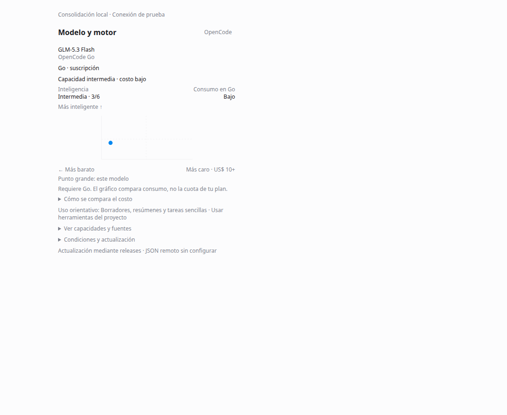
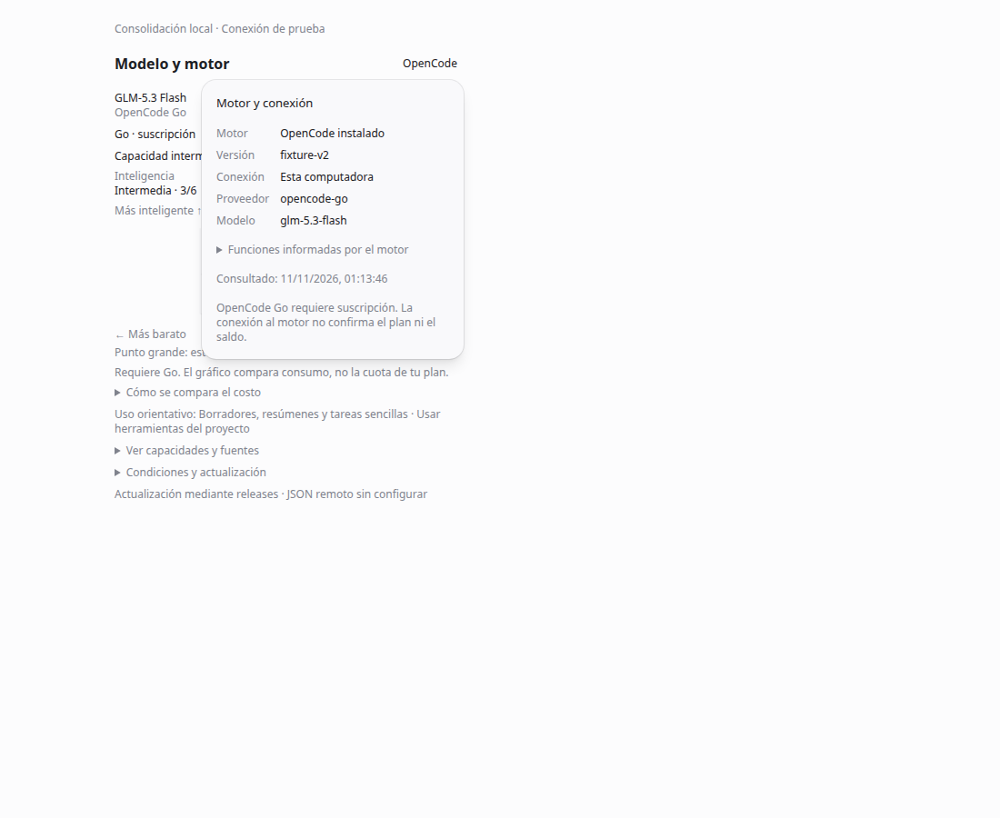
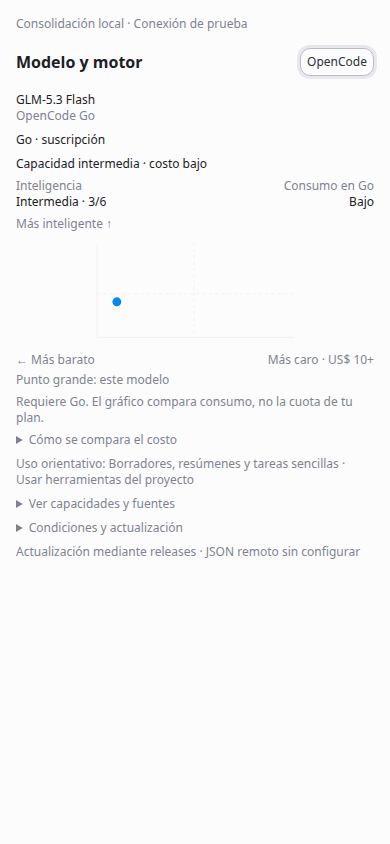
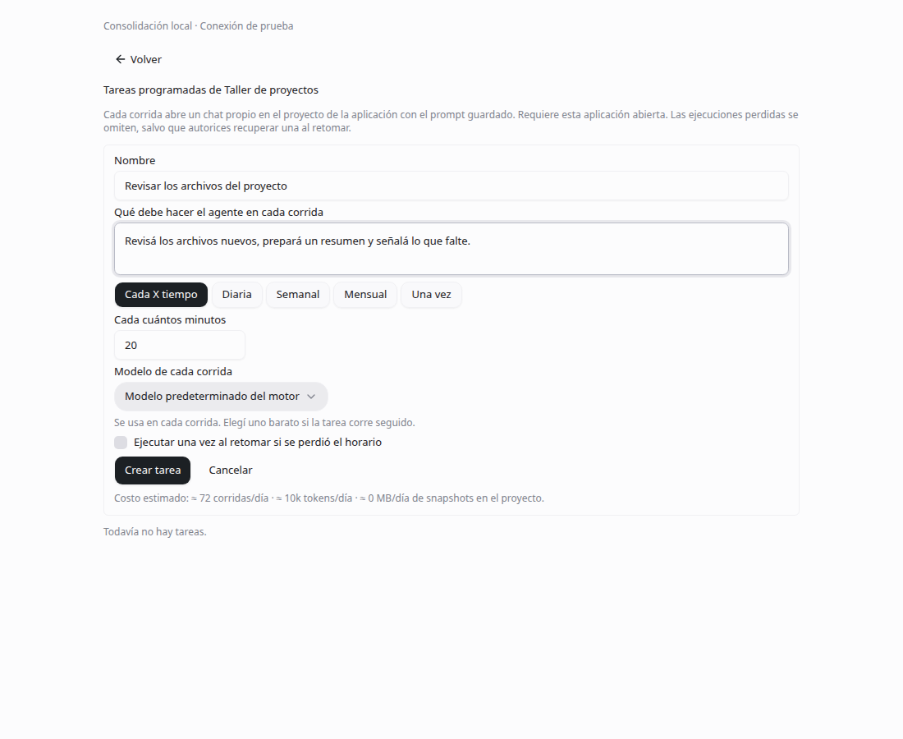
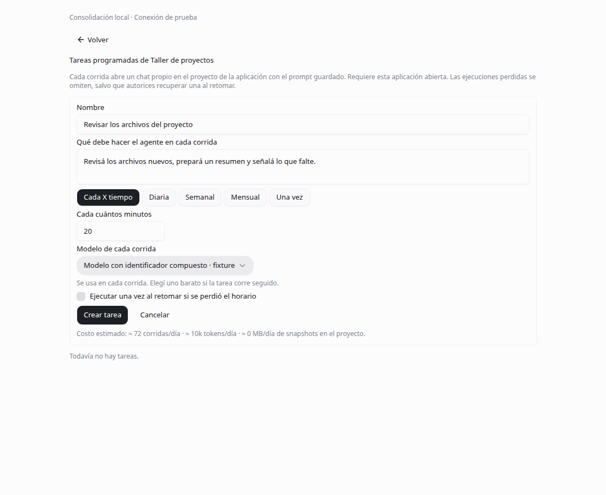

# Consolidación local de la aplicación

Autor: `brianpadilla3072`. Alcance general de agentes, skills y herramientas; los packs especializados no restringen el producto.

Las superficies reutilizan `comexWorkspace`, `comexModelGuide` y `scheduledTasks` (`self_hosted`, registro desactivado por defecto, distribución local con activación existente). No hay un segundo motor de ejecución. Apagar cada bandera conserva datos y recupera su superficie previa; apagar `scheduledTasks` bloquea nuevas admisiones sin borrar tareas ni chats ya creados.

## Alcance del proyecto

Abrir un proyecto general ya no instala el pack de Comercio Exterior ni le asigna esa temática en las instrucciones. La instalación explícita del pack y las actualizaciones de proyectos que ya lo tenían se conservan. La memoria y los resultados respetan las rutas existentes.

## Confiabilidad

Se completó el uso de `resolveRemoteDebugPort`: un build empaquetado no abre CDP sin un puerto explícito válido. Se rechazan sufijos, fracciones y valores fuera de 1–65535. El navegador nativo conserva su puente por conversación. La prueba del resolver no sustituye la prueba de un paquete instalado.

Las lecturas fallidas del historial tienen estado de error propio sin inhabilitar todos los chats del proyecto. Se conservan la paralelización y la eliminación de refetch redundante integradas previamente. El arranque ya no espera el backoff largo después del primer fallo.

Las imágenes locales cancelan escrituras DOM al cambiar de contexto, liberan blob URLs y reintentan hasta tres veces cuando un archivo aún se está guardando. Una promesa del chat anterior no puede cambiar la imagen del nuevo. Se mantienen los controles existentes de archivo regular, límite de tamaño y aislamiento por chat.

Los journals de recuperación y continuidad se leen por registro. Antes de reemplazar un conjunto parcialmente incompatible se conserva el original exacto en `recovery_quarantine`, en la SQLite local. No se imprime JSON, prompts ni objetos de error de parseo. La cuarentena no vuelve a ejecutar registros desconocidos ni migra historial de OpenCode.

## Motor, modelos y catálogo

El compositor ofrece **OpenCode** para consultar motor, versión, conexión y proveedor/modelo. La consulta es bajo demanda, no imprime URL ni credenciales y no afirma que Go esté activo. La versión es informativa: no se deduce soporte de funciones de un número de versión sin evidencia del motor.

Se conserva la lista con seis barras y ficha. La orientación de uso depende de la capacidad general y las funciones declaradas, con ausencia explícita de evaluación por tarea. No se publican nuevos benchmarks propios.

Catálogo r5: se agregaron 35 precios de coincidencia exacta proveedor/modelo consultados en `https://models.dev/api.json` el 11 de noviembre de 2026. Los formatos no reconocidos se conservan sin aplanar. Se preservan las evaluaciones previas. La fuente no reemplaza las condiciones de suscripción ni verifica la factura.

`model-catalog-review.yml` prepara propuestas diarias, con timeout/tamaño acotados, validación, tests e informe de diferencias. No modifica routing, identidad, fuentes editoriales de otro origen ni inteligencia; no autoaprueba ni fusiona. La app sigue usando el release incluido y la URL estática opcional. El workflow debe estar en la rama predeterminada y GitHub debe permitir crear PR con su token. En esta entrega no se ejecutó ni publicó ese workflow.

## Tareas locales

Tareas programadas reutiliza el planificador y editor existentes de la aplicación activa, sin iniciar sesión en Den. **Ver tareas de Den** conserva el acceso separado a las automatizaciones conectadas. Sin aplicación/proyecto ofrece crear los objetos existentes; no los crea automáticamente.

Cada ejecución usa una conversación nativa de OpenCode y los permisos del proyecto. No se copian transcripciones ni se instala un daemon. La app/servidor local debe permanecer abierto. El estado de ejecución se observa desde el motor; una respuesta completada con error no se registra como exitosa.

El formulario nuevo omite horarios perdidos por defecto (`catchUp: false`). Se puede autorizar **Ejecutar una vez al retomar**; las tareas anteriores conservan su comportamiento de consolidar las perdidas en una. Cada tarea muestra su política y permite cambiarla. La omisión se registra como `skipped_missed`, sin llamar al motor ni repetir recibos. El selector conserva IDs compuestos con `/`.

## Respaldo y mantenimiento

`scripts/local-backup.mjs` copia carpetas explícitas a un destino nuevo privado, usa snapshots SQLite que incluyen WAL confirmado, registra hashes y verifica antes de restaurar. La restauración prepara una carpeta nueva: no sustituye el perfil en uso ni credenciales protegidas por el sistema operativo. Ver [guía](../../maintenance/RESPALDOS.md).

`fork-maintenance.mjs` registra diferencias respecto al ancla upstream, detecta archivos no inventariados y prepara una revisión de release con intersecciones. El workflow semanal abre un PR de revisión, no fusiona ni ejecuta código ajeno. El inventario describe diferencias, no atribuye autoría. Una lista de comparación de GitHub con 300 archivos se marca como posiblemente recortada.

## Verificación y límites

Las capturas son de componentes reales en Chrome headless con conexión y respuestas de prueba, sin crear tareas reales, ejecutar inferencias o cambiar permisos. Se verificaron el formulario, modelo con ID compuesto, política de horarios perdidos, consulta de conexión, Escape y ancho 390 px sin desborde.

Las pruebas abarcan concurrencia SQLite real con dos hilos, journals parcialmente incompatibles y cuarentena exacta, carreras de imágenes, formatos de catálogo, respaldo/restauración/corrupción, scheduler y regresiones de chat. Resultados de esta corrida en `verification.json`. La consulta al motor nativo instalado no estuvo disponible durante esta verificación; no se ejecutó una comparación real entre modelos. Las pruebas de instalación Windows limpia, actualización instalada A→B y restauración de un perfil real permanecen pendientes y no se declaran aprobadas.

Diseño: P1, P3, P5, P10, S2, S5, S7, V1, V2. Se reutilizan Button, Popover, Checkbox, Select y el editor de tareas existente. El nivel no aparece como `/6` en las filas; su detalle permanece en la ficha accesible.

Fuentes de las correcciones seleccionadas de OpenWork: [6876](https://github.com/different-ai/openwork/pull/6876), [6481](https://github.com/different-ai/openwork/pull/6481), [6975](https://github.com/different-ai/openwork/pull/6975), [6987](https://github.com/different-ai/openwork/pull/6987), [6988](https://github.com/different-ai/openwork/pull/6988), [6097](https://github.com/different-ai/openwork/pull/6097), [7079](https://github.com/different-ai/openwork/pull/7079), [7068](https://github.com/different-ai/openwork/pull/7068), [7066](https://github.com/different-ai/openwork/pull/7066), [7105](https://github.com/different-ai/openwork/pull/7105), [7114](https://github.com/different-ai/openwork/pull/7114), [7082](https://github.com/different-ai/openwork/pull/7082), [7046](https://github.com/different-ai/openwork/pull/7046), [6852](https://github.com/different-ai/openwork/pull/6852). Se adaptan sobre el árbol actual; no se incorpora Den/EE para actualizar el catálogo.
