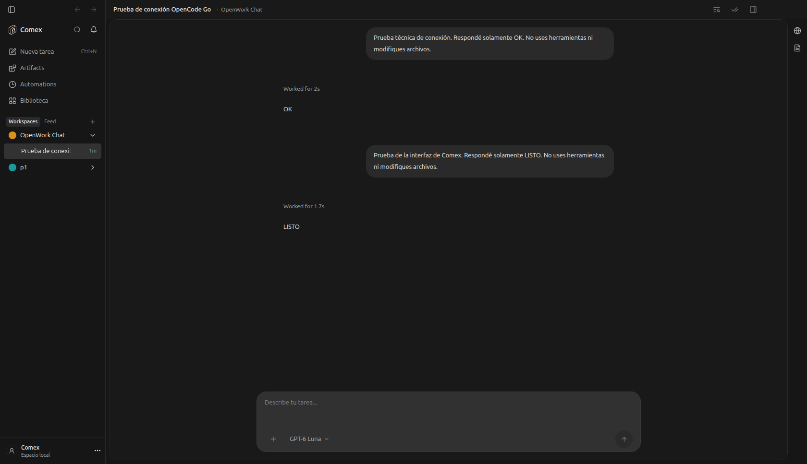

# Promociones de OpenWork

Flag: `openworkPromotions`. **Desactivado por defecto (`false`).**

Configuración del servidor de Comex:

```env
DEN_FEATURE_OPENWORK_PROMOTIONS=false
```

Cambiar a `true` permite las invitaciones de OpenWork Cloud, promociones de
modelos alojados y enlaces comunitarios. Reiniciar Comex después de cambiar
el entorno del servidor. El cliente consulta el valor autenticado cada 15 segundos.
Sin conexión o con configuración inválida, las promociones quedan ocultas.
Las preferencias antiguas del usuario no anulan este flag.

Con `false` se ocultan las invitaciones del encabezado y pie del chat,
los banners de registro y las promociones de modelos. El menú local conserva
ajustes y estado de conexión. Las cuentas de proveedores externos, como
OpenCode, siguen disponibles. No elimina licencias ni atribuciones del código.

Validación: pruebas del resolvedor con `true`, `false` y valor inválido; pruebas
React de cambios en vivo y preferencias antiguas. Verificado en Electron contra
el servidor real con `openworkPromotions: false` y una respuesta real del modelo.


