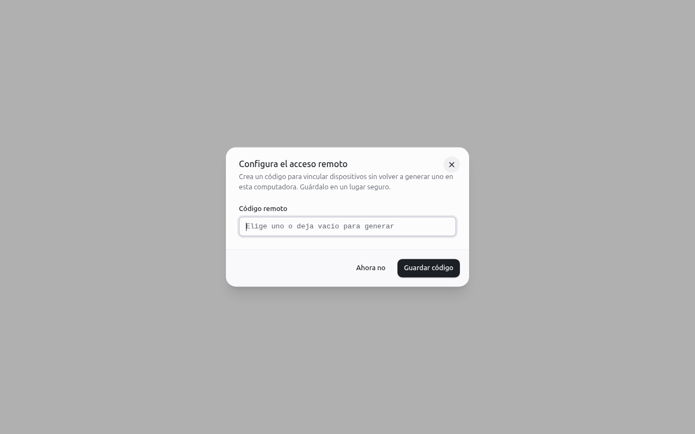

# Reusable remote pairing code (`remotePairingCode`)

Pair a new browser with an owner token without generating a fresh one-time code on the
desktop for every device.

## Behavior

On by default on self-hosted installs. Production starts without a code and asks the owner to
create one on first run; no reusable code is accepted until that setup completes.

- The reusable code stays valid until it is rotated or removed.
- Every redemption still creates a separate owner token labelled with the device name, so
  existing devices remain individually revocable.
- Only a salted `scrypt` hash is persisted. The plaintext code is returned once when it is
  created or rotated and is never logged.
- Failed guesses are globally throttled because a Tailscale proxy makes every request look
  like it comes from loopback.
- The existing five-minute, single-use code remains available.

## First-run screen

The desktop asks for a code only when no reusable or development code is available. It defers
the first-application dialog so the two setup steps never stack.



## Development default

`OPENWORK_DEV_MODE=1` alone never enables a known code. A development fallback exists only when
`OPENWORK_DEV_PAIRING_CODE` is explicitly defined and non-empty. The desktop dev launcher sets
it to `3570`; an absent or empty variable means no fallback, which lets eval worlds exercise
production behavior without disabling the rest of dev mode. Non-empty values are normalized to
uppercase alphanumeric. A stored reusable code always takes precedence over the development
fallback, and deleting it restores the explicitly configured fallback, if any.

## Turning it off

Set `DEN_FEATURE_REMOTE_PAIRING_CODE=false`, use the feature kill switch, or remove the feature
override. Redemption through the reusable code stops immediately. Already-issued device
tokens and the persisted hash remain intact, and the one-time pairing flow keeps working.
Re-enabling the feature restores the reusable code.

## Storage

`<configDir>/remote-pairing-code.json`, schema version 1. `OPENWORK_REMOTE_PAIRING_CODE_STORE`
can override the full file path:

```json
{
  "schemaVersion": 1,
  "algorithm": "scrypt",
  "salt": "base64",
  "hash": "base64",
  "createdAt": 0,
  "updatedAt": 0
}
```

The file is written with an exclusive temporary file, mode `0600` where supported, atomic
rename, and serialized mutations. It is removed by the desktop data-reset flow. Salts are 16
random bytes and derived keys are 64 bytes, both standard Base64. Hashing uses scrypt with
`N=16384`, `r=8`, `p=1`; comparisons are timing-safe. User-chosen codes are normalized to
uppercase alphanumeric and must contain 12–128 normalized characters. Generated production
codes contain exactly 16 RFC 4648 Base32 characters (`A–Z`, `2–7`).

The store fails closed: invalid JSON, an invalid schema, or any read error other than `ENOENT`
returns HTTP `409` with code `remote_pairing_code_store_invalid`. While it is corrupt, status,
redemption, and create/rotate do not accept a development fallback or overwrite the file.
`DELETE /pairing/remote-code` remains available to remove the corrupt file and restore the
configured fallback, if any.

`GET /pairing/status` reports only capability and source metadata, never the code.
`POST /pairing/remote-code` creates or rotates it and returns `{code, createdAt}` once;
`DELETE /pairing/remote-code` removes it. Both mutations require the desktop host actor, not a
paired owner token. Five failed reusable-code attempts block further reusable attempts for
five minutes in process memory; valid one-time codes remain available during that block.

## Try it

1. In **Settings › Advanced › Devices**, create or rotate the reusable code.
2. On another browser, open `/pair`, enter the code and a device name.
3. Repeat with another device: the same code still works.
4. Rotate the code: new redemptions with the old code fail; already-paired devices keep
   working until individually revoked.

A reusable code does not create a network tunnel. OpenWork must still be running and reachable
through HTTPS, for example through `tailscale serve`.
