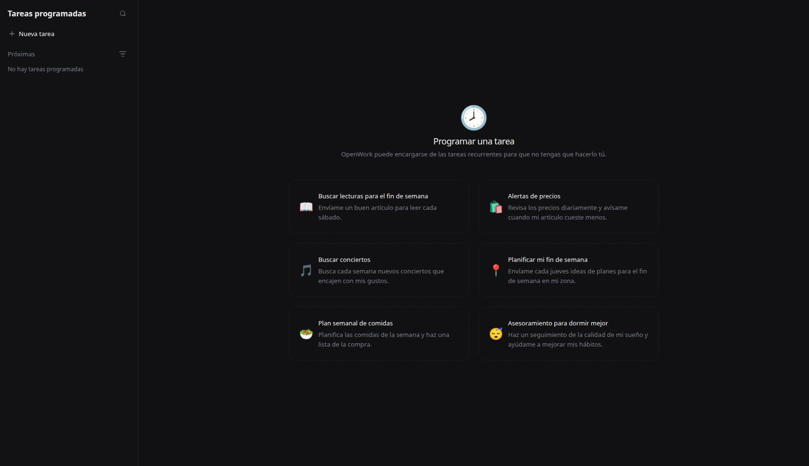
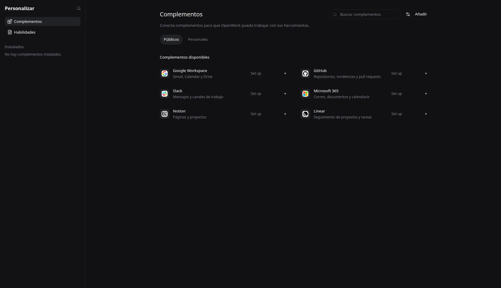

# Tareas programadas y Complementos

Ajuste visual solicitado el 6 de noviembre de 2026 a partir de dos capturas del usuario. Se aplica bajo el flag existente `comexWorkspace`; su nombre histórico no limita estas vistas a Comercio Exterior. Desactivarlo conserva las vistas anteriores.

Tareas programadas tiene lateral de 288 px, búsqueda desplegable, filtro de tareas activas, lista ordenada por próxima ejecución y seis ejemplos. Los ejemplos precargan nombre, instrucciones y horario mediante el contrato existente del editor. No crean ni activan tareas al seleccionarlos. Sin sesión, la acción de crear abre el acceso a la cuenta existente.

Complementos tiene lateral Personalizar con navegación a Habilidades e instalados, búsqueda, actualización, Añadir y configuración. Públicos muestra el catálogo disponible y el inventario existente; Personales limita el inventario a la sección propia. Los datos, permisos, conexiones y formularios siguen usando los servicios existentes. No se agregaron proveedores ficticios ni se instaló ningún complemento durante la revisión. El catálogo requiere su disponibilidad real en la cuenta.

Se reutilizan Button, Input, ExtensionCard, LibraryInventory y los formularios existentes (DESIGN P5), tokens de tema (V2), controles accesibles y la distribución solicitada. Las tarjetas con emojis y títulos con descripción siguen la referencia explícita del usuario.

## Verificación

- Typecheck completo de `apps/app` sin errores después de corregir el ordenamiento de timestamps.
- Chrome sin interfaz: selección del ejemplo de jueves a las 09:00, Nueva tarea, apertura de búsqueda, cambio a Personales, navegación a Habilidades y callback de configuración.
- Capturas a 1680 × 968 de los componentes reales montados en el servidor Vite. No son capturas del instalador ni pruebas de conexiones externas. Complementos usa seis filas de muestra exclusivamente en la captura para revisar la distribución; no se incluyen estos datos en producción.

## Tareas locales (11 de noviembre de 2026)

La entrada general ahora reutiliza el planificador local de la aplicación activa, detrás de comexWorkspace y scheduledTasks. No exige cuenta de Den; Ver tareas de Den conserva el flujo conectado aparte. Las nuevas tareas del formulario omiten horarios perdidos por defecto y permiten recuperar una vez al retomar. Las existentes conservan su política y pueden cambiarla. No hay otro motor: cada corrida es un chat OpenCode con permisos del proyecto. Ver [consolidación](../local-consolidation/README.md).
