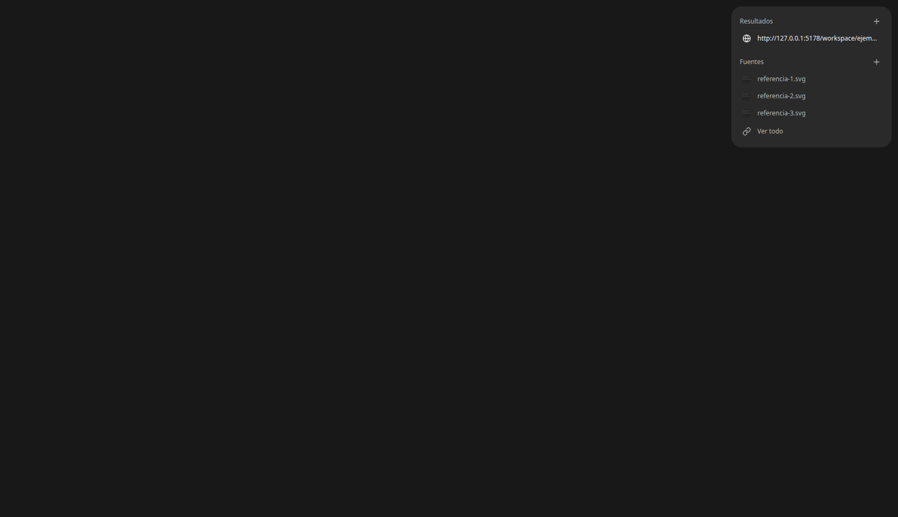
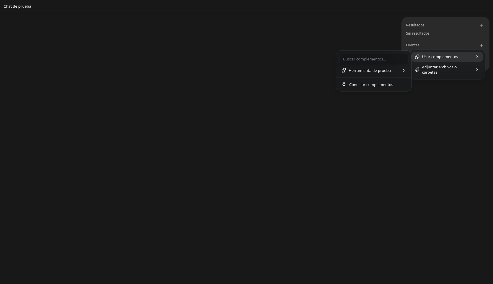
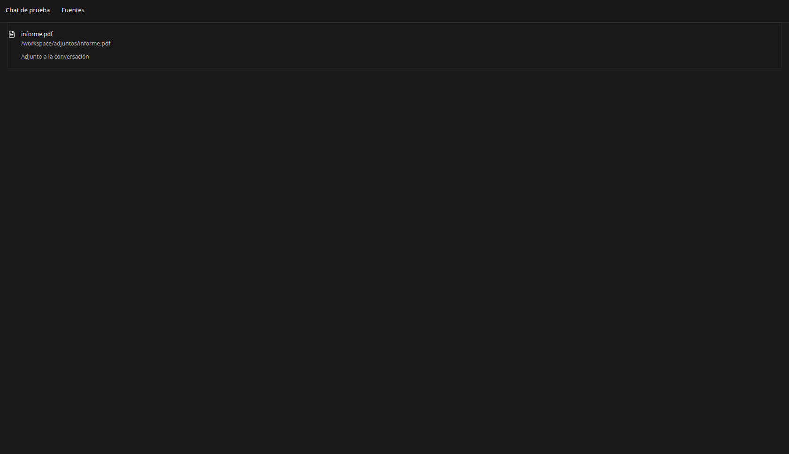

# Resultados, Fuentes y contexto del chat

La tarjeta compacta permanece a la derecha de la conversación, siguiendo la referencia del usuario. Usa el control existente `comexWorkspace`. Reserva 316 px cuando el espacio del chat tiene al menos 1100 px; se oculta al abrir el panel completo o dividir el chat. Las vistas estrechas conservan los adjuntos en el historial y el acceso existente a archivos.

Resultados reúne destinos verificados del historial y páginas abiertas en pestañas de esta conversación. Fuentes reúne archivos y enlaces aportados por el usuario; las imágenes adjuntas muestran miniaturas. No se agrega contenido del proyecto sin evidencia del chat. Cada grupo muestra hasta tres filas.

«Ver todo» abre una pestaña **Fuentes** en la barra común; reutiliza la de esa conversación si ya está abierta. Consulta el historial nativo completo del chat propietario, incluso al recargar o cambiar de conversación. Lista adjuntos, rutas disponibles y llamadas de herramientas registradas, con imágenes ampliables y destinos que conservan su chat de origen. Si una imagen solo conserva su URL de datos, se muestra como imagen adjunta sin inventar una ruta local. La caché se separa por conexión, identidad y conversación; los bytes del historial no entran en el almacenamiento de pestañas.

«+» en Resultados abre una pestaña de herramientas asociada al chat. «+» en Fuentes abre un menú:

- **Usar complementos**: submenú con búsqueda, plugins importados, conectores y skills disponibles. Los plugins ofrecen sus acciones insertables. La selección reutiliza las menciones, comandos y skills existentes del compositor; las conexiones que requieren autenticación usan su flujo existente.
- **Conectar complementos**: abre la administración de plugins existente.
- **Adjuntar archivos o carpetas**: permite elegir archivos o una carpeta. Sus archivos pasan al flujo existente de adjuntos del borrador; no se envían automáticamente ni se concede acceso permanente a la carpeta. Cada archivo se carga con la identidad única que ya usa ese flujo.

El menú de Fuentes se monta desde el compositor en el disparador de la tarjeta, conservando el mismo catálogo, carga y acciones del menú del compositor. No se mantiene otro catálogo ni otro ejecutor.

Se reutilizan Button, DropdownMenu y Dialog (DESIGN P5/S7), densidad compacta (P6), apertura explícita (S5) y divulgación de la lista completa (P3).

Verificación: TypeScript de la aplicación sin errores; seis pruebas de estado, incluida reutilización y separación de Fuentes por chat. Navegador headless con los componentes reales y datos de prueba: menú anidado, búsqueda sin resultados, acción de plugin, selección de carpeta, Escape, apertura de la pestaña sin diálogo, lectura del historial propietario mediante respuesta nativa simulada y apertura de un archivo conservando ese propietario. También se verificaron previamente separación de datos, límite de tres miniaturas y ampliación de imágenes. Sin subidas, mensajes, conexiones ni instalación de plugins reales. Las capturas son montajes de componentes con fixtures y encabezado de prueba, no una conversación productiva. No se generó instalador.

