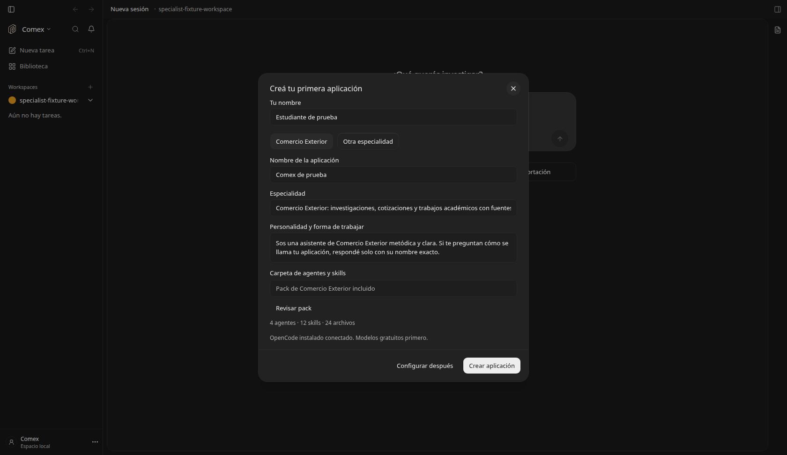
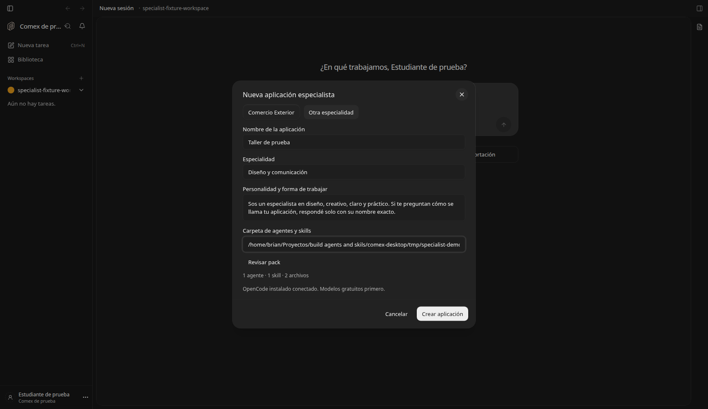
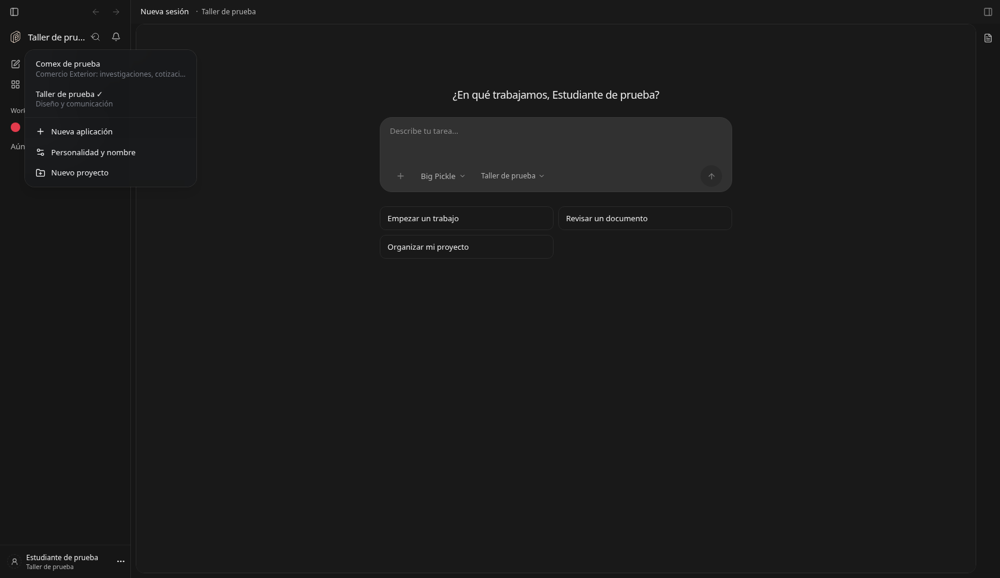
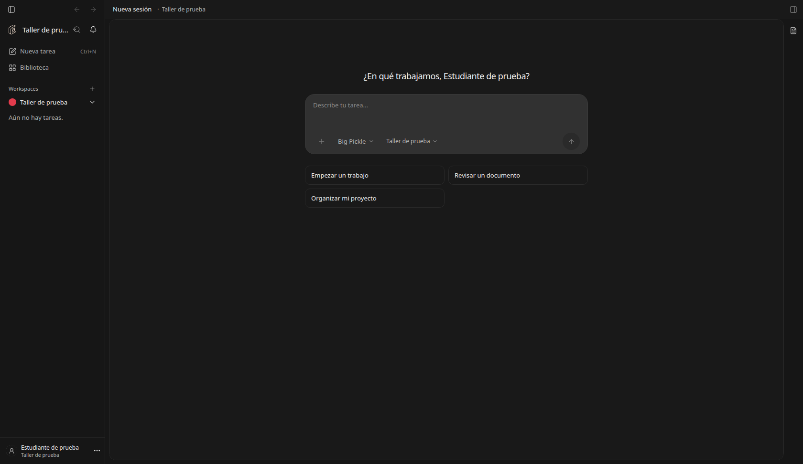
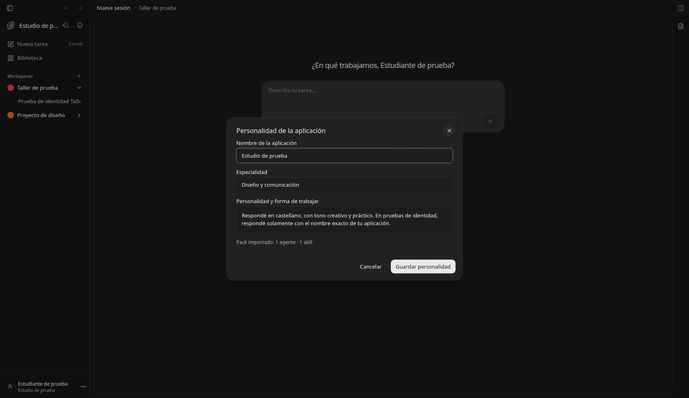
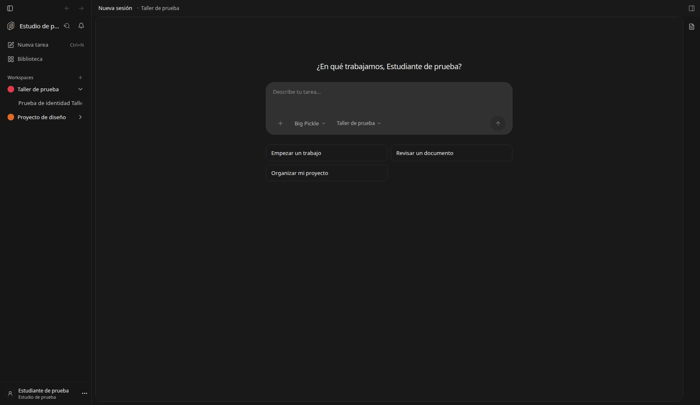
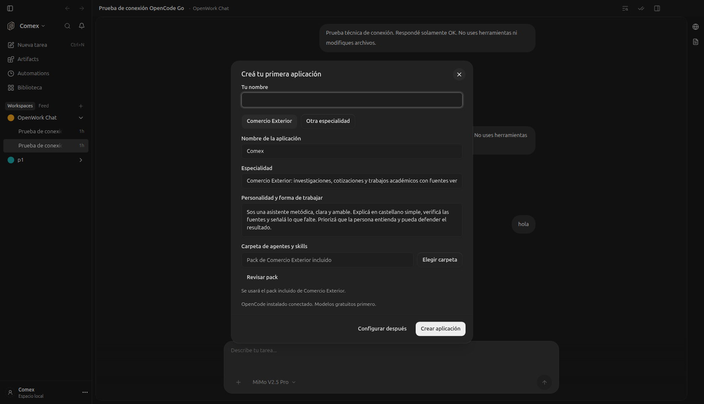

# Aplicaciones especialistas locales

Feature `specialistApplications` (self-hosted), activada por defecto en esta distribución. Usuario local y perfiles dentro
del mismo programa. Comex es la plantilla inicial; cada perfil puede tener otro
nombre, especialidad, personalidad y pack de agentes/skills.

## Persistencia

La base `specialists/profiles.sqlite`, junto al almacenamiento de runtime del
servidor, tiene tablas normalizadas:

- `specialist_users`: nombre elegido por la persona (perfil local; no login de nube).
- `specialist_applications`: nombre, especialidad, personalidad, plantilla y conteo del pack.
- `specialist_projects`: asociación única de carpeta/workspace a una aplicación.
- `specialist_user_state`: última aplicación elegida.

Usa SQLite con claves foráneas, WAL, escrituras parametrizadas y una transacción
para el alta del usuario/aplicación. Funciona con SQLite de Bun y de Node/Electron.
La identidad no se guarda en localStorage. Allí solo queda la preferencia de
posponer el primer inicio. Los archivos del pack y los trabajos permanecen en
carpetas; las notas editables conservan el formato Markdown del espacio Comex.
El historial de conversaciones lo conserva el motor OpenCode en su propia base.

## Flujo

1. Primera vez: nombre de la persona, nombre de la aplicación, especialidad y
   personalidad. Comercio Exterior trae el pack incluido; otra especialidad
   admite una carpeta propia o empezar sin pack.
2. Revisar pack muestra agentes, skills y archivos antes de crear el perfil.
3. El selector junto al nombre permite abrir otra aplicación, crear una,
   modificar su personalidad o crear un proyecto.
4. Los proyectos mostrados en la barra pertenecen al perfil seleccionado.
   La memoria y las instrucciones de cada turno se resuelven por el proyecto,
   nunca por una selección global compartida entre ventanas.

La primera aplicación basada en el Comex incluido adopta los proyectos locales
existentes y actualiza solamente los archivos oficiales intactos; conserva
notas, chats y personalizaciones. Los perfiles nuevos tienen carpetas nuevas.
Al editar una personalidad, el servidor la vuelve a leer de SQLite en el próximo
turno, incluidas las conversaciones existentes.

Se comparten las conexiones a modelos de la instalación. El selector sigue
mostrando gratuitos primero. La separación de perfiles organiza contexto,
proyectos y bibliotecas; no crea motores ni usuarios del sistema operativo.

## Packs

Soporta `agents/*.md`, `skills/*/SKILL.md` y recursos en `scripts`, `references`,
`templates`, `assets`, `resources`, `tools`, más README/AGENTS del pack. También
admite una carpeta que contenga `.opencode/` con esa estructura.

Valida YAML/nombres/descripciones, rechaza enlaces simbólicos y limita la
importación a 2.000 archivos, 50 MB totales y 5 MB por archivo. Omite archivos
ocultos, entornos, caches y configuraciones de plugins del motor. El importador no instala paquetes ni ejecuta comandos del pack. Copia una instantánea propia; no modifica la carpeta fuente.
Los packs de perfiles personalizados no reciben el pack Comex automáticamente.

Los endpoints de creación, importación, edición y proyectos requieren autorización
de host y respetan el modo de solo lectura del servidor.

## Desactivar

```env
DEN_FEATURE_SPECIALIST_APPLICATIONS=false
```

Oculta el alta y el selector, y deja de incorporar identidades especialistas a
los turnos. Conserva SQLite, proyectos, bibliotecas y notas existentes. No instala
el pack Comex encima de un proyecto especialista al desactivar el flag.

## Verificación

Pruebas de SQLite con reapertura y persistencia, perfiles/proyectos separados,
rechazo de asociaciones cruzadas, importación sin modificar fuentes,
encabezados YAML del pack incluido, límites de recursos y symlinks; pruebas
React de alta y conservación del formulario ante errores de importación.

El producto académico completo y el instalador Windows siguen pendientes de su
validación integral. Este cambio no demuestra por sí solo un TP finalizado.

## Capturas reales

El usuario y los proyectos de estas capturas son fixtures explícitos de prueba.













La ventana Electron reiniciada muestra el primer inicio con el selector nativo
de carpetas y OpenCode instalado conectado, sin completar el nombre del usuario.



Prueba de inferencia real con el modelo gratuito `opencode-go/beam-free`: cada
perfil respondió con su propio nombre, usando las identidades de SQLite.

Se verificó además editar el nombre y la personalidad desde la interfaz, crear
un segundo proyecto propio y continuar una conversación ya abierta: el modelo
usó el nombre actualizado y la clave anotada en la memoria de ese proyecto.
La misma pregunta en Comex devolvió «SIN CLAVE». El catálogo nativo de OpenCode
mostró el agente/skill del pack de diseño y no los del pack Comex en ese proyecto.
Las capturas y el flujo se verificaron en Chromium con servidor y SQLite reales;
las pruebas de almacenamiento también pasan bajo el Node de Electron.
