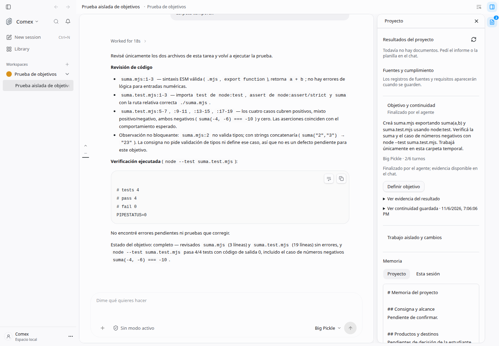
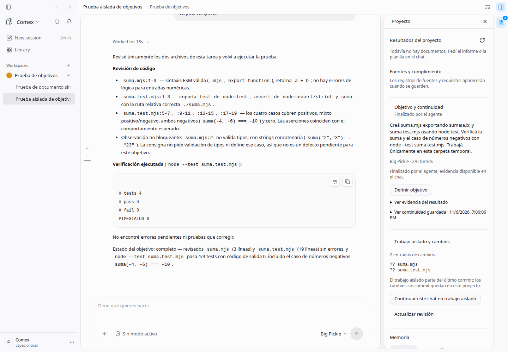

# Objetivos, continuidad y trabajos aislados

Feature: `taskContinuity`. Deployment: `self_hosted`. Author: `brianpadilla3072`.
Registro desactivado por defecto. La distribución de escritorio lo activa con el
operador existente (`DEN_FEATURE_TASK_CONTINUITY=true`); un `false` explícito gana.
La revisión Git usa además `comexGitWorkspace`, activada en esa distribución.

## Uso

En Proyecto, abrir «Objetivo y continuidad», definir el resultado, sus criterios y
un límite de 1–30 turnos. Iniciar autoriza las continuaciones con **Big Pickle**
(`opencode/big-pickle`). No hay sustitución automática por otro modelo. Pausar
impide los siguientes turnos; el botón Detener del chat además interrumpe el
turno nativo. Un resultado no confirmado, una falla, el límite de turnos o el
reinicio de la aplicación requieren retomar explícitamente. Las solicitudes de
permiso y preguntas siguen perteneciendo al motor y no se responden por el agente.

Cada turno completado guarda automáticamente un extracto atribuido del último
pedido y respuesta. El servidor lo vuelve a incorporar antes de admitir el
siguiente pedido, incluso después de cerrar el navegador o reiniciar. No es un
resumen semántico ni una lista de decisiones confirmadas. No reemplaza los
checkpoints manuales existentes ni sus conflictos de edición. Las credenciales
comunes se redactan; la memoria reside en SQLite local del servidor, nunca en un
servicio nuevo ni en el control plane de OpenWork.

El objetivo termina cuando la última respuesta completada del agente declara un
resultado con evidencia. La interfaz dice «Finalizado por el agente»: esa
conclusión no equivale a una certificación independiente. Si hay código cambiado,
se ejecuta un turno adicional de revisión. Los hallazgos pendientes vuelven a
implementación. Se detectan tanto diferencias Git respecto del inicio como
archivos de código reportados por los snapshots nativos, incluidos commits hechos
durante la tarea. Documentos e informes no activan revisión de código.

En «Trabajo aislado y cambios», el mismo chat puede pasar a un worktree creado
desde el commit revisado y volver al proyecto. Conserva su historial, objetivo y
memoria, anclados al proyecto original. Los cambios sin commit permanecen en la
carpeta de origen. La revisión muestra el código de la carpeta donde está
trabajando el chat; excluye informes y planillas. No se cambia de pantalla
automáticamente. Para cambiar de carpeta, pausar el objetivo y esperar que el
motor esté inactivo.

«Retirar trabajo limpio e integrado» rechaza modificaciones sin commit, commits
no integrados, worktrees bloqueados y carpetas usadas por cualquier conversación.
No usa `--force`, no elimina ramas ni hace merges. Los worktrees que no se pueden
retirar se conservan para recuperación.

## Implementación y límites

- Se reutilizan la API nativa de OpenCode v2 para modelo, mensajes y traslado, la
  autorización por hogar persistente y el dispatcher autenticado de OpenWork.
- Las continuaciones atraviesan las políticas y permisos habituales. La admisión
  queda registrada antes de enviarse; ante una respuesta incierta, se pausa sin
  repetir el envío. El reinicio conserva la tarea y exige retomar.
- La observación corre en el servidor cada tres segundos, solo para chats con
  objetivo activo o un turno pendiente de guardar. No requiere que el panel esté
  abierto. Se conservan hasta 1.000 conversaciones; hasta 80 mensajes recientes
  por observación y 6.000 caracteres por extracto.
- Las escrituras del controlador se serializan y las ediciones llevan revisión.
  Un proceso de escritorio es dueño del journal; no iniciar dos servidores con la
  misma base de ejecución. Se comprueba que un cambio concurrente no resucite una
  tarea pausada.
- Desactivar la feature impide nuevas continuaciones y oculta su panel, sin
  borrar memoria, historial, código ni worktrees. Los turnos ya admitidos quedan
  bajo el control nativo del motor.
- El servidor necesita seguir abierto para observar y admitir turnos. Esto no
  agrega un servicio que funcione con la computadora apagada.

## Investigación

- [Objetivos en Codex](https://developers.openai.com/cookbook/examples/codex/using_goals_in_codex): objetivo durable y criterios de terminación.
- [Plugins y sesiones en OpenCode](https://opencode.ai/docs/build/plugins/server): operaciones nativas y límites de admisión.
- Esquema `/openapi.json` del OpenCode instalado: verificados `session.prompt`,
  `session.switchModel`, `session.move`, historial, actividad y permisos. Se usa
  este contrato real en vez de asumir compatibilidad con hooks de OpenCode v1.
- [Git worktree](https://git-scm.com/docs/git-worktree): listado porcelain y
  eliminación sin forzar, conservando trabajo que todavía no esté integrado.

## Verificación

Con Node 24, ejecutar desde la raíz:

```sh
node --conditions=development --import ./apps/server/node_modules/tsx/dist/loader.mjs --test apps/server/test/task-continuity.test.ts apps/server/test/comex-git.test.ts apps/server/test/comex-git-routes.test.ts
TSX_TSCONFIG_PATH=apps/app/tsconfig.json node --conditions=development --import ./apps/server/node_modules/tsx/dist/loader.mjs --test apps/app/tests/task-continuity.test.tsx
node --conditions=development --import ./apps/server/node_modules/tsx/dist/loader.mjs scripts/task-continuity-proof.mts
```

El último comando requiere un servicio OpenCode local con Big Pickle, crea solo
un proyecto y chat de prueba nuevos y ejecuta inferencia real. Conserva su
carpeta temporal para inspeccionar los archivos. No altera los chats existentes.
La ruta del servicio puede configurarse con `OPENWORK_COMEX_OPENCODE_SERVICE_FILE`.
Resultado y afirmaciones verificadas: [native-proof.json](native-proof.json).

Reglas de diseño aplicadas: P1, P3, P5, P8, P10, P11, S1, S3, S5, C1 y C6.





Validación registrada el 6 de noviembre de 2026: 30 pruebas de servidor y Git,
3 de interfaz y credenciales locales, sin fallos ni omisiones; typecheck del
servidor y de la aplicación correctos. La prueba nativa con Big Pickle verifica
código con revisión, informe sin revisión, reinicio y traslado del mismo chat.
La aplicación completa se comprobó en Chrome sin ventana contra el servidor
real; se corrigió la pérdida de la credencial de host al resolver el cliente
del proyecto y se comprobó que no se envía a servidores remotos. El traslado
nativo se verifica con relectura acotada porque su confirmación es asíncrona.
Registro de features y esquema de Helm sincronizados; el render del chart no
se ejecutó porque Helm no está instalado. Detalle: [verification.json](verification.json).
