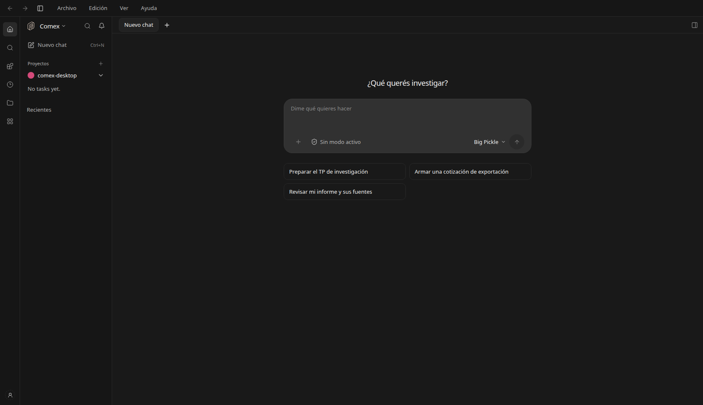
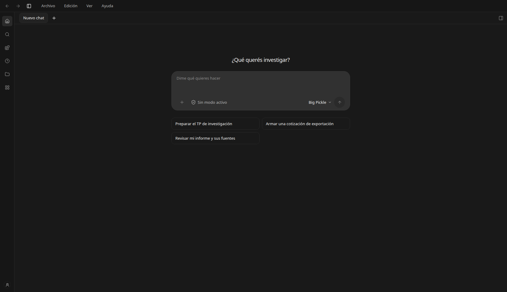
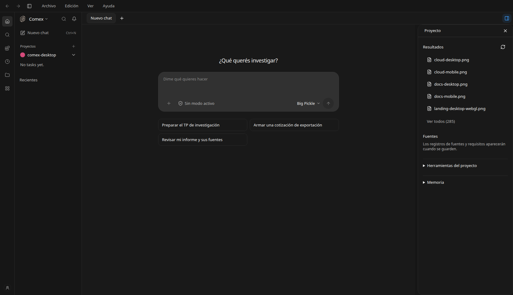
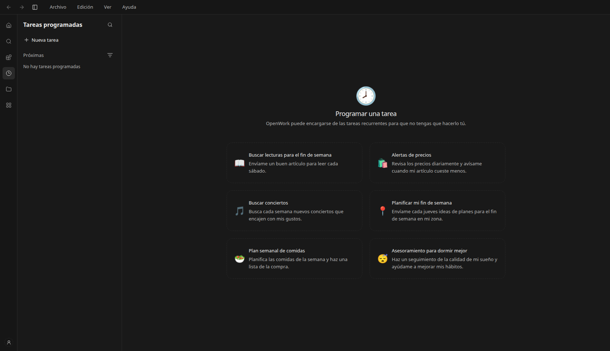
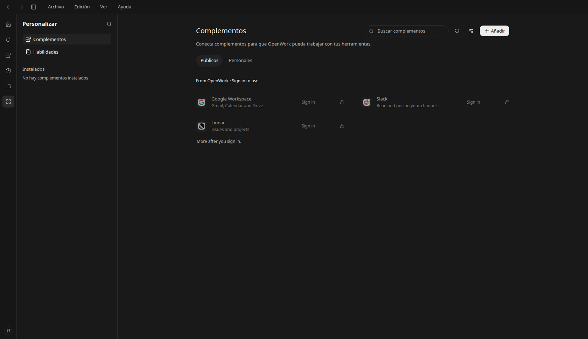
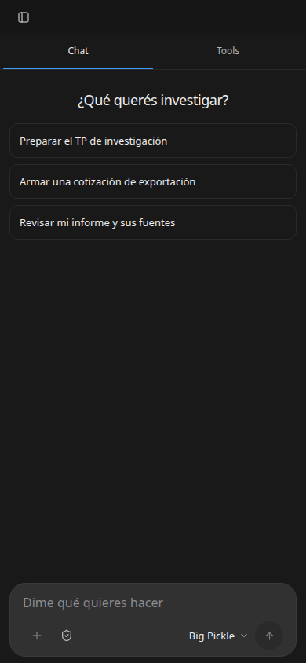

# Navegación y disposición del espacio de trabajo

Cambio solicitado el 6 de noviembre de 2026 a partir de las referencias visuales del usuario. Alcance general para agentes, herramientas y skills. Se reutiliza el control local existente `comexWorkspace`; su denominación histórica no restringe el producto a Comercio Exterior.

## Comportamiento

- Columna de iconos permanente de 48 px en escritorio, con cuenta al pie. Contraer el panel contextual conserva los accesos. Proyectos recupera el árbol desde cualquier sección.
- Barra superior con historial, control del lateral y menús Archivo, Edición, Ver y Ayuda. Las acciones reutilizan navegación, configuración, búsqueda y paneles existentes. Edición actúa sobre el borrador con el historial del editor.
- Proyectos y Recientes comparten el lateral. Recientes ordena por la fecha de actualización disponible y excluye chats secundarios y archivados. Conserva la identidad de proyecto y conversación al abrir cada fila.
- Pestañas visibles de conversaciones guardadas, con selección, cierre y botón de nuevo chat. Cerrar una pestaña no archiva ni elimina el chat. Los borradores de chats secundarios siguen en su mecanismo existente y no se tratan como identificadores de conversaciones guardadas.
- Tareas programadas y Complementos utilizan su propio lateral en lugar de duplicar el árbol de proyectos. El mismo control superior permite contraerlo. El panel derecho del chat se oculta en esas secciones sin perder su estado al regresar.
- Resultados muestra hasta cinco archivos y Fuentes hasta tres, con acceso al resto. Memoria y herramientas están en secciones desplegables. Se conserva la lectura/escritura y los controles de continuidad y Git existentes.
- En móvil se conserva la navegación mediante el panel adaptable; no se añaden dos laterales permanentes.

Los datos del proyecto, la especialidad seleccionada, permisos, modelos y conexiones conservan sus servicios existentes. No se añadieron opciones de dictado o esfuerzo inexistentes para un modelo.

## Control y límites

Desactivar `comexWorkspace` restaura la estructura anterior. Sin sesión, el acceso local a tareas programadas y resultados generales conserva sus estados de acceso a la cuenta; mostrar la sección no habilita ejecución en la nube ni evita controles de permisos.

Los menús nuevos pertenecen a la interfaz de la aplicación. El menú nativo de Electron y su preferencia de visibilidad permanecen disponibles. Las pruebas se realizaron en Chrome sin interfaz sobre el servidor local, no en un instalador ni sobre controles nativos de ventana.

## Verificación

- Typecheck completo de `apps/app`.
- Chrome a 1680 × 968: columna permanente, contraer/restaurar proyectos, menús, panel derecho, navegación a tareas y complementos sin laterales duplicados y control del lateral contextual.
- Control desactivado mediante respuesta aislada de prueba: desaparecen la barra superior nueva y la columna permanente.
- Chrome a 390 × 844: adaptación móvil sin desbordamiento horizontal.
- Pestañas con datos de muestra: selección y cierre preservan la identidad del proyecto y conversación. La captura del inicio y de las secciones corresponde a la aplicación real local.
- Deshacer sobre un borrador sin enviar mensajes. No se cambiaron permisos ni se instalaron complementos durante la revisión.

Se reutilizan Button y DropdownMenu (DESIGN P5/S7), colores semánticos (V2), secciones desplegables (P3/S3) y capturas reales (P10).

