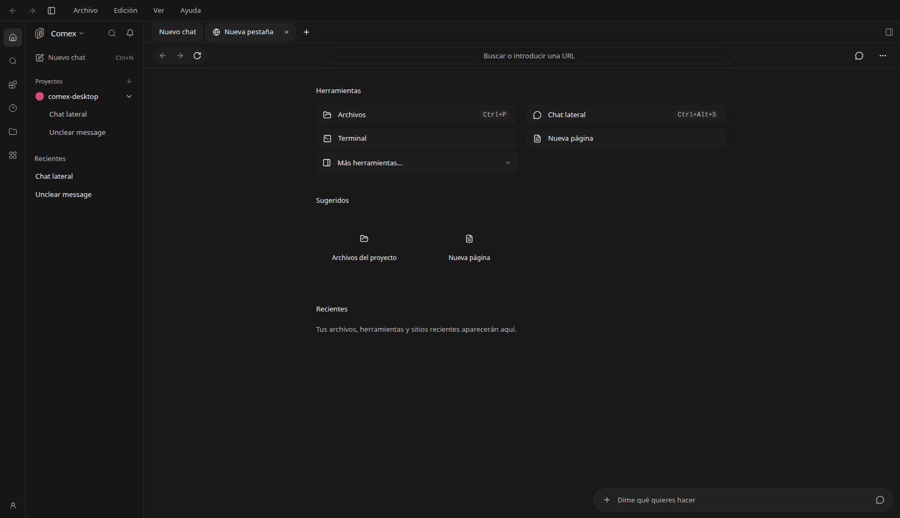
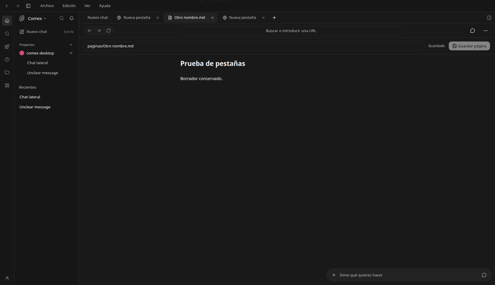
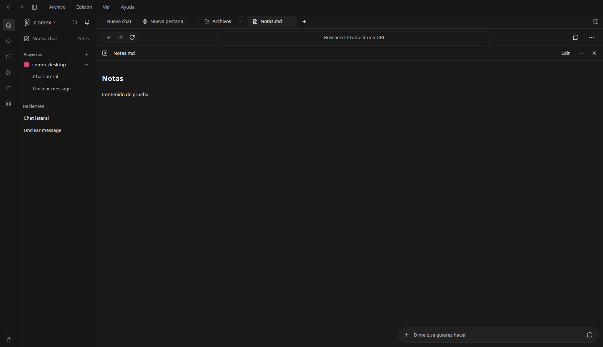

# Pestañas de trabajo

Implementación solicitada a partir de la referencia visual del usuario del 6 de noviembre de 2026. Forma parte de la interfaz general para trabajar con agentes, archivos y herramientas. Se mantiene bajo el control existente `comexWorkspace`; el nombre histórico del control no limita su alcance a Comercio Exterior.

## Comportamiento

El **+** abre Nueva pestaña. Nuevo chat sigue siendo una acción independiente. La pantalla incluye barra de dirección, Herramientas en dos columnas, Sugeridos con destinos reales, Recientes y el acceso compacto al asistente abajo a la derecha.

La barra común reúne conversaciones, nuevas pestañas, archivos, páginas, navegador y terminal. Las pestañas se guardan por servidor, proyecto y alcance de cuenta. Los archivos de una conversación conservan el alcance de su worktree y su conversación propietaria; no se mezclan con archivos del mismo nombre en la raíz del proyecto.

- **Archivos** reutiliza el explorador existente. La selección abre la vista previa o editor existente en una pestaña común. Sus cachés incluyen el alcance de la cuenta y proyecto.
- **Terminal** reutiliza TerminalDock y el puente nativo. Alternar entre herramientas y volver al chat mantiene el proceso dentro del proyecto actual; cerrar su pestaña libera la terminal. Los procesos dependen del ciclo de vida del escritorio y no se restauran tras reiniciar.
- **Nueva página** abre el editor Markdown existente. El borrador y la ruta se conservan localmente. Guardar crea un archivo dentro del proyecto. Un cierre con cambios sin guardar requiere elegir entre seguir editando y descartar el borrador.
- **Chat lateral** reutiliza las conversaciones secundarias existentes cuando hay una conversación principal. Sin conversación principal, permite preparar y enviar una nueva conversación. El acceso compacto despliega el compositor real, con modelo, permisos y adjuntos existentes; no se añadieron controles de voz ficticios. Al enviar desde una herramienta se incluye su URL o ruta como contexto visible en el mensaje.
- **Navegador** reutiliza BrowserPanelContent y el navegador nativo, con propiedad de conversación, selección, historial y límites geométricos existentes. En la vista web muestra su disponibilidad de escritorio y permite abrir la dirección en el navegador externo. No se usa un iframe ni un proxy para eludir restricciones de sitios.
- **Más herramientas** conecta con Complementos y Habilidades. Las sugerencias y recientes se derivan de archivos y aperturas reales, sin proveedores o actividad inventados.

Los recursos ya abiertos permanecen montados al alternar con el chat y las herramientas del proyecto. El navegador nativo solo presenta la pestaña activa. Cambiar de proyecto conserva los metadatos y borradores de sus pestañas; la terminal sigue el ciclo de vida del proyecto que la aloja. Al reducir la ventana, se oculta la superficie de herramientas sin desmontar sus recursos abiertos.

Las páginas tienen un guardado explícito; los archivos abiertos con el editor de artefactos conservan su comportamiento de guardado existente. Un error de almacenamiento local avisa y mantiene utilizable la sesión en memoria.

## Creación de páginas sin sobrescritura

El cliente envía `createOnly: true` al crear o guardar con otro nombre. La ruta existente de escritura conserva la aprobación y validación de rutas. Después de la aprobación usa un archivo temporal y un enlace exclusivo para la publicación del nuevo archivo. Si otro proceso ya creó ese nombre, devuelve 409 y conserva el archivo existente. Actualizar una página ya guardada mantiene la revisión y el control de conflictos existentes. Los errores no borran el borrador.

La interfaz y el servidor deben ejecutar esta misma revisión para disponer de la creación exclusiva completa. No se reinició un servidor compartido ni se interrumpieron conversaciones para hacer las pruebas.

## Verificación

- Typecheck de la aplicación y del servidor sin errores.
- Cinco pruebas de estado: separación de cuentas y proyectos, identidad de archivos de worktrees, cierre de pestañas inactivas, direcciones web y rutas relativas.
- Dos pruebas del servidor: archivo existente intacto y dos creaciones concurrentes con un único ganador, sin temporales sobrantes.
- Navegador sobre la aplicación local: Nueva pestaña, edición y recuperación del borrador al cambiar y recargar, cancelar cierre, conflicto y reintento de guardado, historial web, compositor y chat lateral. Las respuestas de guardado se aislaron con fixtures; no se escribieron documentos del usuario ni se enviaron mensajes.
- Explorador y vista previa con catálogo y lectura aislados: el archivo seleccionado abre una pestaña común.
- Prueba con un puente nativo simulado y los componentes reales: navegador reutilizado, dueño de conversación conservado, geometría enviada al puente, terminal viva al cambiar de herramientas y volver al chat, y liberada al cerrar. No equivale a una prueba de un navegador ni una shell reales en Electron.

No se generó un instalador ni se publicó un release. Las capturas son de la interfaz local; Página y Archivo usan contenido de prueba y no acreditan una escritura real en la cuenta del usuario.

Se reutilizan Button, Input, DropdownMenu y ConfirmModal (DESIGN P5/S7), el editor, terminal y navegador existentes (P5), colores semánticos (V2) y capturas de las vistas modificadas (P10).

